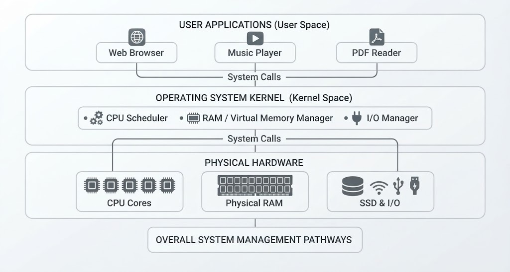

# 1.1 Operating Systems (Core V1.0 Developed Topic)

**Development Status:** `checked` (Fully Developed V1.0 — Peer Reviewed)  
**Author:** Yeo Shih Jie (`@ysjie03`)  

---

## 1. Concept Explanations & Core Terminology

When you press the power button on your laptop or smartphone and open a web browser, music player, and document editor at the same time, those applications do not directly control the physical CPU chips or memory sticks. Instead, they rely on a master coordinator called the **Operating System (OS)**.

### Key Terminology (Defined on First Appearance)
* **Operating System (OS):** The primary system software that manages computer hardware and software resources, providing a stable environment and common services for application programs to run.
* **Kernel:** The central, privileged core of the operating system that stays in memory at all times, having complete control over everything in the system (connecting software requests to physical hardware).
* **Resource Allocation:** The process by which the OS distributes limited hardware resources (such as CPU processing time, RAM capacity, and storage bandwidth) fairly and safely among competing programs.
* **Process:** An active instance of a computer program that is currently being executed in RAM.
* **Virtual Memory (Paging/Swapping):** A memory management technique where the OS uses a portion of slower storage (SSD/HDD) to temporarily hold inactive data from RAM when physical RAM becomes full.

### The Three Core Management Functions of an OS
1. **Resource Allocation (CPU & RAM):** 
   A computer has a finite amount of RAM and a fixed number of CPU cores. If three applications demand CPU calculation time simultaneously, the OS uses **CPU Scheduling (Time-Slicing)**—rapidly switching the CPU's attention between processes thousands of times per second so all apps appear to run smoothly at once. For memory, the OS assigns each process its own isolated **Memory Address Space** in RAM so that if one app crashes, it cannot corrupt the memory of another app or the OS itself.
2. **Performance Monitoring:**
   The OS continuously tracks hardware utilization—measuring what percentage of the CPU is busy, how many gigabytes of RAM are occupied, and how fast data is being read from or written to the disk. Built-in OS tools like **Windows Task Manager** and **macOS Activity Monitor** display these metrics so users and the system can detect bottlenecks or terminate frozen ("Not Responding") processes.
3. **Device Management:**
   Your computer connects to multiple Input/Output (I/O) peripherals (keyboards, mice, Wi-Fi cards, printers, displays). The OS coordinates access to these devices through **I/O Queues and Buffers**. For example, if two documents are sent to a printer at the same time, the OS queues them in order rather than mixing lines from both documents onto the same page.

---

## 2. Visual Comparison: Major Operating Systems

Different computing devices have different priorities (e.g., high-power desktop multitasking vs. smartphone battery conservation). Below is a structured comparison of the major OS platforms:

| Feature / Dimension | Microsoft Windows | Apple macOS | Google Android | Linux (e.g., Ubuntu) |
| :--- | :--- | :--- | :--- | :--- |
| **Target Hardware** | Wide range of x86/ARM PCs and laptops from many manufacturers | Exclusively Apple Mac hardware (Apple Silicon M-series / Intel) | Smartphones, tablets, and embedded smart devices | Servers, cloud infrastructure, embedded systems, and developer PCs |
| **Kernel Architecture** | Windows NT Hybrid Kernel | XNU Hybrid Kernel (Unix-based Darwin core) | Modified Linux Kernel (optimized for mobile power/RAM) | Monolithic Linux Kernel (open-source and modular) |
| **Resource Allocation Priority** | Broad hardware/software compatibility and desktop multitasking | Tight hardware-software integration and media/power efficiency | Aggressive background battery saving and strict app sandboxing | High stability, low memory overhead, and multi-user server performance |
| **Performance Monitoring Tool** | Task Manager & Resource Monitor | Activity Monitor | Android System Profiler / Developer Memory Settings | `top`, `htop`, and System Monitor |

**Supporting Architecture Visual:**  



```text
