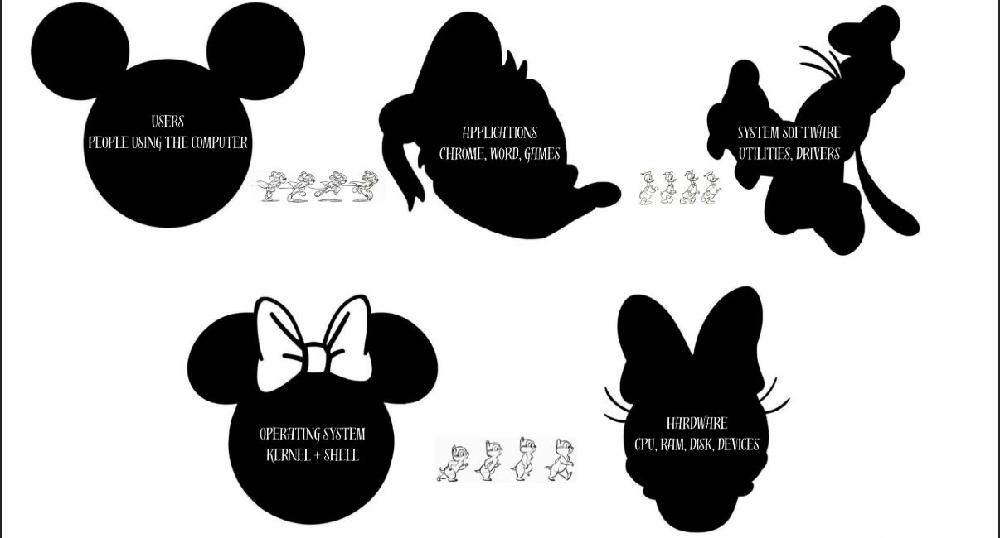
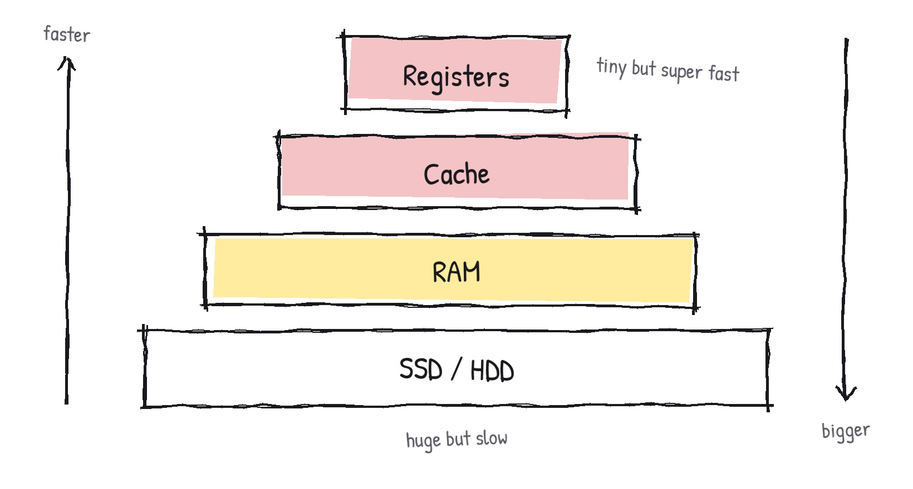

# 1.1 Operating Systems

**Status:** ✅  
**Team Members:** Cao Minh Tuan (`@mnhtnc`) & Frederick Samuel Lesmana (`@Ti4nCi`)

**In this section:** What is an OS · History · Types · Platforms · Components · Processes · System Calls · Scheduling · Memory · I/O · Performance · Security · Threads

---

## 1. What is an Operating System?
An **Operating System (OS)** is the primary software that runs the computer. It sits directly between end-users/applications and the physical hardware (CPU, RAM, storage, and I/O devices), sharing CPU time, memory, and storage fairly across all open programs. Without an operating system, users would have to write raw machine code by hand to interact with the computer.

*Figure 1.1: Where the OS sits between users and hardware.*

* **Kernel:** The central core of the operating system that stays in memory and directly controls the hardware.
* **Shell:** The outer interface layer that the user interacts with (can be a GUI or CLI).

### 3 Basic Functions of an OS
1. **Manage Resources:** Allocates and tracks CPU cycles, main memory (RAM), disk storage, and I/O devices.
2. **Provide a User Interface:** Gives humans an intuitive way to interact with the system without machine language.
3. **Run Applications (Multitasking):** Loads user programs into memory and allows multiple programs to run smoothly at the same time.

### CLI vs. GUI
* **CLI (Command Line Interface):** Users type exact text commands into a terminal and must memorize command syntax. It is fast, scriptable, and uses minimal RAM (e.g., MS-DOS, Linux terminal).
* **GUI (Graphical User Interface):** Users click visual icons, menus, and windows on a desktop using a mouse or touchscreen. It is visual and user-friendly (e.g., Windows, macOS).

---

## 2. How the Operating System Evolved
* **Before 1940s (No OS):** Computers had no operating system; operators entered raw machine code by hand or wired plugboards.
* **1940s–1950s (Batch Systems):** Jobs were submitted on paper punch cards and run together in groups (batches) without user interaction.
* **1950s–1960s (Multiprogramming):** Many programs were kept in RAM at once; whenever one program had to wait for slow I/O, the CPU immediately switched to another program.
* **1960s–1970s (Time-Sharing):** Each running program was given a short turn (time slice) on the CPU so multiple users felt like they were using the computer simultaneously.
* **1970s–1980s (Personal Systems & GUI):** Personal computers (PCs) introduced graphical interfaces with icons, windows, and mice.
* **1980s–1990s (Network & Parallel OS):** Added built-in file and printer sharing across local networks (Novell NetWare, Windows NT) as well as parallel systems with multiple CPUs in one machine.
* **Late 1990s–2000s (Mobile OS):** Smartphones led to touch-focused mobile operating systems like iOS and Android.
* **2010s–Present (Cloud & AI):** Modern operating systems integrate cloud computing and built-in AI voice/workflow assistants such as Siri, Google Assistant, and Copilot.

---

## 3. Types of Operating Systems
1. **Batch OS:** Runs similar jobs in a row automatically with no user input required during execution (e.g., bank payroll processing).
2. **Time-Sharing OS:** Switches the CPU between tasks in rapid, short turns so multiple apps and users run simultaneously (e.g., Windows, Linux).
3. **Real-Time OS (RTOS):** Must respond to inputs within strict, guaranteed time limits where delays are dangerous (e.g., car airbags, medical pacemakers).
4. **Distributed OS:** Connects many separate computers over a network (with no shared physical memory or clock) so they act together as one unified system (e.g., cloud computing clusters).
5. **Network OS:** Runs on a server to share files, printers, and user accounts across connected computers (e.g., Windows Server).
6. **Mobile OS:** Built specifically for touchscreens, battery efficiency, and wireless connectivity (e.g., Android, iOS).
7. **Embedded OS:** A tiny, specialized OS built into a device to perform one dedicated job (e.g., smart TVs, Wi-Fi routers).

*(Note: Operating systems are also categorized as **Single-user vs. Multi-user** and **Single-tasking vs. Multitasking**.)*

---

## 4. Platform Comparison: Windows vs. macOS vs. Linux vs. Android vs. iOS

| Feature | Windows | macOS | Linux | Android | iOS |
| :--- | :--- | :--- | :--- | :--- | :--- |
| **Maker** | Microsoft | Apple | Open-Source Community | Google | Apple |
| **Cost** | Paid license | Free with Mac | Free | Free | Free with iPhone |
| **Source Code** | Closed | Closed | Open | Open base | Closed |
| **Kernel** | Windows NT | XNU (Unix) | Linux | Linux | XNU |
| **Runs On** | Most PCs | Macs only | Almost anything | Many phones/tablets | Apple iPhones only |
| **Security** | Most targeted | Strong | Very strong | Good | Very strong |
| **File System** | NTFS | APFS | ext4 | ext4 / F2FS | APFS |
| **Best For** | Games, office work | Design, video editing | Servers, coding | Most smartphones | Apple ecosystem users |

* **Open Source:** Software whose source code can be freely read, modified, and shared by anyone.
* **Linux Distros:** Linux is packaged into different distributions ("distros") such as Ubuntu and Fedora, and forms the base kernel of Android.
* **Older Operating Systems:** **DOS** (MS-DOS / PC-DOS, command-line only), **OS/2** (developed by IBM), and **Unix** (foundational enterprise server OS).

---

## 5. The 8 Core OS Components
1. **Process Management:** Creates and deletes processes, suspends and resumes execution, and handles process synchronization and communication.
2. **Main Memory Management:** Tracks which parts of RAM are used or free, and allocates or frees memory space as programs open and close.
3. **File Management:** Creates, deletes, and edits files and folders, maps files onto physical storage, and manages backups.
4. **I/O Device Management:** Controls hardware peripherals using device drivers, temporary buffering, and high-speed caching.
5. **Secondary Storage Management:** Allocates disk space, manages free storage blocks, and performs disk scheduling on SSDs and HDDs.
6. **Security:** Protects system integrity by ensuring only authorized users and programs gain access to files and memory.
7. **Network Management:** Shares network resources, manages connection speed, and maintains communication reliability.
8. **Command Interpreter:** Reads and executes user commands (also known as the control card interpreter, command-line interpreter, or shell).

---

## 6. Processes and Process States
* **Program vs. Job vs. Process:** A **Program** is a passive executable file stored on disk. A **Job** is a program selected and scheduled to run. A **Process** is an active program currently loaded and running in RAM (for example, Google Chrome runs a separate process for every open tab).
* **Process Control Block (PCB):** The record where the OS stores all vital tracking data for a process: **PID (Process ID)**, current **state**, **program counter**, **CPU registers**, **memory limits**, **open files**, and **scheduling priority**.
* **Context Switch:** The action where the OS saves the current state of one process into its PCB and loads the PCB of the next process onto the CPU.
* **System Queues:**
  * **Job Queue:** Processes waiting on disk to enter main memory (RAM).
  * **Ready Queue:** Processes already in RAM waiting for their turn on the CPU.
  * **I/O Queue:** Processes waiting for a hardware device (such as a disk or printer) to finish an operation.

### How a Process Moves Between States
* **New → Hold → Ready:** A newly created job is admitted to the **Hold** state and loaded into RAM to join the **Ready** queue.
* **Ready → Running:** The CPU scheduler selects the ready process and gives it CPU time.
* **Running → Waiting (Blocked):** The running process requests an I/O operation (such as reading a file) and waits until the device finishes.
* **Waiting → Ready:** Once the I/O operation is done, the process returns to the **Ready** queue to wait for the CPU.
* **Running → Ready:** The process's allocated CPU time slice expires ("time up"), so it returns to the **Ready** queue.
* **Ready ↔ Suspended:** When RAM is full, the OS can move a process out to disk to free up memory, then bring it back to **Ready** later.
* **Running → Terminated:** The process finishes executing ("done") and the OS reclaims its memory and PCB.

---

## 7. System Calls
A **System Call** is the safe, controlled way for a program to ask the OS kernel to perform protected hardware work. Normal applications run in **User Mode** with limited privileges, whereas the OS runs in **Kernel Mode** with full hardware control.

* **Process Control:** `fork()`, `exec()`, `exit()`, `kill()`
* **File Manipulation:** `open()`, `read()`, `write()`, `close()`
* **Device Management:** `ioctl()`, `read()`, `write()`
* **Memory Management:** `brk()`, `mmap()`, `munmap()`
* **Information Maintenance:** `getpid()`, `time()`
* **Communication:** `pipe()`, `socket()`
* **Windows API Equivalents:** `CreateProcess()`, `ReadFile()`, `VirtualAlloc()`

---

## 8. Resource Allocation and CPU Scheduling
The OS decides which process gets the CPU, RAM, storage, and devices, and for how long. Its primary goals are fairness, efficiency, **no starvation**, and **no deadlock**.
* **Preemptive Scheduling:** The OS can interrupt a running process and switch the CPU to another task.
* **Non-Preemptive Scheduling:** Once a process starts on the CPU, it runs until it finishes or voluntarily waits for I/O.

### CPU Scheduling Algorithms
1. **FCFS (First Come, First Served):** Processes run in the order they arrive. Simple, but one long job blocks all shorter jobs behind it.
2. **SJF (Shortest Job First):** Runs the shortest job next. Efficient, but long jobs may suffer from **starvation**.
3. **Priority Scheduling:** Runs the most important process first. Low-priority processes may starve unless fixed with **aging** (gradually raising a waiting process's priority over time).
4. **Round Robin:** Gives every process an equal, short **time slice**. Fair for multitasking, though setting the time slice too small causes excessive context-switch overhead.

*Figure 1.2: Round Robin. Each process gets a short turn on the CPU, then goes to the back of the line.*

### Deadlock and Starvation
* **Deadlock:** Two or more processes are permanently stuck waiting on resources held by each other. A deadlock requires all **4 conditions** at once:
  1. **Mutual Exclusion** (resources cannot be shared simultaneously)
  2. **Hold and Wait** (a process holds one resource while waiting for another)
  3. **No Preemption** (resources cannot be forcibly taken away)
  4. **Circular Wait** (a closed loop of processes waiting on each other)
  * *How to Fix Deadlock:* Prevention (breaking one of the 4 conditions), Avoidance (using the **Banker's Algorithm**), or Detection and Recovery (killing one stuck process).
* **Starvation:** A process waits forever because system resources keep going to higher-priority processes.

---

## 9. Memory Management
Programs must be loaded into **RAM** to run.

*Figure 1.3: Memory hierarchy. Faster and smaller at the top, slower and bigger at the bottom.*

* **MMU (Memory Management Unit):** Hardware unit that translates **logical addresses** into **physical RAM addresses**.
* **Monoprogramming vs. Multiprogramming:** Monoprogramming keeps only one program in RAM; multiprogramming keeps many programs in RAM simultaneously while the CPU switches between them.
* **Swapping:** Moving an inactive process between RAM and disk.
* **Paging:** Dividing memory into equal, fixed-size blocks (**pages** in logical memory mapped to **frames** in physical RAM).
* **Segmentation:** Dividing memory into logical sections (such as code, data, and stack).
* **Demand Paging & Virtual Memory:** Loading pages into RAM only when needed (**Demand Paging**) and using disk storage (SSD/HDD) as extra simulated RAM (**Virtual Memory**).
* **Page Fault:** Happens when a running program needs data that is not currently in RAM, requiring the OS to fetch it from disk.
* **Thrashing:** When RAM is overfull and the system spends all its time swapping pages between RAM and disk, making the PC extremely slow.

| Memory Type | Volatility | Speed | Capacity | Cost |
| :--- | :--- | :--- | :--- | :--- |
| **Main Memory (RAM)** | **Volatile** (erased when power turns off) | Very Fast | Small (8–64 GB) | Expensive per GB |
| **Storage (SSD / HDD)** | **Non-Volatile** (keeps data without power) | Slower | Large (256 GB – 4 TB+) | Cheap per GB |

---

## 10. Device (I/O) Management
* **I/O Categories:** Input (keyboard), Output (screen), Storage (SSD), and Network (Wi-Fi).
* **Communication Flow:** `App` → `System Call` → `Driver` → `Controller` → `Device` → `Interrupt`.
* **Driver:** Translates general OS commands for one specific hardware device.
* **Interrupt vs. Polling:** With an **Interrupt**, the device signals the CPU only when it needs attention; with **Polling**, the CPU wastefully checks the device over and over.
* **DMA (Direct Memory Access):** Allows a device to write data straight into RAM without using the CPU.
* **Buffering, Caching, and Spooling:**
  * **Buffering:** Temporary memory hold to smooth out speed differences (e.g., video buffering).
  * **Caching:** Keeping a fast copy of frequently used data.
  * **Spooling:** Lining up jobs in a queue for a slow device (e.g., a printer queue).
* **Plug and Play:** Automatically detects newly connected hardware devices and loads their drivers.
* **Device Manager & File Manager:** The Device Manager monitors hardware queues and access rules, while the File Manager handles file names, storage locations, permissions, and backups.

---

## 11. Performance Monitoring
* **Key Metrics:** CPU %, RAM usage, disk activity, network speed, response time, waiting time, and page faults.
* **Warning Signs:** CPU stuck near 100%, RAM completely full, and heavy disk swapping (thrashing).
* **Monitoring Tools:**
  * **Windows:** Task Manager, Resource Monitor
  * **macOS:** Activity Monitor
  * **Linux:** `top`, `htop`, `free`, `vmstat`
  * **Android / iOS:** Battery and storage settings
* **How to Fix Slowdowns:** Close unused apps, add more RAM, upgrade to an SSD, install OS updates, remove unnecessary startup apps, and scan for malware.

---

## 12. Security and Protection
* **Protection vs. Security:** **Protection** controls internal access between users and programs inside the PC; **Security** defends against external attacks.
* **Authentication vs. Authorization:** **Authentication** verifies who you are (password, Face ID); **Authorization** controls what files and settings you are allowed to touch.
* **Defense Mechanisms:** User vs. Admin/`root` accounts, file permissions (Linux `rwx`), memory protection, CPU timers, encryption, firewalls, security updates, and app sandboxing.
* **Common Threats:** Viruses, worms, trojans, ransomware, and phishing.

---

## 13. Advantages and Disadvantages of Operating Systems

| Advantages | Disadvantages |
| :--- | :--- |
| Manages hardware devices and drivers automatically | Critical OS errors or crashes can lose unsaved data |
| Runs many applications at once (multitasking) | Targeted by viruses, ransomware, and cyberattacks |
| Organizes files cleanly on storage drives | Requires regular security updates and patches |
| Shares CPU and RAM resources efficiently | Consumes CPU, RAM, and disk storage for itself |

---

## 14. Threads
* A **Thread** is a small worker task running inside a process.
* Threads share the parent process's memory and are much faster to create and switch than full processes (e.g., Chrome loads a page on one thread while playing a video on another).

*Booting and kernel types are covered in [1.2 System Software](02_System_Software.md).*

---

## 15. Exercise Answers
1. **Process Management:** The PCB holds the PID, state, program counter, registers, memory limits, and open files. Processes are managed by the scheduler and context switching; `fork()` creates a new process, while `kill()` stops a process and frees its resources.
2. **File Management:** Stores, organizes, finds, and protects files using system calls like `open()`, `read()`, `write()`, `close()`, and `unlink()` arranged in a directory tree (`root` → `folders` → `files`, such as `/home/tom/notes.txt`).
3. **Command Interpreter:** Acts as the direct link between the user and the OS (`bash`, PowerShell, CMD, Terminal). It follows the cycle: read command → parse arguments → find program → run process → display result.
4. **System Calls:** Provide a safe doorway for user apps to request kernel tasks, such as memory allocation (`mmap()`, `brk()`) and I/O (`read()`, `write()`).
5. **Network Management:** Handles network drivers, TCP/IP protocols, sockets, firewalls, load balancing, fault handling, and backups.
6. **I/O Management:** Coordinates drivers, interrupts, DMA, and device queues using buffering, caching, and spooling.

---

## 16. Glossary
* **Buffer:** Temporary data holding area in memory.
* **Cache:** Fast memory storing copies of frequently used data.
* **Context Switch:** Swapping the active process on the CPU.
* **Deadlock:** Processes permanently stuck waiting on each other.
* **Demand Paging:** Loading memory pages from disk into RAM only when needed.
* **DMA:** Direct Memory Access (device writes straight to RAM without the CPU).
* **DOS:** Disk Operating System.
* **Driver:** Software that controls and translates for one hardware device.
* **Interrupt:** Signal sent from a hardware device to the CPU.
* **Job:** A program selected and scheduled to run.
* **Kernel:** The privileged core of the operating system.
* **MMU:** Memory Management Unit (translates logical addresses to physical addresses).
* **Monoprogramming:** Keeping only one program in memory at a time.
* **Multitasking:** Running many programs concurrently.
* **Open Source:** Software code that anyone can inspect and change.
* **Paging:** Dividing memory into equal-sized fixed blocks.
* **PCB:** Process Control Block (process information record).
* **Process:** A program currently running in memory.
* **RAM:** Fast, volatile main memory.
* **Scheduler:** OS component that picks the next process to run on the CPU.
* **Segmentation:** Dividing memory into logical parts (code, data, stack).
* **Shell:** Interface program that runs user commands.
* **Spooling:** Job queue stored on disk for a slow device like a printer.
* **Starvation:** When a process waits forever for resources.
* **Suspended:** A process moved out of RAM to disk to free up memory.
* **System Call:** Request from an app to the OS kernel.
* **Thrashing:** Severe slowdown caused by excessive swapping between RAM and disk.
* **Thread:** A lightweight task inside a process.
* **Virtual Memory:** Using disk space as extra simulated RAM.
* **Volatile:** Memory that loses its data when power is turned off.

---

## 17. References
1. Silberschatz, A., Galvin, P. B., & Gagne, G. (2018). *Operating System Concepts* (10th ed.). Wiley.
2. Tanenbaum, A. S., & Bos, H. (2022). *Modern Operating Systems* (5th ed.). Pearson.
3. BIT2026 Course Lecture Slides (Operating Systems Module).
