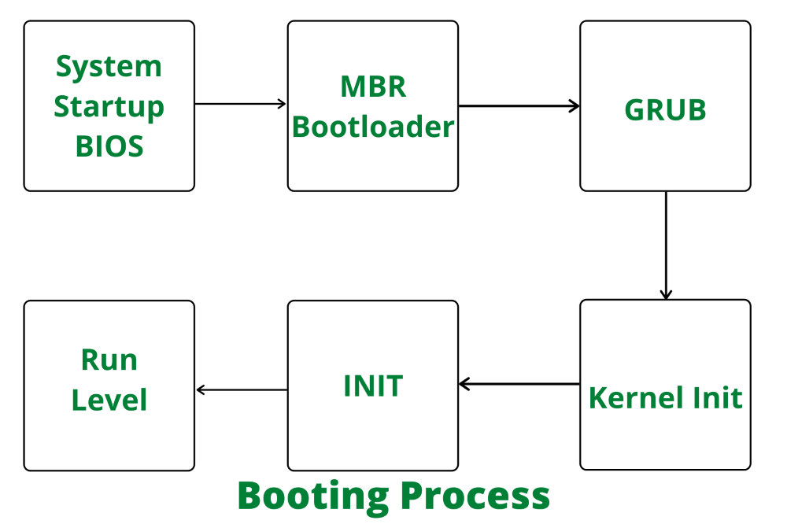

# 1.2 System Software (BIOS, Firmware, Drivers, and Utilities)

**Status:** Completed  
**Team Member:** Cassinis Soulisack (`@DiegoSmiley`)  

---

## 1. What is System Software?
**System software** is software that runs and manages the computer itself so that other programs can run on top of it.
* **Application Software** works directly for the user (e.g., Chrome, Word, games).
* **System Software** works for the computer in the background (controlling hardware chips and managing system resources).
* **Simple Analogy (A Restaurant):** Physical **Hardware** is the kitchen and stoves. **System Software** is the kitchen staff who operate the equipment safely. **Applications** are the finished dishes brought to the table. The customer (**You**) never touches the hot stove directly.

### Main Types of System Software
1. **Firmware** (including motherboard BIOS and UEFI)
2. **Operating System (OS)**
3. **Device Drivers**
4. **Utility Programs**
5. **Language Translators** (compilers, interpreters, and assemblers)

---

## 2. Layers of a Computer System
Read from top (the user) to bottom (the physical hardware). Each layer only talks to the layer directly above or below it. The middle four layers are **System Software**:

| Layer | Concrete Example | Classification |
| :--- | :--- | :--- |
| **User** | You | End User |
| **Application Software** | Chrome, Word, games | Application Software |
| **Utilities and Translators** | Antivirus, `gcc` compiler | **System Software** |
| **Operating System (Kernel)** | Windows, Linux, macOS | **System Software** |
| **Device Drivers** | GPU driver, Wi-Fi driver, printer driver | **System Software** |
| **Firmware (BIOS / UEFI)** | Motherboard ROM chip | **System Software** |
| **Hardware** | CPU, RAM, SSD | Physical Hardware |

---

## 3. Firmware
**Firmware** is low-level software stored permanently on a hardware memory chip (flash memory or ROM) that gives a device its most basic startup instructions.
* **Non-Volatile:** Firmware stays intact even when electrical power is turned off.
* **Where It Is Found:** Motherboards, SSDs, Wi-Fi routers, printers, smartphones, and cars.
* **Updating ("Flashing"):** Firmware can be updated to fix bugs, but a power loss during an update can permanently **"brick"** the device.
* **Simple Appliances:** In single-purpose appliances like a microwave oven or washing machine, firmware is the *only* software inside the device.

---

## 4. BIOS and UEFI
**BIOS (Basic Input/Output System)** is the startup firmware stored on a chip on the PC motherboard. It is the very first software that runs when you press the power button.

### What BIOS Does at Startup
1. **POST (Power-On Self-Test):** Checks that the CPU, RAM, keyboard, and graphics card are working properly. Hardware errors are reported through **beep codes** or screen alerts.
2. **Initializes Hardware:** Sets up motherboard buses and devices so they are ready to use.
3. **Reads CMOS Settings:** Loads saved settings (such as the boot order and system clock) from CMOS memory, which is kept alive by a small coin-cell **CMOS battery** on the motherboard.
4. **Finds a Bootable Drive:** Checks connected SSDs, HDDs, or USB drives according to the boot order.
5. **Hands Control to the Bootloader:** Starts the OS bootloader stored on the boot drive.

### Legacy BIOS vs. Modern UEFI
**UEFI (Unified Extensible Firmware Interface)** is the modern replacement for traditional BIOS (standard on PCs since around 2012), though people still commonly refer to it as "BIOS."

| Feature | Legacy BIOS | Modern UEFI |
| :--- | :--- | :--- |
| **Execution Mode** | 16-bit | 32-bit / 64-bit |
| **Disk Partition Format** | MBR (Master Boot Record) | GPT (GUID Partition Table) |
| **Max Boot Disk Size** | ~2 TB | Practically unlimited |
| **User Interface** | Plain text, keyboard only | Graphical menu with mouse support |
| **Pre-Boot Security** | None | **Secure Boot** |
| **Startup Speed** | Slower | Faster |

* **Secure Boot:** A UEFI security feature that only allows digitally signed (trusted) bootloaders and operating systems to start, blocking rootkit malware that tries to load before the OS.

---

## 5. The Boot Process (Step by Step)
**Booting** means starting the computer from power-on until the login screen appears (**Cold boot** = starting from power off; **Warm boot** = restarting).

### Step-by-Step Breakdown of the Boot Sequence
1. **Power On & System Startup BIOS / UEFI:** You press the power button; the CPU wakes up, runs the motherboard **BIOS / UEFI** firmware, performs the **POST** hardware test, and initializes RAM and devices.
2. **MBR / GPT Boot Drive Selection:** The firmware checks the boot order and reads the boot sector on the primary storage drive (reading the first 512 bytes from the **MBR [Master Boot Record]** on Legacy BIOS systems, or the **EFI System Partition** on UEFI systems).
3. **GRUB / Windows Bootloader Runs:** The initial boot sector launches the full **Bootloader** program (such as **GRUB** on Linux or **Windows Boot Manager** on Windows), which lets the system select which operating system kernel to load.
4. **Kernel Init (Kernel Loads into RAM):** The bootloader loads the core **Operating System Kernel** into RAM and hands control of the CPU over to the kernel, which initializes hardware device drivers.
5. **INIT / System Services Start:** Once the kernel is initialized, it launches the master initialization process (**`init`** or **`systemd`** on Linux, **`smss.exe` / `services.exe`** on Windows) to start background system services.
6. **Run Level / Login Screen:** The system reaches its target operational **Run Level** (such as multi-user graphical mode), displays the login screen, and loads your desktop once you sign in.

---

## 6. Operating System (OS) and Kernel
The **Operating System** is the main system software that manages all hardware and gives applications a safe environment to run (e.g., Windows, Linux, macOS, Android).

### 6 Main Functions of an OS
1. **Process Management:** Runs programs and schedules which process uses the CPU next (`New` → `Ready` → `Running` → `Waiting` → `Terminated`).
2. **Memory Management:** Gives each program its own protected section of RAM and uses virtual memory (disk as extra RAM) when physical RAM is full.
3. **File Management:** Organizes files and folders using file systems (`NTFS`, `FAT32`, `ext4`).
4. **Device (I/O) Management:** Controls hardware peripherals using device drivers.
5. **Security:** Enforces user accounts, passwords, and access permissions.
6. **User Interface:** Provides a CLI (typing commands) or GUI (windows and icons).

### The Kernel (Kernel Mode vs. User Mode)
The **Kernel** is the innermost core of the OS that stays in memory at all times and controls hardware directly:
* **Kernel Mode:** Full hardware access (used by the kernel and most device drivers). A crash here crashes the entire PC (causing a Blue Screen of Death).
* **User Mode:** Limited sandbox access (used by normal apps). A crash here only closes that single application.
* **System Call:** How a user-mode app asks the kernel for help (e.g., in C, `printf()` uses the `write()` system call).
* **Interrupt:** A hardware signal that tells the CPU *"stop, I need attention"* (such as pressing a key on the keyboard). The CPU pauses, handles the interrupt, and continues its previous task.

| Kernel Type | Core Idea | Examples |
| :--- | :--- | :--- |
| **Monolithic** | Everything runs inside one big kernel. Very fast, but less fault-isolated. | Linux |
| **Microkernel** | Tiny core kernel; drivers and file systems run outside. Very safe, slightly slower. | MINIX, QNX |
| **Hybrid** | Combines the speed of monolithic with modular structure. | Windows, macOS |

---

## 7. Device Drivers
A **Device Driver** is a small system program that lets the OS communicate with one specific hardware device. Every piece of hardware speaks its own internal language, and the driver acts as the translator.

### Worked Example: Printing a Document
1. You click **Print** inside Microsoft Word.
2. Word asks the Operating System to print the document.
3. The OS places the job into the **print queue (spooling)**.
4. The OS sends the print job to the **printer driver**.
5. The driver translates the document into hardware commands your specific printer model understands.
6. The printer prints the page and reports its status back (e.g., *"Done"* or *"Out of paper"*).

### Key Points About Drivers
* Most drivers run in **kernel mode**, so a buggy driver can crash the entire PC.
* **Plug and Play:** The OS automatically detects newly plugged-in hardware and loads its matching driver.
* Drivers require periodic updates for bug fixes and new OS versions.
* **Driver vs. Firmware:** **Firmware** lives on a chip *inside the hardware device*; a **Driver** lives *inside the Operating System* on your storage drive.

---

## 8. Utilities and Language Translators

### Utility Programs (Keeping the Computer Healthy)
* **Antivirus:** Detects and removes malware.
* **Disk Cleanup:** Deletes temporary junk files to free up storage.
* **Defragmenter:** Rearranges fragmented data on mechanical hard drives (HDDs) to speed up access *(not needed for SSDs)*.
* **Backup:** Copies important data to keep it safe from hardware failure.
* **Compression:** Shrinks files into smaller archive packages (`.zip`).
* **Firewall:** Monitors and filters incoming and outgoing network traffic.

### Language Translators (Turning Human Code into Binary Machine Code)

| Translator | Input Language | How It Works | Example |
| :--- | :--- | :--- | :--- |
| **Assembler** | Assembly code | Converts assembly mnemonics directly into binary machine code | `NASM` |
| **Compiler** | C, C++ | Translates the entire program all at once into an executable binary before running | `gcc` |
| **Interpreter** | Python | Translates and runs source code line by line on the fly | `python` |

### From C Source Code to a Running Program (5 Steps)
1. **Preprocessor:** Handles `#include` and `#define` directives.
2. **Compiler:** Translates C source code into **Assembly code**.
3. **Assembler:** Converts assembly code into a binary **Object file (`.o`)**.
4. **Linker:** Joins object files and external libraries together into a standalone **`.exe` executable**.
5. **Loader (part of the OS):** Copies the `.exe` file into RAM and starts running it.

---

## 9. Key Comparisons and Quick Summary

| Comparison | Core Difference |
| :--- | :--- |
| **System vs. Application Software** | Runs the computer hardware vs. serves the human user |
| **Firmware vs. Driver** | Stored on the hardware device chip vs. stored inside the OS |
| **BIOS vs. UEFI** | Older 16-bit MBR firmware vs. modern 64-bit GPT firmware with Secure Boot |
| **OS vs. Kernel** | The kernel is the innermost core part of the full operating system |
| **Program vs. Process** | Passive file stored on disk vs. active program running in RAM |
| **Kernel Mode vs. User Mode** | Full hardware access vs. restricted sandbox access |
| **Compiler vs. Interpreter** | Translates the whole program at once vs. translates and runs line by line |

### 6 Essential Points to Remember
1. **System software** sits directly between physical hardware and user applications.
2. **BIOS/UEFI** runs first at power-on, performs **POST**, and starts the bootloader.
3. The **Bootloader (e.g., GRUB)** loads the **OS Kernel** into RAM.
4. The **Operating System** manages processes, memory, files, devices, and security.
5. **Device Drivers** translate OS requests so the OS can talk to hardware.
6. **Utilities** maintain the PC, while **Language Translators** turn human code into binary machine code.

---

## 10. References
1. Mueller, S. (2015). *Upgrading and Repairing PCs* (22nd ed.). Que Publishing.
2. Patterson, D. A., & Hennessy, J. L. (2020). *Computer Organization and Design* (6th ed.). Morgan Kaufmann.
3. BIT2026 Course Lecture Slides (System Software Module).
