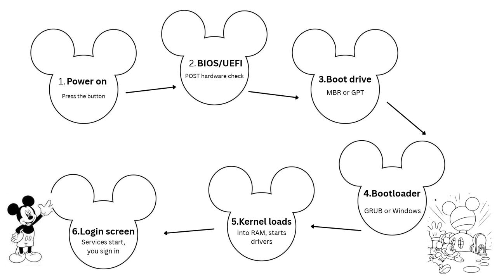

# 1.2 System Software

**Status:** ✅  
**Team Member:** Cassinis Soulisack (`@DiegoSmiley`)

**In this section:** What is System Software · Layers · Firmware · BIOS & UEFI · Boot Process · Kernel · Drivers · Utilities & Translators · Summary · Practice Questions

---

## 1. What is System Software?
Think of a restaurant. The **hardware** is the kitchen: the stoves, ovens, and fridges. The **applications** are the dishes that customers order. But dishes do not cook themselves. Someone has to light the stoves, keep the fridge cold, and make sure two cooks do not use the same pan at once. That is the kitchen staff, and in a computer, the kitchen staff is **system software**. You, the customer, never touch the hot stove directly.

**System software** is software that runs and manages the computer itself so that other programs can run on top of it. It is different from **application software**:
* **Application software** works for *you*. Chrome, Word, and games are examples.
* **System software** works for *the computer*. It controls the hardware and manages resources in the background, and you usually do not notice it.

There are five main kinds of system software:
1. **Firmware**, including the BIOS or UEFI
2. **The operating system (OS)**
3. **Device drivers**
4. **Utility programs**
5. **Language translators**: compilers, interpreters, and assemblers

---

## 2. Layers of a Computer System
A computer is built in layers, like a building. Each layer relies on the one below it and offers simpler services to the one above it. The table reads from the top (you) to the bottom (the physical machine):

| Layer | Example | Type |
| :--- | :--- | :--- |
| **User** | You | End user |
| **Application software** | Chrome, Word, games | Application software |
| **Utilities and translators** | Antivirus, `gcc` compiler | **System software** |
| **Operating system (kernel)** | Windows, Linux, macOS | **System software** |
| **Device drivers** | GPU driver, Wi-Fi driver, printer driver | **System software** |
| **Firmware (BIOS / UEFI)** | Motherboard ROM chip | **System software** |
| **Hardware** | CPU, RAM, SSD | Physical hardware |

Two details are worth knowing. First, device drivers run inside the OS, together with the kernel. Second, the motherboard firmware (BIOS or UEFI) does its main job **when the computer starts**. Once the OS is running, the drivers talk to the hardware directly, not through the BIOS.

---

## 3. Firmware
**Firmware** is low-level software stored permanently on a chip (flash memory or ROM) inside a device. It is the very first set of instructions a device follows, telling it how to wake up and get ready.

* **It stays when the power is off.** Firmware is **non-volatile**, so it is still there every time you switch the device on.
* **It is everywhere.** Motherboards, SSDs, Wi-Fi routers, printers, smartphones, and cars all have firmware.
* **It can be updated ("flashed").** Manufacturers release firmware updates to fix bugs. If the power cuts out in the middle of an update, though, the device can be left unable to start at all. People call this **"bricking"** it, because it becomes as useful as a brick.
* **Simple devices have nothing else.** In a microwave or washing machine, firmware is the *only* software inside. It does one job, so it needs no operating system.

---

## 4. BIOS and UEFI
When you press the power button on a PC, the CPU does not yet know where Windows or Linux is. The first program it runs is the motherboard's firmware: the **BIOS (Basic Input/Output System)**, or on newer computers, **UEFI**.

### What It Does at Startup
1. **POST (Power-On Self-Test):** It checks that the CPU, RAM, keyboard, and graphics card are working. If something is wrong, it reports it with **beep codes** or an on-screen message. This is like a pilot's pre-flight checklist.
2. **Prepares the hardware:** It sets up the motherboard and devices so they are ready to use.
3. **Reads saved settings:** It loads settings such as the boot order and the clock from **CMOS** memory, which is kept alive by a small coin-cell battery. That is why a PC still knows the time after being unplugged.
4. **Finds a drive to start from:** It checks the SSD, hard drive, or USB stick, in the boot order you set.
5. **Hands over to the bootloader:** It starts the small program on that drive that knows how to load the OS.

### Legacy BIOS vs. Modern UEFI
**UEFI (Unified Extensible Firmware Interface)** replaced the old BIOS and has been standard on PCs since about 2012. Many people still call it "the BIOS" out of habit.

| Feature | Legacy BIOS | Modern UEFI |
| :--- | :--- | :--- |
| **Mode** | 16-bit | 32-bit / 64-bit |
| **Disk format** | MBR (Master Boot Record) | GPT (GUID Partition Table) |
| **Largest boot disk** | About 2 TB | Practically unlimited |
| **Interface** | Plain text, keyboard only | Usually a graphical menu with mouse support |
| **Security** | Basic (e.g., a BIOS password), no Secure Boot | **Secure Boot** |
| **Startup speed** | Slower | Faster |

The most important difference is **Secure Boot**. It only lets bootloaders and operating systems that are digitally signed (trusted) start up. This blocks a dangerous kind of malware that tries to load *before* the OS, where antivirus software cannot see it.

---

## 5. The Boot Process
**Booting** means starting the computer, from pressing the power button until the login screen appears. A **cold boot** starts from fully off. A **warm boot** is a restart. The name comes from the phrase "pulling yourself up by your bootstraps": the computer starts a tiny program, which starts a bigger one, which starts the whole OS.

*Figure 1.4: The 6 steps of booting, from pressing the power button to the login screen. Drawn by Team Mickey Mouse in Canva.*

1. **Power on → BIOS / UEFI:** The CPU wakes up and runs the firmware, which does the **POST** check and prepares RAM and devices.
2. **Boot drive (MBR / GPT):** The firmware follows the boot order and reads the start-up information on the main drive. On Legacy BIOS this is the first 512 bytes of the disk, called the **MBR**. On UEFI it is a small partition called the **EFI System Partition**.
3. **Bootloader:** The bootloader starts. It is **GRUB** on Linux and **Windows Boot Manager** on Windows. If you have more than one OS installed, this is where you choose.
4. **Kernel loads:** The bootloader copies the **OS kernel** into RAM and hands it control of the CPU. The kernel then starts the device drivers.
5. **System services start:** The kernel starts the first process (**`systemd`** on modern Linux, or the older **`init`**; **`smss.exe`** on Windows), which then starts all the background services, such as networking and sound.
6. **Login screen:** The system is now fully running. It shows the login screen and loads your desktop after you sign in.

---

## 6. The Kernel
The **operating system** manages processes, memory, files, devices, and security (see [1.1 Operating Systems](01_Operating_Systems.md) for the details). Its most important part is the **kernel**: the core of the OS that stays in memory and controls the hardware directly.

The CPU protects the kernel by running in two modes:
* **Kernel mode** has full access to the hardware. The kernel and most drivers run here. Because nothing stops it, a crash here brings down the whole PC. On Windows, this is the "Blue Screen of Death."
* **User mode** has limited access. Normal apps run here. If an app crashes, only that app closes and the rest of the computer keeps working.

Two more terms connect apps and hardware to the kernel:
* A **system call** is how an app in user mode asks the kernel for help. For example, when a C program uses `printf()` to show text, it ends up making the `write()` system call.
* An **interrupt** is a signal from the hardware that tells the CPU *"stop, I need attention,"* for example when you press a key. The CPU deals with it, then carries on with what it was doing.

### Kernel Types
Kernels are designed in different ways. The question is how much of the OS should live inside the kernel:

| Kernel type | Main idea | Examples |
| :--- | :--- | :--- |
| **Monolithic** | Almost everything, including drivers and file systems, runs inside one big kernel. It is very fast, but one bug can crash the whole system. | Linux |
| **Microkernel** | The kernel is kept tiny, and drivers and file systems run outside it as separate programs. If one crashes, it can be restarted, so the system is very stable, but slightly slower. | MINIX, QNX |
| **Hybrid** | A mix of both: mostly fast like a monolithic kernel, but more modular. | Windows, macOS |

---

## 7. Device Drivers
Every device speaks its own language. A Canon printer and an HP printer need completely different commands, and so do two different graphics cards. The OS cannot know every device ever made. Instead, each device comes with a **device driver**: a small program that translates the OS's general requests into the exact commands that one device understands. It works like an interpreter between two people who speak different languages.

### Example: Printing a Document
Here is what happens when you print:
1. You click **Print** in Microsoft Word.
2. Word asks the OS to print the document. Word does not need to know which printer you have.
3. The OS puts the job in the **print queue**. This is called **spooling**, and it lets you keep working while the printer catches up.
4. The OS sends the job to the **printer driver**.
5. The driver translates the job into the exact commands your printer understands.
6. The printer prints and reports back, for example *"Done"* or *"Out of paper."*

### Key Points About Drivers
* Most drivers run in **kernel mode**, so a buggy driver can crash the whole PC. This is why driver updates matter.
* **Plug and Play:** When you connect new hardware, such as a USB mouse, the OS detects it and loads the right driver automatically.
* Drivers need updates to fix bugs and to keep working with new OS versions.
* **Driver vs. firmware:** These are easy to mix up. **Firmware** lives on a chip *inside the device*. A **driver** lives *inside the OS*, on your computer's drive.

---

## 8. Utilities and Language Translators

### Utility Programs
**Utility programs** keep the computer healthy, like cleaners and security guards in a building:
* **Antivirus** finds and removes malware.
* **Disk Cleanup** deletes temporary junk files to free up space.
* **A defragmenter** puts scattered pieces of files back together on a hard drive (HDD) so it reads faster. SSDs do not need this.
* **Backup** tools copy important files in case the drive fails.
* **Compression** tools shrink files into smaller archives, such as `.zip` files.
* **A firewall** watches network traffic and blocks connections that are not allowed.

### Language Translators
CPUs only understand **machine code**: long strings of 0s and 1s. People write programs in languages that are easier to read, such as C or Python. A **language translator** turns human-readable code into something the CPU can run.

| Translator | Input | How it works | Example |
| :--- | :--- | :--- | :--- |
| **Assembler** | Assembly code | Converts each assembly instruction directly into machine code | `NASM` |
| **Compiler** | C, C++ | Translates the whole program before it runs; together with the assembler and linker, this produces an executable file | `gcc` |
| **Interpreter** | Python | Translates and runs the code step by step while the program is running | `python` |

A simple way to remember the difference: a **compiler** is like translating a whole book before anyone reads it, while an **interpreter** is like a live interpreter translating a speech sentence by sentence. Compiled programs usually run faster. Interpreted programs are easier to test and change. (Python actually turns code into a simpler form called **bytecode** first, then runs it one instruction at a time, but "line by line" is a good way to picture it.)

### From C Source Code to a Running Program
Turning a C program into something you can run takes five steps:
1. **Preprocessor:** Handles lines such as `#include` and `#define`, for example by pasting in the header files.
2. **Compiler:** Turns the C code into **assembly code**.
3. **Assembler:** Turns the assembly code into a binary **object file** (`.o` on Linux, `.obj` on Windows).
4. **Linker:** Joins the object files and libraries into one **executable** file (`.exe` on Windows).
5. **Loader (part of the OS):** When you run the program, it copies the executable into RAM and starts it.

---

## 9. Summary

| Comparison | Difference |
| :--- | :--- |
| **System vs. application software** | Runs the computer vs. does tasks for the user |
| **Firmware vs. driver** | Stored on the device's chip vs. stored inside the OS |
| **BIOS vs. UEFI** | Older 16-bit with MBR vs. modern 64-bit with GPT and Secure Boot |
| **OS vs. kernel** | The kernel is the core part of the whole OS |
| **Kernel mode vs. user mode** | Full hardware access vs. limited access |
| **Compiler vs. interpreter** | Translates the whole program first vs. step by step while running |

### Key Points to Remember
1. **System software** sits between the hardware and the applications you use.
2. When you press the power button, **BIOS/UEFI** runs first, does the **POST** check, and starts the bootloader.
3. The **bootloader** (such as GRUB) loads the **kernel** into RAM.
4. **Drivers** let the OS talk to each hardware device.
5. **Utilities** keep the PC healthy, and **translators** turn human code into machine code.

---

## 10. Practice Questions and Answers
Try answering each question yourself first, then read the answer.

**Questions**
1. Is a printer driver system software or application software? Why?
2. Your PC beeps several times when you turn it on and nothing appears on the screen. Which boot step has found a problem?
3. Put these in order: kernel loads, POST, login screen, bootloader starts.
4. Why does a buggy driver crash the whole PC, while a buggy app only closes itself?
5. What is the difference between firmware and a driver?
6. Your friend says Python is compiled like C. Are they right?

**Answers**
1. System software. It does not do a task for the user; it lets the OS control a piece of hardware.
2. The **POST** check in the BIOS/UEFI. Beep codes are how it reports hardware problems before the screen is working.
3. POST → bootloader starts → kernel loads → login screen.
4. Most drivers run in **kernel mode**, which has full access to the whole system, so a crash there affects everything. Apps run in **user mode**, which is kept separate, so only that app is affected.
5. Firmware is stored on a chip inside the device itself. A driver is stored inside the OS on your computer and tells the OS how to use that device.
6. Not quite. C is compiled into an executable before it runs. Python is interpreted: it is turned into bytecode and run step by step while the program is running.

---

## 11. References
1. Mueller, S. (2015). *Upgrading and Repairing PCs* (22nd ed.). Que Publishing.
2. Patterson, D. A., & Hennessy, J. L. (2020). *Computer Organization and Design* (6th ed.). Morgan Kaufmann.
3. Silberschatz, A., Galvin, P. B., & Gagne, G. (2018). *Operating System Concepts* (10th ed.). Wiley.
4. BIT2026 Course Lecture Slides (System Software Module).
