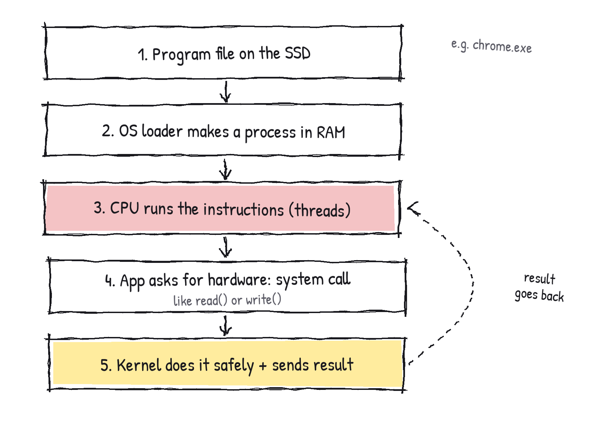

# 1.3 Application Software & Execution Lifecycle

**Status:** Completed  
**Team Member:** Lu My Ky (`@jojolu11`)  

---

## 1. What is Application Software?
**Application software** refers to end-user programs designed for specific tasks (such as Microsoft Word, Excel, Figma, and Google Chrome) that run on top of the Operating System.

### 8 Categories of Application Software
1. **Word processing**
2. **Spreadsheet**
3. **Presentation**
4. **Multimedia**
5. **Web browsers**
6. **Educational**
7. **Graphics**
8. **Simulation**

### Key Architectural Ideas
* **User space:** Where applications run — a restricted sandbox with **no direct hardware access**.
* **Kernel space:** Where the OS kernel runs — **full hardware access** to the CPU, RAM, and devices.
* **System call (syscall):** The controlled doorway an application uses to ask the kernel to perform hardware actions (such as saving a file or sending network data).

---

## 2. The Execution Lifecycle

### Step-by-Step Breakdown of the 5 Lifecycle Stages

#### 1. Executable on SSD
* The application is stored as a passive file on disk (e.g., `chrome.exe`).
* Contains compiled machine code + data, not running yet.

#### 2. OS loader creates a process in RAM
* Copies the executable code from the SSD into fast RAM.
* Creates an active **process + PCB (Process Control Block)** holding its ID, state, and priority.
* Gives the process dedicated memory regions: **code, data, stack, and heap**.

#### 3. CPU executes instructions (threads)
* The OS scheduler gives the process a slice of CPU time.
* The CPU runs the instruction cycle: **fetch → decode → execute**.
* **Threads** inside the process perform the actual work while sharing the process's memory.

#### 4. App requests hardware via syscall
* Because the app is restricted to **user space**, it cannot touch hardware directly.
* Makes a formal **system call (syscall)**: `read()`, `write()`, `socket()`.
* Switches the CPU from user mode into privileged **kernel mode**.

#### 5. Kernel performs the action safely and returns the result
* The kernel checks that the app has permission for the request.
* Uses the appropriate **device driver** to reach the physical hardware device.
* Returns the result back to the app ("result back") and switches the CPU back to **user mode** so Step 3 continues.

### Why Computer Systems Use This Design
* **Safety:** One buggy app cannot crash hardware or overwrite other running apps.
* **Sharing:** Many apps can safely share the exact same CPU, RAM, and hardware devices.
* **Simplicity:** App developers do not need to write custom code for specific hardware models—the OS and drivers handle it.

---

## 3. Types of Application Software

### 1. Word processing
* Create and edit text documents with advanced formatting.
* Features: Spell check, tables, templates, track changes.
* **Examples:** Microsoft Word, Google Docs, Apple Pages, LibreOffice Writer.

### 2. Spreadsheet
* Organize numbers and financial data in rows and columns.
* Features: Formulas, charts, pivot tables, data analysis.
* **Examples:** Microsoft Excel, Google Sheets, Apple Numbers, LibreOffice Calc.

### 3. Presentation
* Build visual slide decks for talks, lectures, and pitches.
* Features: Slide layouts, animations, transitions, speaker notes.
* **Examples:** Microsoft PowerPoint, Google Slides, Apple Keynote, Canva.

### 4. Multimedia
* Create, edit, and play audio, video, and AR/VR content.
* Features: Timeline editing, visual effects, sound mixing.
* **Examples:** Adobe Premiere Pro, DaVinci Resolve, Audacity, VLC Media Player, Unity (AR/VR).

### 5. Web browsers
* Provide secure interactive access to websites and web applications.
* Features: Tabs, extensions, sandboxing, built-in security and AI features.
* **Examples:** Google Chrome, Mozilla Firefox, Microsoft Edge, Safari, Brave.

### 6. Educational
* Help students and learners master new skills interactively.
* Features: AI personalization, quizzes, virtual classrooms.
* **Examples:** Duolingo, Khan Academy, Google Classroom, Moodle, Kahoot!

### 7. Graphics
* Professional 2D design, photo editing, and 3D modeling.
* Features: Photo manipulation, vector art, UI/UX design.
* **Examples:** Adobe Photoshop, Adobe Illustrator, CorelDRAW, Blender, Figma.

### 8. Simulation
* Model real-world scenarios for training, physics testing, or engineering analysis.
* Features: Safe virtual testing without real-world risk or hardware damage.
* **Examples:** MATLAB/Simulink, Microsoft Flight Simulator, Arena Simulation, AnyLogic, SimScale.

---

## 4. How Apps Are Built: Native vs. Web vs. Cross-Platform

### Native apps
* Written for one specific OS in its native language (**Swift** for iOS/macOS, **C++/C#** for Windows, **Kotlin** for Android).
* Compiled directly into machine code → talks to the OS directly.
* ✅ **Pros:** Fastest speed, lowest memory usage, full hardware access.
* ❌ **Cons:** Requires writing and maintaining a separate version for every OS.
* **Examples:** Microsoft Word, Adobe Photoshop, Final Cut Pro.

### Web apps
* Run inside a web browser using **HTML, CSS, and JavaScript**.
* Nothing to install locally—just open a URL in the browser.
* ✅ **Pros:** Works on any device with a browser, always up to date automatically.
* ❌ **Cons:** Needs an internet connection (mostly), limited hardware access, slower than native code.
* **Examples:** Google Docs, Figma (web), Canva.

### Cross-platform apps (bundled browser engine)
* A web app packed together with its own browser engine (e.g., **Electron** = Chromium + Node.js).
* Installed like a normal desktop app using one shared codebase for every OS.
* ✅ **Pros:** Write once, run on Windows, macOS, and Linux.
* ❌ **Cons:** Heavy — each app carries its own private browser engine and uses lots of RAM.
* **Examples:** VS Code, Discord, Slack, Microsoft Teams.

### The Architectural Trade-Off

| Feature | Native | Web | Cross-platform (Electron) |
| :--- | :--- | :--- | :--- |
| **Portability** | Low — one OS | Highest — any browser | High — one codebase |
| **Speed** | Fastest | Slowest | Medium |
| **Memory use** | Lowest | Shares the browser | Highest (own engine) |
| **Hardware access** | Full | Limited | Good |
| **Install needed** | Yes | No | Yes |

* **More portable** → usually slower and heavier on RAM.
* **More native** → faster and lighter, but requires more work to support every OS.

---

## 5. Review Questions & Answers

**Q1. What is application software?**  
* End-user programs designed for specific tasks that run on top of the OS.

**Q2. Difference between application and system software?**  
* **Application** → performs user tasks (Word, Chrome).  
* **System** → runs and manages the computer itself (OS, drivers, BIOS).

**Q3. Why can’t apps access hardware directly?**  
* They run in **user space** (a restricted sandbox) for safety; only the OS **kernel** has full hardware access.

**Q4. What is a system call? Give an example.**  
* The controlled doorway from a user-space app to the kernel (e.g., `write()` to save a file, `socket()` to send network data).

**Q5. List the 5 steps of the execution lifecycle.**  
* (1) Executable on SSD → (2) OS loader creates process in RAM → (3) CPU runs threads → (4) App requests hardware via syscall → (5) Kernel acts safely and returns the result.

**Q6. What does the OS loader do?**  
* Copies the program from SSD into RAM, creates the process and PCB, and allocates its memory (code, data, stack, heap).

**Q7. Process vs. thread?**  
* **Process** = a running program with its own isolated memory.  
* **Thread** = a worker task inside a process that shares that process's memory.

**Q8. Why is VS Code or Discord heavier than a native app?**  
* They are built with **Electron**, meaning each app bundles its own separate Chromium browser engine, consuming more RAM.

**Q9. Native vs. web app — which is faster and why?**  
* **Native** — because it is compiled directly into machine code and talks to the OS directly without browser overhead.

**Q10. Name 2 examples each of graphics and simulation software.**  
* **Graphics:** Adobe Photoshop, Blender.  
* **Simulation:** MATLAB/Simulink, Microsoft Flight Simulator.

---

## 6. References
1. Arpaci-Dusseau, R. H., & Arpaci-Dusseau, A. C. (2018). *Operating Systems: Three Easy Pieces*. Arpaci-Dusseau Books.
2. Silberschatz, A., Galvin, P. B., & Gagne, G. (2018). *Operating System Concepts* (10th ed.). Wiley.
3. BIT2026 Course Lecture Slides (Application Software Module).
