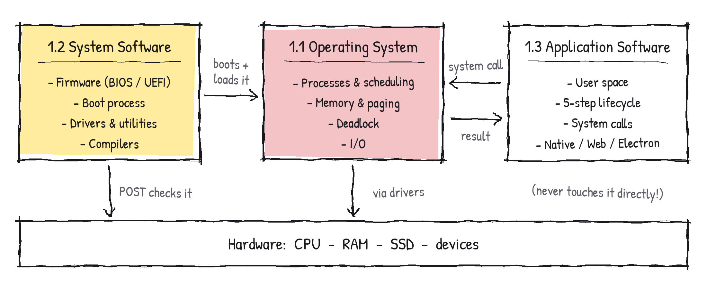

# 1.4 Module Summary & Self-Check Quiz

**Status:** ✅  
**Team Members:** Wong Hiu Chung Samuel (`@Samuel940398`) & Goh Ye Han (`@LewisYeHan`)

**In this section:** How It All Connects · Key Ideas from Each Section · Quiz · Answer Key

---

## 1. How It All Connects

*Figure 1.7: How system software, the OS, and applications work together on top of the hardware.*

Sections 1.1 to 1.3 describe three layers of software that work together every time you use a computer. The easiest way to see how they connect is to follow what happens from the moment you press the power button to the moment an app saves a file.

**Starting up (1.2 System Software).** When you press the power button, the first thing that runs is the **firmware** (BIOS or UEFI) stored on the motherboard. It checks the hardware with **POST**, finds the boot drive, and starts the **bootloader**. The bootloader loads the **kernel** into RAM, and the kernel starts the device drivers and system services until the login screen appears.

**Managing everything (1.1 Operating Systems).** Once the OS is running, it shares the computer between everything that wants to use it. It turns programs into **processes**, decides which one gets the CPU next (**scheduling**), gives each one its own part of RAM (**memory management**), and controls devices through **drivers**. It also has to prevent problems like **deadlock** and **thrashing**.

**Doing the user's work (1.3 Application Software).** When you open an app, the OS **loader** copies it from the SSD into RAM as a new process, and the CPU starts running its instructions. The app lives in **user space**, so it cannot touch hardware directly. Whenever it needs to save a file or use the network, it makes a **system call**, and the kernel does the job safely and sends the result back.

**The main idea:** each layer only does its own job and relies on the layer below it. Apps ask the OS, the OS uses drivers, and drivers talk to the hardware. This design keeps the computer **safe** (one bad app can't crash everything), **shared** (many apps can run at once), and **simple** (app makers don't need to know every hardware model).

---

## 2. Key Ideas from Each Section

| Section | Main Question | Key Ideas |
| :--- | :--- | :--- |
| **1.1 Operating Systems** | How does the OS share the computer? | Processes and process states, CPU scheduling (FCFS, SJF, Priority, Round Robin), deadlock, virtual memory and paging, I/O and drivers |
| **1.2 System Software** | How does the computer start and control hardware? | Firmware, BIOS vs. UEFI, the boot process, kernel types, device drivers, utilities, compilers and interpreters |
| **1.3 Application Software** | How does an app actually run? | User space vs. kernel space, the 5-step execution lifecycle, system calls, types of apps, native vs. web vs. Electron apps |

### Words That Connect All Three Sections
* **Kernel:** loaded during boot (1.2), manages processes and memory (1.1), and answers system calls from apps (1.3).
* **Process:** created by the loader (1.3), scheduled and moved between states by the OS (1.1).
* **Driver:** part of system software (1.2), used by the OS to control devices (1.1) when an app asks for hardware (1.3).
* **RAM:** where the kernel is loaded at boot (1.2), managed with paging and virtual memory (1.1), and where apps run (1.3).

---

## 3. Self-Check Quiz
Try all 10 questions first, then check your answers in Section 4.

### Part A: Multiple Choice

**Q1. When you press the power button on a PC, what runs first?**  
* A) The OS kernel  
* B) The BIOS / UEFI firmware  
* C) The bootloader  
* D) The device drivers  

**Q2. During booting, what is the main job of the bootloader (such as GRUB or Windows Boot Manager)?**  
* A) To check the hardware with POST  
* B) To load the OS kernel into RAM  
* C) To show the login screen  
* D) To start the background system services  

**Q3. Which four conditions must all be true at the same time for a deadlock to happen?**  
* A) Mutual Exclusion, Hold and Wait, No Preemption, Circular Wait  
* B) Paging, Segmentation, Swapping, Thrashing  
* C) Fetch, Decode, Execute, Store  
* D) Preprocessor, Compiler, Assembler, Linker  

**Q4. Why do applications run in user space instead of touching hardware directly?**  
* A) So one buggy app cannot crash the whole system  
* B) Because user space makes apps run faster  
* C) Because the CPU cannot run app instructions  
* D) So apps can skip the CPU scheduler  

**Q5. Which tool joins compiled object files (`.o`) and libraries into one `.exe` file?**  
* A) Assembler  
* B) Linker  
* C) Loader  
* D) Interpreter  

**Q6. In Round Robin scheduling, what happens when a running process uses up its time slice?**  
* A) It is terminated  
* B) It moves to the Waiting state  
* C) It goes back to the Ready queue  
* D) It is suspended to disk  

### Part B: True or False

**Q7.** When RAM runs out, the OS can use disk space as extra memory (virtual memory), but too much swapping between RAM and disk causes a big slowdown called *thrashing*.

**Q8.** A device driver is a type of application software, like a word processor.

**Q9.** To save a file, a user-space app must make a system call (such as `write()`) so the kernel can do the hardware work safely.

**Q10.** A compiler translates a whole C program into machine code before it runs, while an interpreter translates and runs Python code line by line.

---

## 4. Answer Key

| Question | Answer | Explanation |
| :--- | :--- | :--- |
| **Q1** | **B** | The firmware runs first. It checks the hardware with POST and then starts the bootloader. *(1.2)* |
| **Q2** | **B** | The bootloader finds the OS kernel, loads it into RAM, and hands it control of the CPU. POST happens before it, and services and the login screen come after. *(1.2)* |
| **Q3** | **A** | These are the 4 deadlock conditions. Breaking any one of them prevents deadlock. *(1.1)* |
| **Q4** | **A** | User space keeps apps isolated, so a crash or bug in one app can't damage the hardware or other apps. *(1.3)* |
| **Q5** | **B** | The linker combines object files and libraries into one executable. The loader then copies it into RAM to run it. *(1.2)* |
| **Q6** | **C** | When its time slice ends, the process goes back to the Ready queue to wait for its next turn. It only goes to Waiting if it asks for I/O. *(1.1)* |
| **Q7** | **True** | Virtual memory uses the disk as extra RAM, and too much page swapping causes thrashing. *(1.1)* |
| **Q8** | **False** | A device driver is system software. It lets the OS talk to one specific hardware device. *(1.2)* |
| **Q9** | **True** | A system call is the only safe way for an app in user space to ask the kernel for hardware work. *(1.3)* |
| **Q10** | **True** | Compilers like `gcc` translate everything first, while interpreters like `python` translate and run line by line. *(1.2)* |

---

## 5. References
1. Tanenbaum, A. S., & Bos, H. (2022). *Modern Operating Systems* (5th ed.). Pearson.
2. Silberschatz, A., Galvin, P. B., & Gagne, G. (2018). *Operating System Concepts* (10th ed.). Wiley.
3. BIT2026 Course Lecture Slides (Stages 1.1–1.4).
