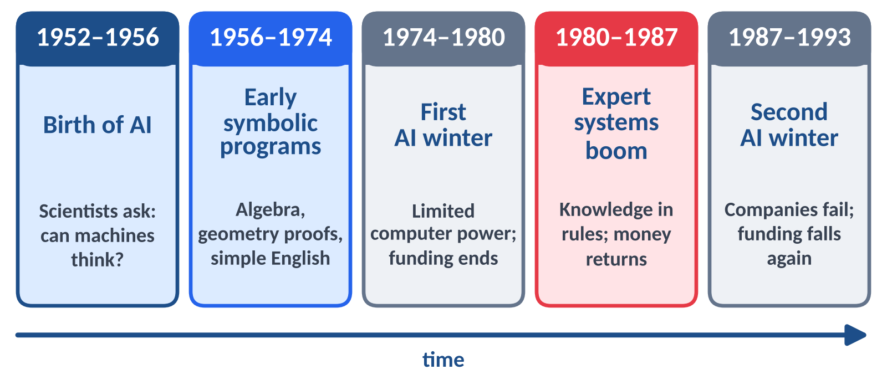

# 2.1 What is Symbolic AI?

**Status:** 📝  
**Team Member:** Frederick Samuel Lesmana (`@Ti4nCi`)

**In this section:** What is AI? · What "Symbolic" Means · A Short History (GOFAI) · How a Rule-Based Decision Works · Common Misunderstandings · Practice Questions

---

## 1. Where We Are in the Module

In Part 1 we learned that a computer only does what a program tells it to do. In [1.3 Application Software](03_Application_Software.md), an app was a list of machine-code instructions that the CPU fetches, decodes and executes, one by one.

Part 2 asks a bigger question: **can we write a program that behaves intelligently?** The first serious answer, tried from the 1950s onwards, was **Symbolic AI**: write down what an expert knows as clear rules and facts, and let the computer follow them. This section explains the idea and its history. The next sections go deeper:

* [2.2 Knowledge Representation](07_Knowledge_Representation.md): how facts are stored.
* [2.3 How Symbolic AI Reasons](08_How_Symbolic_AI_Reasons.md): how the computer uses rules to reach new conclusions.
* [2.4 Expert Systems](09_Expert_Systems.md): real systems built this way.
* [2.5 Strengths and Limits](10_Strengths_and_Limits.md): where Symbolic AI works and where it fails.

---

## 2. What is Artificial Intelligence?

**Artificial intelligence (AI)** is the field of computer science that builds programs to do tasks we would normally say need intelligence, such as solving puzzles, understanding language, giving advice, or making decisions. This is one simple definition; textbooks such as Russell and Norvig (2020) compare several.

There are two big ways to build such a program:

| | **Symbolic AI** | **Machine learning (ML)** |
|---|---|---|
| Where the knowledge comes from | People write it down as rules and facts | The program finds patterns in lots of example data |
| What the knowledge looks like | Readable rules, e.g. `IF fever AND cough THEN flu is possible` | Millions of numbers inside a **model** (the program that ML builds from the data). These numbers are called **weights**, and the program adjusts them while it learns. |
| Can you see why it decided? | Yes, you can point to the rule it used | Usually hard to explain |
| Everyday example | A tax-advice system that checks your form against rules taken from the tax law | A photo app that recognises your friend's face |

In the rule `IF fever AND cough THEN flu is possible`, **AND** means both parts must be true: a fever alone is not enough. Section [2.3](08_How_Symbolic_AI_Reasons.md) explains AND and OR in rules.

This section is about the left column. Section [2.5](10_Strengths_and_Limits.md) compares the two in detail.

> **Common mix-up:** "AI" does not only mean ChatGPT. ChatGPT is a machine-learning system. For about 40 years, from the mid-1950s to the mid-1990s, Symbolic AI was the main approach in AI research. Other ideas, such as early neural networks, also existed but got less attention.

---

## 3. What Does "Symbolic" Mean?

A **symbol** is something that stands for something else. The word `cat` is not a cat; it is a symbol that stands for one. The number `7`, a red STOP sign, and the letter `H` in a chemistry formula are also symbols.

**Symbolic AI** represents the world with symbols that people can read, and then works by **following rules to manipulate those symbols**. (**Manipulate** means to change symbols by rules: compare them, copy them, or write new ones.) For example:

* **Facts** (things that are true about the situation): `Tom is a student.` · `Tom has borrowed 2 books.` (We also say the books are "on loan".)
* **Rules** (what follows when certain facts are true): `IF a student has fewer than 5 books on loan THEN the student may borrow another book.`
* **Conclusion** (what the program works out by applying a rule): either a **new fact**, such as `Tom may borrow another book.`, or a **decision**, such as `Refuse`. Inside the program, a decision is usually saved as one more fact, for example `decision = refuse`.

(This is a simplified example with one rule. In Section 5 we add more rules, for example about unpaid fines.)

The computer does not "understand" what a student or a book is. It only checks whether the symbols in the facts match the symbols in the rule. This is the same thing the CPU does in Part 1: it follows instructions exactly, without understanding them. The difference is that in Symbolic AI the knowledge (facts and rules) is stored **separately**, like data. A general program reads the rules and applies them; the knowledge is not mixed into step-by-step code.

### The Big Idea Behind It

In 1976, looking back on twenty years of their own work, two AI pioneers, **Allen Newell** and **Herbert Simon**, wrote down the idea behind the whole approach. They called it the **Physical Symbol System Hypothesis**:

> "A physical symbol system has the necessary and sufficient means for general intelligent action." (Newell & Simon, 1976)

Let's take it apart word by word:

* A **physical symbol system** is a real machine, such as a computer, that stores symbols and changes them by rules. ("Physical" means it is built from real parts, not just an idea on paper.)
* **General intelligent action** means acting intelligently in many kinds of situations, like a person does, not in only one narrow task.
* **Sufficient** means such a machine *can* be intelligent.
* **Necessary** means anything intelligent, even a human brain, *must* work this way.

In plain words: Newell and Simon believed that **thinking is symbol manipulation**. If they are right, a computer with the right symbols and rules could act as intelligently as a person. Many thinkers disagree: they say that matching symbols, as our programs do, is not the same as understanding. That is why it is called a **hypothesis**, a claim to be tested, not a proven fact. Section 2.5 explains why it turned out to be much harder than expected.

---

## 4. A Short History: "Good Old-Fashioned AI"

Symbolic AI is often called **GOFAI**, short for **"Good Old-Fashioned AI"**. The philosopher **John Haugeland** introduced the name in 1985 (Haugeland, 1985), as a label for the classic idea that intelligence is symbol manipulation. Today the name can sound fond or a little old-fashioned, depending on who uses it. In this module it simply means the classic, rule-based way of doing AI, from before machine learning became popular (from the 1990s, and especially after about 2012).



*Figure 2.1: Key moments in the history of Symbolic AI, from the first AI program to today. Periods of excitement (green) were followed by "AI winters" (blue), when funding and interest dropped. White boxes mark single milestones. Events are evenly spaced, not drawn to scale.*

| Year | Event | Why it matters |
|---|---|---|
| 1955–56 | **Logic Theorist** by Allen Newell, Herbert Simon and Cliff Shaw | Often called the first AI program. It proved 38 of the first 52 theorems in chapter 2 of *Principia Mathematica*, a famous book about the logic behind mathematics, by applying logic rules to symbols. |
| 1956 | **Dartmouth workshop**, organised by John McCarthy, Marvin Minsky, Nathaniel Rochester and Claude Shannon | McCarthy had invented the name "artificial intelligence" in the 1955 proposal for this workshop (McCarthy et al., 1955). The workshop is seen as the start of AI as a research field. |
| 1966 | **ELIZA** by Joseph Weizenbaum | A chatbot that imitated a therapist (Weizenbaum, 1966). It used simple pattern-matching rules, such as: IF the user types "I am X" THEN reply "How long have you been X?". So "I am sad" becomes "How long have you been sad?". Many users felt it understood them, even though it did not. |
| 1970s (about 1974–1980) | **First AI winter** | Programs worked on small "toy" problems (for example, moving blocks around in a tiny pretend world) but failed on real ones, such as understanding normal conversation. Funding was cut in the UK, after the Lighthill report (1973), and in the US. |
| 1970s–1980s | **Expert systems** | Programs that stored hundreds of rules from human experts. **MYCIN** (Stanford University, 1970s) suggested antibiotics for serious blood infections. It was a research system and was never used in hospitals. In the 1980s, companies started using other expert systems in real work, for example **XCON**, which helped the computer company DEC put together customers' orders (see [2.4](09_Expert_Systems.md)). |
| Late 1980s–early 1990s | **Second AI winter** | Expert systems were expensive to build and keep up to date, and they broke when facing situations their rules did not cover. In 1987 the market for special AI computers (LISP machines) collapsed, and funding was cut. |
| 1997 | **Deep Blue** beats world chess champion Garry Kasparov | IBM's chess computer used **search**: it looked ahead through about 200 million possible positions per second ("if I move here, they move there…") and gave each position a score with a formula that its programmers built with help from a chess grandmaster. Search is a classic Symbolic AI method. |
| Today | Symbolic AI inside many systems | **Rule engines** (for example, a bank checking a loan form against its rules), **planning systems** (working out the steps to reach a goal, such as delivery routes) and **knowledge graphs** (large networks of linked facts, see [2.2](07_Knowledge_Representation.md)). They are often combined with machine learning; this is called **neuro-symbolic AI** (see [2.5](10_Strengths_and_Limits.md)). |

> **Why "AI winter"?** After big promises, people expected human-level AI within a few decades. When the programs did not deliver, governments and companies stopped paying for research. The field "froze" for several years, like winter.

---

## 5. How a Rule-Based Decision Works

The simplest kind of Symbolic AI is a **rule-based system**: a program that makes decisions by checking a list of IF-THEN rules against the facts it has. First, one new word: **inference** means working out something new from what you already know. For example: Lin has 5 books on loan, and the rule says 5 or more means refuse, so we *infer*: refuse Lin.

A rule-based system has three parts:


*Figure 2.2: The three parts of a rule-based system. Facts about the situation go into working memory. The inference engine compares them with the rules in the knowledge base and produces a decision, together with the rule that explains it. The knowledge (left) can be edited; the engine (right) stays the same.*

1. **Knowledge base:** the list of rules, written by people who know the subject (domain experts).
2. **Working memory:** the list of facts about the current situation, for example about one student. It changes for every new case.
   > **Careful:** this is **not** the same as RAM from Part 1. RAM is the computer's hardware memory. "Working memory" is just the name for the system's list of current facts. While the program runs, this list is stored in RAM, like any other data. The name comes from psychology, where it means what a person is thinking about right now.
3. **Inference engine:** the part of the program that compares the facts with the rules, picks which rule to use by a fixed method, and produces the result.

The key design idea is that **the knowledge (rules) is kept separate from the program that uses it (the inference engine)**. To change the library's policy, someone edits a rule in the knowledge base. In real projects this is often a **knowledge engineer** working together with the librarian. The system's behaviour changes, but the inference engine's code stays the same.

### Worked Example: The Library Borrowing Assistant

Our university library wants a program that decides whether a student may borrow a book. A librarian (the expert) gives us the policy, and we write it as four rules:

| Rule | IF … | THEN … |
|---|---|---|
| **R1** | the student has an unpaid fine | **Refuse:** "Please pay your fine first." |
| **R2** | the book is reference-only | **Refuse:** "This book cannot leave the library." |
| **R3** | the student already has 5 or more books on loan | **Refuse:** "You have reached the 5-book limit." |
| **R4** | (always true: a **default rule** that catches every other case) | **Allow:** "You may borrow this book." |

Our engine uses the simplest method: it checks the rules **in order, from R1 to R4, and uses the first rule whose IF part is true**. (Real engines first find *all* the rules that match, then use a fixed method to pick one, for example "the rule that is higher in the list" or "the rule with the highest priority". "First match in order" is one simple method; Section [2.3](08_How_Symbolic_AI_Reasons.md) shows others.)

Now let's trace three students step by step.

**Student A: Mei.** Facts: no unpaid fine · book is normal · has 2 books on loan.

1. R1: Does Mei have an unpaid fine? **No** → go to R2.
2. R2: Is the book reference-only? **No** → go to R3.
3. R3: Does Mei have 5 or more books? She has 2, so **No** → go to R4.
4. R4: Always true → **Allow.** Explanation: "R4 (the default rule) was used, because no refusal rule applied: no fine, normal book, only 2 books on loan."

**Student B: Ali.** Facts: unpaid fine of 3 yuan · book is normal · has 1 book on loan.

1. R1: Does Ali have an unpaid fine? **Yes** → **Refuse: "Please pay your fine first."** The engine stops here.

**Student C: Lin.** Facts: no unpaid fine · book is reference-only · has 5 books on loan.

1. R1: Unpaid fine? **No** → go to R2.
2. R2: Is the book reference-only? **Yes** → **Refuse: "This book cannot leave the library."** The engine stops here.

Notice three things in these traces:

* Lin **also** breaks R3 (she has 5 books), but the engine never checks R3, because R2 fired first. **The order of the rules changes which explanation the user gets.** The rule-writer must choose the order on purpose.
* Order can even change the **decision**. If R4 ("always allow") were moved to the top, every student would be allowed! A different design could also check **all** the rules and tell Lin both reasons. Section 2.3 shows other ways an engine can choose rules.
* The program can always say **which rule** it used. If Lin complains, the librarian can point to R2. This ability to explain a decision is one of the biggest strengths of Symbolic AI.

### Is Every IF Statement "AI"?

No. Programming languages have an **`if`** instruction: "if this is true, do that, otherwise do something else". A programmer could write our library policy straight into the program's code, like this:

```python
if the student has an unpaid fine:
    refuse "Please pay your fine first."
otherwise if the book is reference-only:
    refuse "This book cannot leave the library."
otherwise if the student has 5 or more books:
    refuse "You have reached the 5-book limit."
otherwise:
    allow
