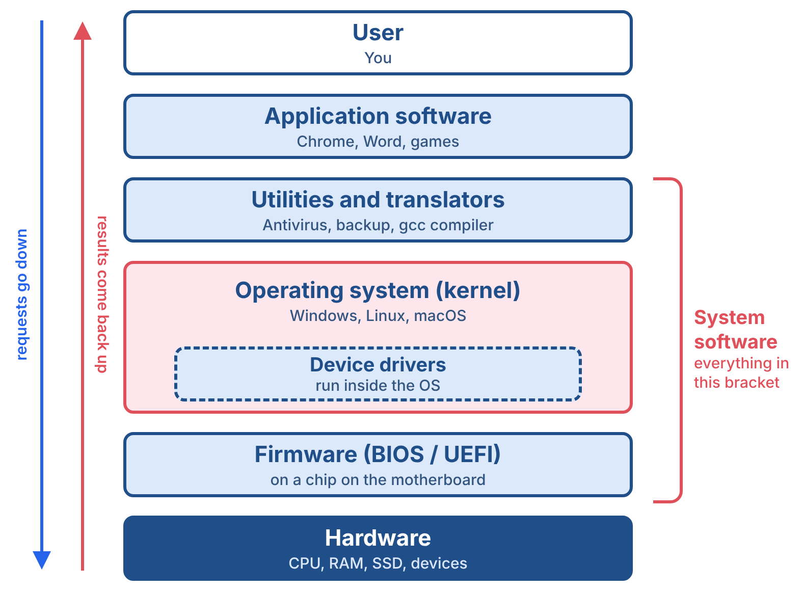
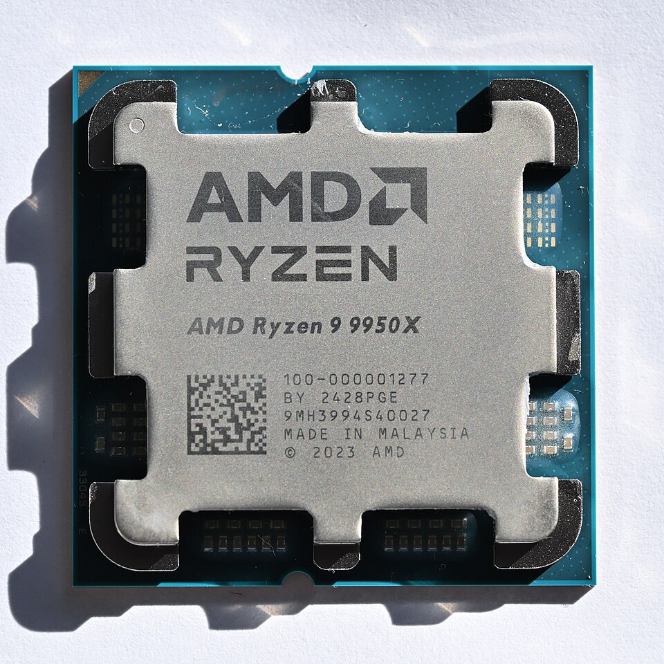
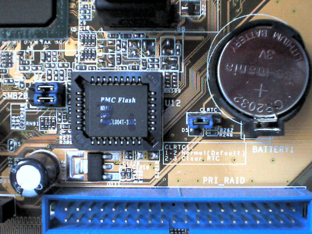
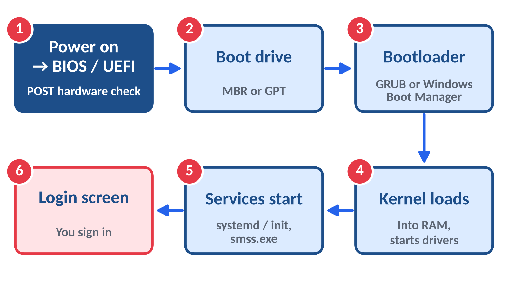
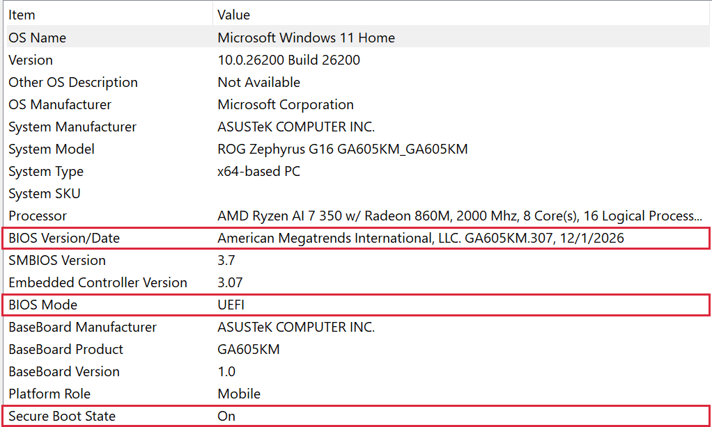

# 1.1 System Software

**Team Member:** Cassinis Soulisack (`@DiegoSmiley`)

**In this section:** [What is System Software?](#1-what-is-system-software) · [Layers](#2-layers-of-a-computer-system) · [Firmware](#3-firmware) · [BIOS & UEFI](#4-bios-and-uefi) · [Boot Process](#5-the-boot-process) · [Kernel](#6-the-kernel) · [Drivers](#7-device-drivers) · [Utilities & Translators](#8-utilities-and-language-translators) · [Summary](#9-summary) · [Lab: Find Your Computer's System Software](#lab-find-your-computers-system-software) · [Practice Questions](#10-practice-questions-and-answers) · [References](#11-references)

**Learning goals.** By the end of this section you can:
* explain what system software is and name its five kinds;
* describe the six steps a computer goes through from the power button to the login screen;
* explain what a device driver does, and how a compiler differs from an interpreter.

**Before you start:** nothing. This is the first section of the module. You only need to have used a computer or phone.

---

## 1. What is System Software?
Think of a restaurant. The **hardware** is the kitchen: the stoves, ovens, and fridges. The **applications** are the dishes that customers order. But dishes do not cook themselves. Someone has to light the stoves, keep the fridge cold, and make sure two cooks do not use the same pan at once. That is the kitchen staff, and in a computer, the kitchen staff is **system software**. You, the customer, never touch the hot stove directly. The most important member of the staff is the head chef, who decides which cook uses which stove and when. That head chef is the **operating system**, and Section 1.2 looks at it in detail.

**System software** is software that runs and manages the computer itself so that other programs can run on top of it. It is different from **application software**:
* **Application software** works for *you*. Chrome, Word, and games are examples.
* **System software** works for *the computer*. It controls the hardware and manages resources in the background, and you usually do not notice it.

There are five main kinds of system software:
1. **Firmware**, including the BIOS or UEFI
2. **The operating system (OS)**
3. **Device drivers**
4. **Utility programs**
5. **Language translators**: compilers, interpreters, and assemblers

---

## 2. Layers of a Computer System
A computer is built in layers, like a building. Each layer relies on the one below it and offers simpler services to the one above it. The table reads from the top (you) to the bottom (the physical machine):

| Layer | Example | Type |
| :--- | :--- | :--- |
| **User** | You | End user |
| **Application software** | Chrome, Word, games | Application software |
| **Utilities and translators** | Antivirus, `gcc` compiler | **System software** |
| **Operating system (kernel)** | Windows, Linux, macOS | **System software** |
| **Device drivers** | GPU driver, Wi-Fi driver, printer driver | **System software** |
| **Firmware (BIOS / UEFI)** | Motherboard ROM chip | **System software** |
| **Hardware** | CPU, RAM, SSD | Physical hardware |

The table gives drivers their own row to show what they do; in the computer they run inside the operating system, as Figure 1.1 shows.

*Figure 1.1: Layers of a computer. Everything inside the red bracket is system software; the operating system is its largest part.*

Figure 1.1 shows the same layers as the table. Requests go down from you to the hardware, and results come back up. Notice that the operating system sits *inside* the bracket: it is one kind of system software, not a separate layer above it.

Two details are worth knowing. First, device drivers run inside the OS, together with the kernel. Second, the motherboard firmware (BIOS or UEFI) does its main job **when the computer starts**. Once the OS is running, the drivers talk to the hardware directly, not through the BIOS.

The **hardware** at the bottom of Figure 1.1 is the physical machine. Its most important part is the **CPU** (processor), the chip that runs every instruction of every program:

*Photo: an AMD Ryzen 9 9950X processor seen from the top. The chip itself sits under the metal lid. Photo by 4300streetcar, [CC BY 4.0](https://creativecommons.org/licenses/by/4.0/), via Wikimedia Commons.*

---

## 3. Firmware
**Firmware** is low-level software normally stored on a **non-volatile** chip (flash memory or ROM) inside a device, so it stays there when the power is off. It is the very first set of instructions a device follows, telling it how to wake up and get ready.

* **It stays when the power is off.** Firmware is **non-volatile**, so it is still there every time you switch the device on.
* **It is everywhere.** Motherboards, SSDs, Wi-Fi routers, printers, smartphones, and cars all have firmware.
* **It can be updated ("flashed").** Manufacturers release firmware updates to fix bugs. If the power cuts out in the middle of an update, though, the device can be left unable to start at all. People call this **"bricking"** it, because it becomes as useful as a brick.
* **Simple devices have nothing else.** In a microwave or washing machine, firmware is the *only* software inside. It does one job, so it needs no operating system.

---

## 4. BIOS and UEFI
When you press the power button on a PC, the CPU does not yet know where Windows or Linux is. The first program it runs is the motherboard's firmware: the **BIOS (Basic Input/Output System)**, or on newer computers, **UEFI**.

### What It Does at Startup
1. **POST (Power-On Self-Test):** It checks that the CPU, RAM, keyboard, and graphics card are working. If something is wrong, it reports it with **beep codes** or an on-screen message. This is like a pilot's pre-flight checklist.
2. **Prepares the hardware:** It sets up the motherboard and devices so they are ready to use.
3. **Reads saved settings:** It loads settings such as the boot order and the clock from **CMOS** memory, which is kept alive by a small coin-cell battery (modern UEFI PCs often keep these settings in flash memory called NVRAM instead, but the battery still runs the clock). That is why a PC still knows the time after being unplugged.
4. **Finds a drive to start from:** It checks the SSD, hard drive, or USB stick, in the boot order you set.
5. **Hands over to the bootloader:** It starts the small program on that drive that knows how to load the OS.

*Photo: the BIOS chip (the square chip labelled PMC Flash) and the round coin-cell CMOS battery on an ASUS P4P800-E motherboard. Photo by Samuel Peixoto, public domain, via Wikimedia Commons.*

### Legacy BIOS vs. Modern UEFI
**UEFI (Unified Extensible Firmware Interface)** replaced the old BIOS and has been standard on PCs since about 2012. Many people still call it "the BIOS" out of habit.

| Feature | Legacy BIOS | Modern UEFI |
| :--- | :--- | :--- |
| **Mode** | 16-bit | 32-bit / 64-bit |
| **Disk format** | MBR (Master Boot Record) | GPT (GUID Partition Table) |
| **Largest boot disk** | About 2 TB | Practically unlimited |
| **Interface** | Plain text, keyboard only | Usually a graphical menu with mouse support |
| **Security** | Basic (e.g., a BIOS password), no Secure Boot | **Secure Boot** |
| **Startup speed** | Slower | Faster |

The most important difference is **Secure Boot**. It only lets bootloaders and operating systems that are digitally signed (trusted) start up. This blocks a dangerous kind of malware that tries to load *before* the OS, where antivirus software cannot see it.

---

## 5. The Boot Process
**Booting** means starting the computer, from pressing the power button until the login screen appears. A **cold boot** starts from fully off. A **warm boot** is a restart. The name comes from the phrase "pulling yourself up by your bootstraps": the computer starts a tiny program, which starts a bigger one, which starts the whole OS.

*Figure 1.2: The 6 steps of booting, from pressing the power button to the login screen.*

Figure 1.2 shows the six steps in order, following the arrows from step 1 to step 6. Each step is explained below.

1. **Power on → BIOS / UEFI:** The CPU wakes up and runs the firmware, which does the **POST** check and prepares RAM and devices.
2. **Boot drive (MBR / GPT):** The firmware follows the boot order and reads the start-up information on the main drive. On Legacy BIOS this is the first 512 bytes of the disk, called the **MBR**. On UEFI it is a small partition called the **EFI System Partition**.
3. **Bootloader:** The bootloader starts. It is **GRUB** on Linux and **Windows Boot Manager** on Windows. If you have more than one OS installed, this is where you choose.
4. **Kernel loads:** The bootloader copies the **OS kernel** into RAM and hands it control of the CPU. The kernel then starts the device drivers.
5. **System services start:** The kernel starts the first process (**`systemd`** on modern Linux, or the older **`init`**; **`smss.exe`** on Windows), which then starts all the background services, such as networking and sound.
6. **Login screen:** The system is now fully running. It shows the login screen and loads your desktop after you sign in.

---

## 6. The Kernel
At step 4 of the boot process, the bootloader loads the **kernel**. The kernel is the core of the operating system: it stays in memory the whole time the computer is on and controls the hardware directly.

The CPU protects the kernel by running in two modes:
* **Kernel mode** has full access to the hardware. The kernel and most drivers run here. Because nothing stops it, a crash here brings down the whole PC. On Windows, this is the "Blue Screen of Death."
* **User mode** has limited access. Normal apps run here. If an app crashes, only that app closes and the rest of the computer keeps working.

How apps ask the kernel for help (**system calls**) and the different ways a kernel can be designed (**kernel types**) are explained in [1.2 Operating Systems, Section 7](02_Operating_Systems.md#7-system-calls-and-kernel-designs).

---

## 7. Device Drivers
Every device speaks its own language. A Canon printer and an HP printer need completely different commands, and so do two different graphics cards. The OS cannot know every device ever made. Instead, each device comes with a **device driver**: a small program that translates the OS's general requests into the exact commands that one device understands. It works like an interpreter between two people who speak different languages.

### Example: Printing a Document
Here is what happens when you print:
1. You click **Print** in Microsoft Word.
2. Word asks the OS to print the document. Word does not need to know which printer you have.
3. The OS puts the job in the **print queue**. This is called **spooling**, and it lets you keep working while the printer catches up.
4. The OS sends the job to the **printer driver**.
5. The driver translates the job into the exact commands your printer understands.
6. The printer prints and reports back, for example *"Done"* or *"Out of paper."*

### Key Points About Drivers
* Most drivers run in **kernel mode**, so a buggy driver can crash the whole PC. This is why driver updates matter.
* **Plug and Play:** When you connect new hardware, such as a USB mouse, the OS detects it and loads the right driver automatically.
* Drivers need updates to fix bugs and to keep working with new OS versions.
* **Driver vs. firmware:** These are easy to mix up. **Firmware** lives on a chip *inside the device*. A **driver** lives *inside the OS*, on your computer's drive.

---

## 8. Utilities and Language Translators

### Utility Programs
**Utility programs** keep the computer healthy, like cleaners and security guards in a building:
* **Antivirus** finds and removes malware.
* **Disk Cleanup** deletes temporary junk files to free up space.
* **A defragmenter** puts scattered pieces of files back together on a hard drive (HDD) so it reads faster. SSDs do not need this.
* **Backup** tools copy important files in case the drive fails.
* **Compression** tools shrink files into smaller archives, such as `.zip` files.
* **A firewall** watches network traffic and blocks connections that are not allowed.

### Language Translators
CPUs only understand **machine code**: long strings of 0s and 1s. People write programs in languages that are easier to read, such as C or Python. A **language translator** turns human-readable code into something the CPU can run.

| Translator | Input | How it works | Example |
| :--- | :--- | :--- | :--- |
| **Assembler** | Assembly code | Converts each assembly instruction directly into machine code | `NASM` |
| **Compiler** | C, C++ | Translates the whole program before it runs; together with the assembler and linker, this produces an executable file | `gcc` |
| **Interpreter** | Python | Translates and runs the code step by step while the program is running | `python` |

A simple way to remember the difference: a **compiler** is like translating a whole book before anyone reads it, while an **interpreter** is like a live interpreter translating a speech sentence by sentence. Compiled programs usually run faster. Interpreted programs are easier to test and change. (Python actually turns code into a simpler form called **bytecode** first, then runs it one instruction at a time, but "line by line" is a good way to picture it.)

### From C Source Code to a Running Program
Turning a C program into something you can run takes five steps:
1. **Preprocessor:** Handles lines such as `#include` and `#define`, for example by pasting in the header files.
2. **Compiler:** Turns the C code into **assembly code**.
3. **Assembler:** Turns the assembly code into a binary **object file** (`.o` on Linux, `.obj` on Windows).
4. **Linker:** Joins the object files and libraries into one **executable** file (`.exe` on Windows).
5. **Loader (part of the OS):** When you run the program, it copies the executable into RAM and starts it.

---

## 9. Summary

| Comparison | Difference |
| :--- | :--- |
| **System vs. application software** | Runs the computer vs. does tasks for the user |
| **Firmware vs. driver** | Stored on the device's chip vs. stored inside the OS |
| **BIOS vs. UEFI** | Older 16-bit with MBR vs. modern 64-bit with GPT and Secure Boot |
| **OS vs. kernel** | The kernel is the core part of the whole OS |
| **Kernel mode vs. user mode** | Full hardware access vs. limited access |
| **Compiler vs. interpreter** | Translates the whole program first vs. step by step while running |

### Key Points to Remember
1. **System software** sits between the hardware and the applications you use.
2. When you press the power button, **BIOS/UEFI** runs first, does the **POST** check, and starts the bootloader.
3. The **bootloader** (such as GRUB) loads the **kernel** into RAM.
4. **Drivers** let the OS talk to each hardware device.
5. **Utilities** keep the PC healthy, and **translators** turn human code into machine code.

**What comes next.** One kind of system software does far more than the others: the operating system. Once the kernel is loaded, it shares the CPU, memory, files and devices between every program you run. [Section 1.2](02_Operating_Systems.md) looks inside it.

---

## Lab: Find Your Computer's System Software

* **Goal:** Find the firmware and one device driver on your own computer, and link what you see to Sections 3, 4 and 7.
* **Preparation:** A Windows 10 or 11 computer and about 15 minutes; re-read §3, §4 and §7. You only look at information, so nothing on your computer changes. On a Mac, follow the note at the end of the task. No computer? Use the screenshots from a team member's laptop below and the example in the feedback box.
* **Task:**

  **Step 1, predict:** does your computer start with Legacy BIOS or with UEFI? Write down your guess. (§4 says when UEFI became standard.)  
  **Step 2, find the firmware:** press **Windows key + R**, type `msinfo32` and press **Enter**. System Information opens on **System Summary**. In the list on the right, find and write down three rows: **BIOS Version/Date**, **BIOS Mode** and **Secure Boot State**.  
  **Step 3, find a driver:** right-click the **Start** button and choose **Device Manager**. Expand **Display adapters**, right-click your graphics card and choose **Properties**, then open the **Driver** tab. Write down **Driver Provider**, **Driver Date** and **Driver Version**, then click **Cancel**. Leave the other buttons on this tab alone, because they change the driver.  
  **Step 4, look for problems:** still in Device Manager, expand a few other groups, such as **Network adapters** and **Audio inputs and outputs**. Look for any device marked with a small yellow warning triangle.

  *On a Mac:* hold **Option**, click the **Apple menu** and choose **System Information**. The **Hardware Overview** page shows the **System Firmware Version**. Macs use Apple's own firmware, and their drivers come built into macOS, so do Steps 1 and 2 with the firmware version and skip Steps 3 and 4.

  

  *Lab screenshot: Step 2 on a team member's laptop. The three rows to find are outlined; the System Name and User Name rows were removed.*

  

  *Lab screenshot: Step 3 on the same laptop. Read the outlined rows, then click Cancel.*

* **Observation:** Copy this table and fill it in.

  | Value | What you found | Firmware or driver? | Stored on the motherboard chip, or inside the OS? |
  | :--- | :--- | :--- | :--- |
  | BIOS Version/Date | | | |
  | BIOS Mode | | | |
  | Secure Boot State | | | |
  | Driver Provider | | | |
  | Driver Date | | | |
  | Driver Version | | | |

* **Reflection:**
  1. Was your guess in Step 1 right? If BIOS Mode says **UEFI**, which disk format does your boot drive use, MBR or GPT? How do you know?
  2. What does Secure Boot protect your computer from?
  3. Your firmware and your driver probably have different makers and dates. Use the "driver vs. firmware" point in §7 to explain why.
  4. What would a yellow warning triangle in Step 4 mean, and what can the OS not do until it is fixed?

<b>Feedback: check your findings</b>

* **Step 2:** **BIOS Mode** shows **UEFI** on almost every PC made since about 2012; **Legacy** means the older BIOS way of starting. **BIOS Version/Date** names the firmware's maker, its version and its release date. Many PC makers build on firmware from a specialist company, such as American Megatrends in the screenshot. **Secure Boot State** shows **On**, **Off** or **Unsupported**.
* **Step 3:** **Driver Provider** is usually the maker of the graphics chip, such as Intel, AMD or NVIDIA, or Microsoft. **Driver Date** and **Driver Version** show which release of the driver is installed. Drivers are updated through Windows Update or the maker's own app.
* **Example (the laptop in the screenshots):** BIOS Version/Date *American Megatrends International, LLC. GA605KM.307, 12/1/2026*; BIOS Mode *UEFI*; Secure Boot State *On*; Driver Provider *NVIDIA*; Driver Date *7/11/2026*; Driver Version *32.0.16.2124*. The firmware and the driver come from different companies and have different dates.
* **Observation:** BIOS Version/Date, BIOS Mode and Secure Boot State describe the **firmware**, stored on a chip on the motherboard. Driver Provider, Driver Date and Driver Version describe a **driver**, stored inside the OS on your drive.
* **Reflection answers:**
  1. In the standard setup, UEFI starts Windows from a **GPT** disk, and Legacy BIOS starts it from an **MBR** disk (the table in §4).
  2. Malware that tries to load **before** the OS, where antivirus software cannot see it. Secure Boot lets only digitally signed, trusted bootloaders and operating systems start (§4).
  3. The firmware lives on a chip on the motherboard and comes from the PC maker, often built on code from a firmware company such as American Megatrends. It is updated rarely, because a failed update can leave the PC unable to start (§3). The driver lives inside the OS and comes from the device maker or Microsoft. It is updated often, to fix bugs and to keep working with new versions of Windows (§7).
  4. It usually means Windows has no working driver for that device, so the OS cannot use the device until a driver is installed. Plug and Play normally finds one automatically (§7).

---

## 10. Practice Questions and Answers
Try each question yourself first, then open the answers to check.

**Questions**
1. Is a printer driver system software or application software? Why?
2. Your PC beeps several times when you turn it on and nothing appears on the screen. Which boot step has found a problem?
3. Put these in order: kernel loads, POST, login screen, bootloader starts.
4. Why does a buggy driver crash the whole PC, while a buggy app only closes itself?
5. What is the difference between firmware and a driver?
6. Your friend says Python is compiled like C. Are they right?

<b>Show answers</b> (try the questions first!)

1. System software. It does not do a task for the user; it lets the OS control a piece of hardware.
2. The **POST** check in the BIOS/UEFI. Beep codes are how it reports hardware problems before the screen is working.
3. POST → bootloader starts → kernel loads → login screen.
4. Most drivers run in **kernel mode**, which has full access to the whole system, so a crash there affects everything. Apps run in **user mode**, which is kept separate, so only that app is affected.
5. Firmware is stored on a chip inside the device itself. A driver is stored inside the OS on your computer and tells the OS how to use that device.
6. Not quite. C is compiled into an executable before it runs. Python is interpreted: it is turned into bytecode and run step by step while the program is running.

---

## 11. References
1. Mueller, S. (2015). *Upgrading and Repairing PCs* (22nd ed.). Que Publishing.
2. Patterson, D. A., & Hennessy, J. L. (2020). *Computer Organization and Design* (6th ed.). Morgan Kaufmann.
3. Silberschatz, A., Galvin, P. B., & Gagne, G. (2018). *Operating System Concepts* (10th ed.). Wiley.
4. BIT2026 Foundations of CS & AI, course lecture slides: System Software module (2026).
