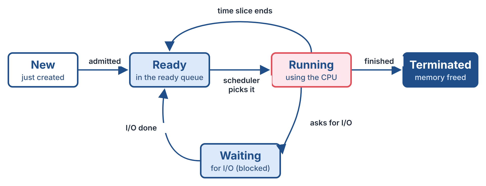
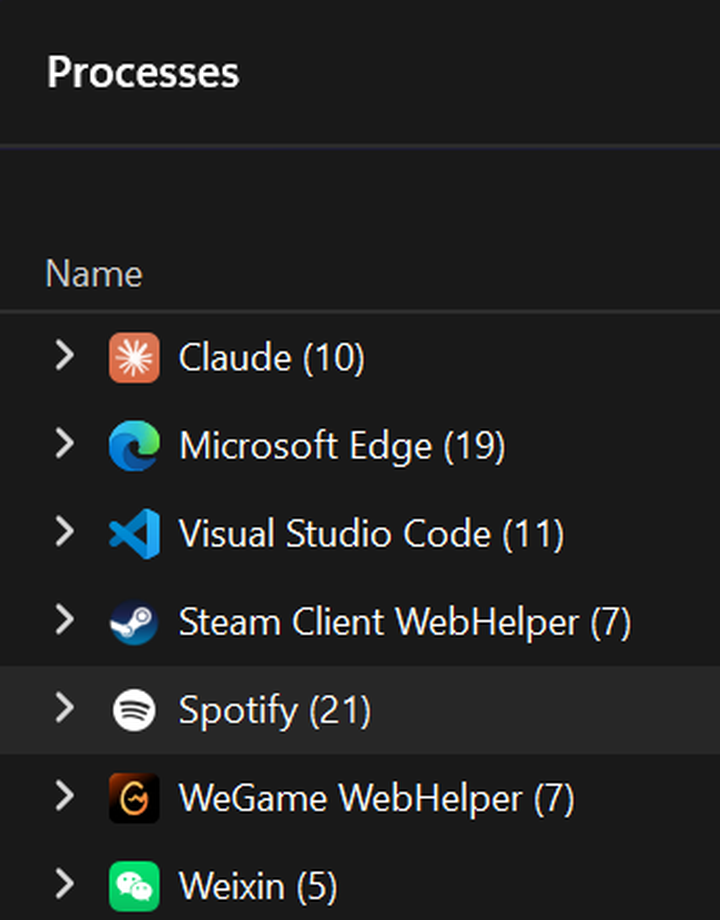
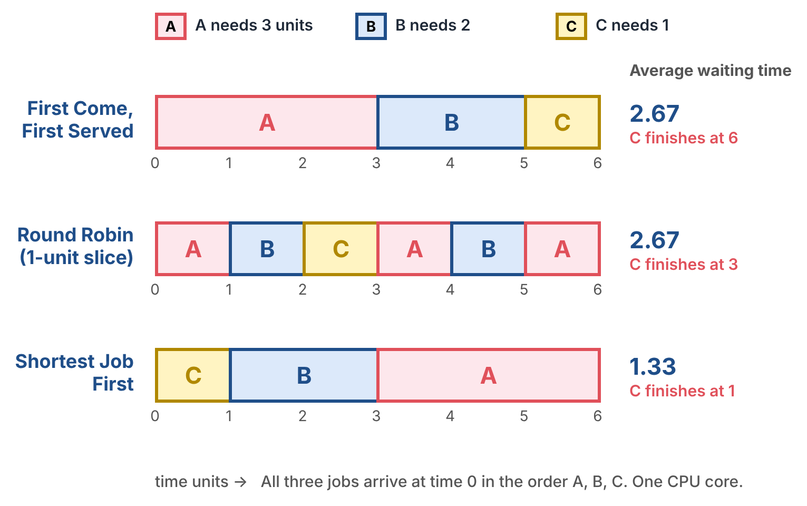
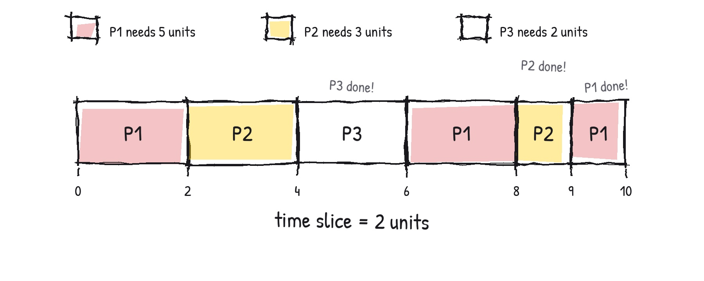
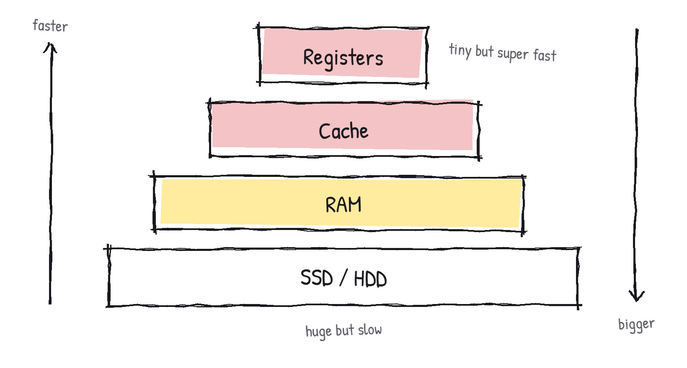
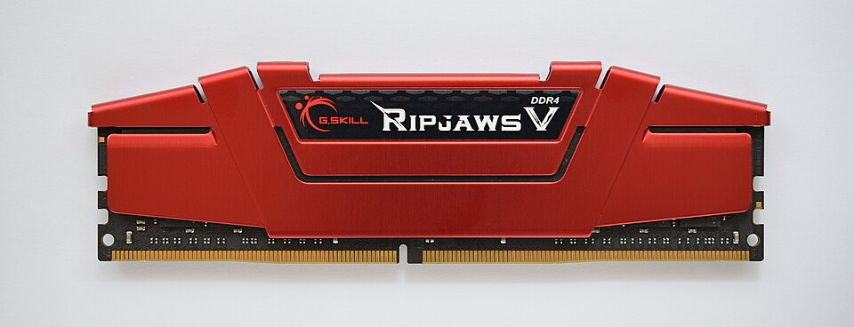

# 1.2 Operating Systems

**Team Members:** Cao Minh Tuan (`@mnhtnc`) & Frederick Samuel Lesmana (`@Ti4nCi`)

**In this section:** [What is an OS?](#1-what-is-an-operating-system) · [History](#2-how-the-operating-system-evolved) · [Types](#3-types-of-operating-systems) · [Platforms](#4-platform-comparison-windows-vs-macos-vs-linux-vs-android-vs-ios) · [Components](#5-the-8-core-components-of-an-os) · [Processes and Threads](#6-processes-and-threads) · [System Calls and Kernel Designs](#7-system-calls-and-kernel-designs) · [Scheduling and Deadlock](#8-cpu-scheduling-and-deadlock) · [Memory](#9-memory-management) · [Files](#10-files-and-file-systems) · [I/O](#11-device-io-management) · [Performance](#12-performance-monitoring) · [Security](#13-security-and-protection) · [Advantages and Disadvantages](#14-advantages-and-disadvantages-of-operating-systems) · [Practice Questions](#15-practice-questions-and-answers) · [References](#16-references)

**Learning goals.** By the end of this section you can:
* explain how an OS lets many programs share one CPU, and trace a process through its states;
* work out when each process finishes under First Come First Served, Shortest Job First and Round Robin, and compare their waiting times;
* explain deadlock, virtual memory, file paths and system calls in your own words.

**Before you start:** read [1.1 System Software](01_System_Software.md), especially the layers (Figure 1.1) and the kernel (Section 6).

**How to read this section.** The core path is Sections 1, 6, 7, 8, 9, 10, 11 and 13. Sections marked *Going further* (2, 3, 4, 5, 12 and 14) give useful background and can be read later.

---

## 1. What is an Operating System?
In 1.1, the hardware was the kitchen and system software was the kitchen staff. Now imagine that kitchen with one stove, one fridge, and ten cooks who all want to use them at the same time. Without a head chef deciding who goes next, the cooks would fight over the stove and nothing would get cooked. A computer has the same problem. Your browser, music player, and chat app all want the same CPU, the same memory (RAM), and the same screen at the same time.

The **Operating System (OS)** is the head chef. It is the main software that runs the computer and sits between your apps and the physical hardware (CPU, RAM, storage, and input/output devices). It decides which program gets the CPU, how much memory each one may use, and who can touch which file (Silberschatz et al., 2018). Without an OS, every app would have to control the hardware itself, and two apps could easily break each other.

Look back at [Figure 1.1 in Section 1.1](01_System_Software.md#2-layers-of-a-computer-system): the OS sits between your apps and the hardware, passing requests down and results back up, with the device drivers running inside it.

An OS has two main parts:
* The **kernel** is the core of the OS. It stays in memory the whole time the computer is on and directly controls the hardware.
* The **shell** is the outer part that you interact with. It takes your commands or clicks and passes them to the kernel.

### What an OS Does
An OS has three basic jobs:
1. **Manage resources.** It shares the CPU, RAM, storage, and devices between all running programs, so no single program takes everything.
2. **Provide a user interface.** It lets people use the computer by clicking or typing instead of writing machine code.
3. **Run applications.** It loads programs into memory and lets many of them run at the same time (**multitasking**).

### CLI vs. GUI
There are two common ways to talk to the shell:
* With a **Command Line Interface (CLI)**, you type text commands, such as `ls` to list files on Linux. It is fast, uses very little memory, and can be automated with scripts, but you have to remember the exact commands. MS-DOS and the Linux terminal are examples.
* With a **Graphical User Interface (GUI)**, you click icons, menus, and windows with a mouse or touchscreen. It is easier for beginners because you can see your options. Windows and macOS desktops are examples.

---

## 2. How the Operating System Evolved
*Going further: background reading, not needed for the rest of the module.*

Operating systems grew step by step, and each step solved a problem from the one before.

* **1940s–early 1950s: no OS.** The first electronic computers had no operating system. Operators entered machine code by hand or rewired plugboards for every new job, so the expensive computer sat idle much of the time.
* **Mid-1950s–1960s: batch systems.** To waste less time, jobs were punched onto cards and run one after another in groups (batches), with no human interaction while they ran.
* **1960s: multiprogramming.** Programs often stop to wait for slow devices such as a tape or disk. Multiprogramming keeps several programs in memory, so when one waits, the CPU switches to another instead of sitting idle.
* **1960s–1970s: time-sharing.** Each program gets a very short turn (a **time slice**) on the CPU. The turns switch so quickly that many users at different terminals feel like they each have the computer to themselves.
* **1970s–1980s: personal computers and GUIs.** Computers became cheap enough for one person, and graphical interfaces with windows, icons, and a mouse made them usable without training.
* **1980s–1990s: network and parallel systems.** Operating systems such as Novell NetWare and Windows NT added built-in file and printer sharing over local networks, and support for computers with more than one CPU.
* **1990s–2000s: mobile.** Early handheld systems (Palm OS, Symbian) were followed by touch-based smartphone operating systems: iOS in 2007 and Android in 2008.
* **2010s–today: cloud and AI.** Modern operating systems are closely tied to cloud storage and include AI assistants such as Siri, Google Assistant, and Copilot.

---

## 3. Types of Operating Systems
*Going further.*

Different jobs need different kinds of operating systems:

1. **Batch OS:** Runs a list of similar jobs automatically, with nobody watching. A bank's overnight payroll run is a good example.
2. **Time-sharing OS:** Switches the CPU between programs very quickly so many apps and users can work at once. Windows and Linux both work this way.
3. **Real-time OS (RTOS):** Must respond within a strict, guaranteed time, because being late is dangerous. A car's airbag system cannot "think about it" for a second.
4. **Distributed OS:** Makes many separate computers on a network work together as if they were one big system, as in cloud computing clusters.
5. **Network OS:** Runs on a server and shares files, printers, and user accounts with the computers connected to it, such as Windows Server.
6. **Mobile OS:** Designed for touchscreens, long battery life, and wireless connections, such as Android and iOS.
7. **Embedded OS:** A small OS built into a device that does one job, such as a smart TV or a Wi-Fi router.

Operating systems can also be grouped as **single-user or multi-user** (how many people can be logged in at once) and **single-tasking or multitasking** (how many programs can run at once).

---

## 4. Platform Comparison: Windows vs. macOS vs. Linux vs. Android vs. iOS
*Going further.*

Most people use one of five operating systems. The table compares them.

| Feature | Windows | macOS | Linux | Android | iOS |
| :--- | :--- | :--- | :--- | :--- | :--- |
| **Maker** | Microsoft | Apple | Open-source community | Google | Apple |
| **Cost** | Paid license | Free with a Mac | Free | Free | Free with an iPhone |
| **Source code** | Closed | Closed | Open | Open base | Closed |
| **Kernel** | Windows NT | XNU (Unix-based) | Linux | Linux | XNU |
| **Runs on** | Most PCs | Macs only | Almost anything | Many phones and tablets | iPhones only |
| **File system** | NTFS | APFS | ext4 | ext4 / F2FS | APFS |
| **Often used for** | Games, office work | Design, video editing | Servers, programming | Most smartphones | Apple users |

A few terms from the table:
* **Open source** means anyone can read, change, and share the source code. Linux is open source, which is why it is free and runs on so many kinds of devices.
* Linux is packaged into different versions called **distributions (distros)**, such as Ubuntu and Fedora. Android is also built on the Linux kernel.
* Older systems worth knowing are **DOS** (command-line only), **OS/2** (made by IBM), and **Unix**. Linux was inspired by Unix, and macOS is itself a certified version of Unix.

---

## 5. The 8 Core Components of an OS
*Going further: a checklist of what the rest of this section explains.*

An OS is not one single program. It is a team of parts, and each one looks after a different resource (Silberschatz et al., 2018):

1. **Process management** creates and stops running programs and decides when each one runs.
2. **Main memory management** keeps track of which parts of RAM are free or in use and gives memory to programs as they open.
3. **File management** creates, deletes, and organizes files and folders, and keeps track of where each file is stored on the disk.
4. **I/O device management** controls devices such as the keyboard, screen, and printer through device drivers.
5. **Secondary storage management** manages space on SSDs and hard drives and decides the order in which disk requests are handled.
6. **Security** makes sure only allowed users and programs can reach each file and each part of memory.
7. **Network management** handles connections to other computers and the internet.
8. **The command interpreter (shell)** reads your commands and asks the rest of the OS to carry them out.

---

## 6. Processes and Threads

### Program vs. Process
A **program** is just a file sitting on your disk, like a recipe in a cookbook. Nothing happens until someone starts cooking. A **process** is a program that is actually running in memory, like a cook following the recipe right now. One program can have several processes. Google Chrome, for example, runs a separate process for each open tab, so if one tab crashes, the others keep working.

### How the OS Keeps Track of Processes
For every process, the OS keeps a record called the **Process Control Block (PCB)**. You can think of it as the process's ID card. It stores the process ID (PID), its current state, where it is in its instructions (the **program counter**), the values in the CPU registers, its memory, its open files, and its priority.

Each CPU core can only run one process at a time (two threads with hyper-threading, as Section 8 explains), so the OS switches between them. When it switches, it saves the current process's progress into its PCB and loads the next process's PCB. This is called a **context switch**. It works like a bookmark: you can stop reading one book, read another, and come back to exactly the same page.

### Process States
A process does not run all the time. It moves between these states, and the OS keeps queues for the processes that are waiting (the Ready and Waiting states):

* **New:** The process has just been created. (Some textbooks call the stage just before it is loaded into memory **Hold**.)
* **Ready:** The process is in memory and waiting in the **ready queue** for its turn on the CPU.
* **Running:** The process is using the CPU right now.
* **Waiting (Blocked):** The process asked for something slow, such as reading a file, and must wait until it finishes. It waits in an **I/O queue**.
* **Terminated:** The process has finished, and the OS takes back its memory.

*Figure 1.3: The five process states and the events that move a process between them.*

Figure 1.3 shows how a process moves between the states. Follow the arrows:
* **New → Ready:** The OS admits it and puts it in the ready queue.
* **Ready → Running:** The scheduler picks it.
* **Running → Waiting:** It asks for I/O, for example to read a file.
* **Waiting → Ready:** The I/O is done, so it lines up again.
* **Running → Ready:** Its time slice ran out, or a more important process needs the CPU.
* **Running → Terminated:** It finished.

If RAM is full, the OS can also move a process out to disk for a while (**suspended**) and bring it back to **Ready** later.

### Threads
A **thread** is a smaller worker inside a process. All the threads of one process share the same memory, so they are quicker to create and switch between than whole processes. Inside one browser tab's process, for example, one thread can load the web page while another plays a video.

---

## 7. System Calls and Kernel Designs
Apps are not allowed to touch the hardware directly. If they could, one buggy app could wipe your disk or freeze the whole computer. Instead, the CPU runs in two modes:
* **User mode**, used by normal apps, has limited rights.
* **Kernel mode**, used by the OS kernel, has full control of the hardware.

When an app needs something only the kernel can do, such as saving a file, it makes a **system call**. A system call works like a bank counter: you cannot walk into the vault yourself, so you ask the teller, who checks that you are allowed and then does it for you.

Some common system calls on Linux and macOS:
* **Processes:** `fork()` to create a new process, `exit()` to end one
* **Files:** `open()`, `read()`, `write()`, `close()`
* **Memory:** `mmap()` to ask for more memory
* **Communication:** `socket()` to open a connection, `send()`/`recv()` to send and receive data over the network

On Windows, apps usually call API functions such as `CreateProcess()` and `ReadFile()`, which make the real system calls for them. Even `printf()` in a C program ends up making the `write()` system call to show text on the screen.

### Kernel Designs
Kernels are designed in different ways. The question is how much of the OS should live inside the kernel, in kernel mode:

| Kernel type | Main idea | Examples |
| :--- | :--- | :--- |
| **Monolithic** | Almost everything, including drivers and file systems, runs inside one big kernel. It is very fast, but one bug can crash the whole system. | Linux |
| **Microkernel** | The kernel is kept tiny, and drivers and file systems run outside it as separate programs. If one crashes, it can be restarted, so the system is very stable, but slightly slower. | MINIX, QNX |
| **Hybrid** | A mix of both: mostly fast like a monolithic kernel, but more modular. | Windows, macOS |

---

## 8. CPU Scheduling and Deadlock

### How Can Hundreds of Programs Run on a Few Cores?
Open Task Manager on a Windows laptop (Ctrl + Shift + Esc) and look at the Processes tab. On one of our team's laptops, just seven apps were running **80 processes**, Spotify alone was running 21, and the whole computer had **over 400 processes**. Yet the laptop has only **8 CPU cores**. With hyper-threading, each core can hold two threads at once, so Windows shows **16 logical processors**: at most 16 things can truly run at the same moment.

*Figure 1.4: Task Manager on a team member's laptop. Seven apps are running 80 processes between them.*

So how do 400 processes share 16? Think of a chess grandmaster playing 20 boards at once. She makes one move, walks to the next board, makes a move there, and keeps going round. Every player feels they are in a game, but she only ever plays one board at a time. A CPU core works the same way:

| Chess simul | Computer |
| :--- | :--- |
| The grandmaster | One CPU core |
| Each board | A process |
| Each move | A **time slice** (a few milliseconds of CPU time) |
| Walking to the next board | A **context switch** |
| Deciding which board is next | The **scheduler** |

Each process gets only a few milliseconds before the core moves on, and the core switches hundreds of times every second. Because the switching is so fast, every program seems to run all the time.

### Concurrency vs. Parallelism
* **Concurrency** means taking turns on *one* core so quickly that several programs seem to run at once, like the grandmaster.
* **Parallelism** means *several* cores really running at the same moment, like eight grandmasters in eight rooms.

Your laptop does both: its 8 cores run in parallel, and each core switches between many processes concurrently.

### Scheduling
Many processes are ready to run, but each CPU core can only run one at a time. (In our examples, one core runs one process.) The OS **scheduler** decides who goes next. Its goals are to be fair, to keep the CPU busy, and to make sure no process waits forever.

There are two styles:
* With **preemptive** scheduling, the OS can pause a running process to let another one run.
* With **non-preemptive** scheduling, a process keeps the CPU until it finishes or waits for I/O.

To compare scheduling methods, we measure two things for each process:
* **Finish time:** when the process is completely done.
* **Waiting time:** how long the process spent ready but not running. For processes that all arrive at time 0, waiting time = finish time − the CPU time the process needs.

Four common scheduling methods, using the example of a supermarket checkout:
1. **First Come, First Served (FCFS):** Customers are served in the order they arrive. It is simple, but one customer with a full cart makes everyone with one item wait.
2. **Shortest Job First (SJF):** Customers with the fewest items go first. When all jobs are ready together, this gives the **lowest average waiting time** of any order. It has two catches. The OS does not know in advance how long a job will take, so it has to estimate from how long the job ran before. And the person with a full cart might **starve**, meaning they never get served if short jobs keep arriving.
3. **Priority scheduling:** The most important process goes first. To stop low-priority processes from starving, the OS can slowly raise the priority of anyone who has waited a long time. This is called **aging**.
4. **Round Robin:** Everyone gets a short, equal turn (a **time slice**), then goes to the back of the line. This is fair, and it is why desktop systems feel smooth even with many apps open.

### Worked Example: Three Ways to Schedule A, B and C
The worked example uses three of the four methods. Priority scheduling works like SJF, except that the OS picks by importance instead of by length.

Three processes arrive at time 0 in the order A, B, C, on one CPU core. A needs 3 units of CPU time, B needs 2, and C needs 1.

*Figure 1.5: The same three jobs scheduled three ways. Average waiting time is shown on the right.*

| Method | Order on the CPU | Finish A, B, C | Waiting A, B, C | Average waiting time |
| :--- | :--- | :--- | :--- | :--- |
| **FCFS** | A A A B B C | 3, 5, 6 | 0, 3, 5 | 8 ÷ 3 ≈ **2.67** |
| **Round Robin** (1-unit slice) | A B C A B A | 6, 5, 3 | 3, 3, 2 | 8 ÷ 3 ≈ **2.67** |
| **SJF** | C B B A A A | 6, 3, 1 | 3, 1, 0 | 4 ÷ 3 ≈ **1.33** |

Three things to notice in Figure 1.5:
* **Round Robin does not make the total work faster.** All three methods finish everything at time 6, and here FCFS and Round Robin even have the same average waiting time. What Round Robin changes is that the short job C no longer waits behind the long job A: C finishes at 3 instead of 6, and every process starts its first turn by time 2.
* **SJF has the lowest average waiting time**, because the short jobs get out of the way first. But if new short jobs kept arriving, A could wait forever. That is starvation.
* **Switching is not free.** Each switch is a context switch: the CPU saves the current process's program counter and registers into its PCB and loads the next one. The timelines above pretend switching takes no time. In a real computer, Round Robin's five switches each cost a little time.

### Choosing the Time Slice
Round Robin depends on the size of the time slice:
* **Too small:** the CPU spends most of its time switching between processes instead of running them.
* **Too large:** each process runs for a long time before the next one gets a turn, so Round Robin behaves like FCFS and the computer feels slow to respond.

Real operating systems use slices of a few milliseconds, and mix priorities with Round Robin.

*Figure 1.6: Round Robin with a time slice of 2. Each process gets a short turn on the CPU, then goes to the back of the line.*

In Figure 1.6, the time slice is 2 units. P1 needs 5 units, P2 needs 3, and P3 needs 2. P3 finishes first at time 6 because it only needed one turn. P2 finishes at 9, and P1, the longest job, finishes last at 10.

### Activity: Be the Scheduler
**Goal:** predict when each process finishes, then check yourself.

**Online (optional):** open the *Be the Scheduler* game at <https://schedulercpu.netlify.app>. The same game is in this repository at [`activities/be_the_scheduler/index.html`](../../activities/be_the_scheduler/index.html) and opens in any browser without internet.

**On paper (no computer needed):**
1. Draw a time line from 0 to 6 and split it into six boxes.
2. Jobs A = 3, B = 2 and C = 1 arrive at time 0 in that order. Fill in the boxes for FCFS, then on a second line for Round Robin with a 1-unit slice.
3. Write down when C finishes in each case.
4. Now three new jobs arrive at time 0 in the order X = 5, Y = 1, Z = 2. Under Round Robin with a 1-unit slice, which job finishes first, and when?

Check your answers

* FCFS: A A A B B C, so C finishes at **6**. Round Robin: A B C A B A, so C finishes at **3**. The total time is 6 in both cases.
* New jobs: X Y Z X Z X X X. **Y finishes first, at time 2.** Z finishes at 5 and X at 8.
* If your timelines differ, check that each Round Robin turn is exactly 1 unit and that a finished job leaves the line.

### Deadlock
Picture two people eating noodles who only have two chopsticks between them. Person A picks up one chopstick and waits for the second. Person B picks up the other chopstick and waits for the first. Neither will let go, so neither can ever eat. This is a **deadlock**: two or more processes stuck forever, each waiting for something the other is holding.

A deadlock can only happen when all **four conditions** are true at once (Silberschatz et al., 2018):
1. **Mutual exclusion:** Only one process can use the resource at a time (only one person can hold a chopstick).
2. **Hold and wait:** A process keeps what it has while waiting for more (each person holds one chopstick).
3. **No preemption:** Nobody can take a resource away by force (you cannot grab a chopstick from someone's hand).
4. **Circular wait:** The processes wait for each other in a loop (A waits for B, and B waits for A).

The OS can deal with deadlock in three ways:
* **Prevention:** Make sure one of the four conditions can never happen, for example by making a process ask for everything it needs at the start.
* **Avoidance:** Check each request ahead of time and refuse it if it could lead to deadlock.
* **Detection and recovery:** Let it happen, notice it, then stop one of the stuck processes.

**Starvation** is different. In a deadlock, nobody can move. With starvation, the system keeps working, but one unlucky process keeps getting skipped.

---

## 9. Memory Management
A program has to be in **RAM** to run, but RAM is limited and shared by every running program. Memory management decides who gets which part of RAM and keeps programs from touching each other's memory.

*Figure 1.7: Memory hierarchy. Faster and smaller at the top, slower and bigger at the bottom.*

Figure 1.7 shows the trade-off. The fastest memory (CPU registers and cache) is tiny and expensive, while the biggest storage (SSD and HDD) is cheap but much slower. RAM sits in the middle.

| Memory type | Keeps data without power? | Speed | Typical size | Cost |
| :--- | :--- | :--- | :--- | :--- |
| **RAM (main memory)** | No (volatile) | Very fast | 8–64 GB | Expensive per GB |
| **SSD / HDD (storage)** | Yes (non-volatile) | Slower | 256 GB – 4 TB+ | Cheap per GB |

*Photo: a DDR4 RAM module for a desktop PC. Its chips hold the running programs and their data, and lose everything when the power goes off. Photo by ElooKoN, [CC BY-SA 4.0](https://creativecommons.org/licenses/by-sa/4.0/), via Wikimedia Commons.*

### Key Ideas
* **Paging:** The OS splits memory into small, equal-sized blocks. A program's blocks are called **pages**, and the matching blocks in RAM are called **frames**. Because all blocks are the same size, the OS can fit a program into any free frames, even if they are not next to each other, like parking cars in any free spaces in a car park.
* **Segmentation:** Instead of equal blocks, memory is split into meaningful parts of a program, such as its code, its data, its heap and its stack.
* **Virtual memory:** Each program gets its own private memory space and behaves as if it has the whole memory to itself. A hardware part called the **MMU (Memory Management Unit)** translates these private (virtual) addresses into real RAM addresses. Because of this, the OS can keep pages that are rarely used on the disk and act as if there is more RAM than there really is (Tanenbaum & Bos, 2022).
* **Demand paging:** A page is only loaded into RAM when the program actually needs it.
* **Page fault:** This happens when a program needs a page that is not in RAM yet, so the OS has to fetch it from the disk.
* **Swapping:** Moving a whole inactive process from RAM to the disk and back.
* **Thrashing:** If RAM is far too full, the OS spends almost all its time moving pages between RAM and disk instead of doing real work, and the computer becomes extremely slow.

---

## 10. Files and File Systems
RAM forgets everything when the power goes off, so anything you want to keep is saved as a **file** on the SSD or hard drive. The part of the OS that looks after files is the **file system**.

* A **file** is a named collection of data, such as an essay or a photo. Besides the data, the OS keeps **metadata**: information *about* the file, such as its size, when it was created and changed, and who owns it.
* **Folders** (also called **directories**) hold files and other folders, so all the files on a drive form a **tree**.
* A **path** is the address of a file in that tree. An **absolute path** starts from the top (the root), such as `C:\Users\Mei\Documents\essay.docx` on Windows or `/home/mei/Documents/essay.txt` on Linux and macOS. A **relative path** starts from the folder you are already in, such as `Documents/essay.txt`.

*Figure 1.8: Files and folders form a tree. A path is the route from a folder down to a file.*

Under the hood, a drive is just millions of numbered blocks. The file system keeps a record of which blocks belong to which file, and which blocks are free. Different operating systems use different file systems: **NTFS** on Windows, **APFS** on macOS and iOS, **ext4** on Linux, and **FAT32** or **exFAT** on USB sticks, because almost every device can read them. Many file systems, such as NTFS and ext4, also keep a **journal**, a short log of changes, so that the disk is not left in a broken state if the power cuts out while saving.

The file system also stores **permissions**: who may read, write or run each file. Section 13 explains how the OS uses them.

---

## 11. Device (I/O) Management
Every device, from a keyboard to a Wi-Fi card, works differently. The OS hides these differences so apps can simply say "print this" or "read this file." Devices fall into four groups: **input** (keyboard), **output** (screen), **storage** (SSD), and **network** (Wi-Fi).

When an app uses a device, the request travels like this:

**App → system call → OS → device driver → device controller → device**

When the device has finished, it sends an **interrupt** back to the CPU to say "I'm done."

Important ideas in I/O:
* A **device driver** is a small program that translates general OS commands into the exact commands one specific device understands.
* **Interrupts vs. polling:** With **polling**, the CPU keeps asking the device "are you done yet?", which wastes time. With **interrupts**, the CPU gets on with other work and the device taps it on the shoulder when it is ready. Interrupts are like a restaurant buzzer; polling is like walking to the counter every minute to check.
* **DMA (Direct Memory Access)** lets a device copy large amounts of data straight into RAM without the CPU moving every byte.
* **Buffering** holds data for a moment to smooth out speed differences. A video player buffers a few seconds ahead so playback does not stutter.
* **Caching** keeps a fast copy of data that is used often.
* **Spooling** lines up jobs for a slow device. When several people print at once, the jobs wait in a print queue.
* **Plug and Play** means the OS notices new hardware, such as a USB mouse, and loads the right driver automatically.

---

## 12. Performance Monitoring
*Going further.*

When a computer feels slow, the OS can show you why. Useful things to check are CPU usage, RAM usage, disk activity, network speed, and the number of page faults.

Warning signs include a CPU stuck near 100%, RAM that is completely full, and constant disk activity, which usually means thrashing.

Each OS has its own tools (Figure 1.4 shows one):
* **Windows:** Task Manager, Resource Monitor
* **macOS:** Activity Monitor
* **Linux:** `top`, `htop`, `free`, `vmstat`
* **Android and iOS:** battery and storage settings

To fix a slow computer, close apps you are not using, remove programs that start automatically, install updates, scan for malware, and if needed add more RAM or switch to an SSD.

---

## 13. Security and Protection
The OS guards the computer in two directions:
* **Protection** controls what users and programs *inside* the computer may access. For example, one app should not be able to read another app's memory.
* **Security** defends the computer against attacks from *outside*, such as viruses and hackers.

It also separates two steps:
* **Authentication** checks *who you are*, using a password, fingerprint, or Face ID.
* **Authorization** decides *what you are allowed to do* once you are in, such as which files you can open or change.

To do this, the OS uses separate user and administrator (`root`) accounts, file permissions (read, write, and execute, or `rwx` on Linux), memory protection, encryption, firewalls, regular security updates, and **sandboxing**, which keeps each app in its own closed box. Common threats include viruses, worms, trojans, ransomware, and phishing.

---

## 14. Advantages and Disadvantages of Operating Systems
*Going further.*

| Advantages | Disadvantages |
| :--- | :--- |
| Manages hardware and drivers automatically | A serious OS crash can lose unsaved work |
| Lets many apps run at once | Is a target for viruses and other attacks |
| Keeps files organized on storage | Needs regular security updates |
| Shares the CPU and RAM fairly | Uses some CPU, RAM, and disk space itself |

*How the OS itself is loaded when the computer starts is covered in [1.1 System Software, Section 5](01_System_Software.md#5-the-boot-process).*

---

## 15. Practice Questions and Answers
Try each question yourself first, then open the answers to check.

**Questions**
1. What is the difference between a program and a process?
2. What is stored in a PCB, and why does the OS need it during a context switch?
3. A process asks to read a file. Which state does it move to, and where does it go when the read is finished?
4. Why do apps use system calls instead of controlling the hardware directly?
5. With Round Robin and a time slice of 2, processes need 4, 1, and 3 units and arrive in that order. In what order do they finish?
6. Two processes are deadlocked. Name the four conditions that must all be true.
7. What is thrashing, and how can you fix it?
8. What is the difference between an interrupt and polling?
9. Jobs P = 2, Q = 4 and R = 1 arrive at time 0 in that order. Work out the average waiting time under FCFS and under SJF.
10. Your laptop has 8 cores and Task Manager shows 400 processes. Is it running them concurrently, in parallel, or both? Explain.
11. You are in the folder `/home/mei`. Write the absolute path and the relative path to `cat.jpg` in Figure 1.8.

<b>Show answers</b> (try the questions first!)

1. A program is a file stored on disk. A process is that program actually running in memory.
2. The PCB stores the process ID, state, program counter, CPU registers, memory, open files, and priority. During a context switch, the OS saves the current process's progress into its PCB so it can continue later from exactly the same point.
3. It moves from **Running** to **Waiting**. When the read is finished, it moves to **Ready** and waits for its next turn on the CPU.
4. For safety. Apps run in user mode, so a buggy or harmful app cannot damage the hardware or other apps. The kernel checks each request and does the hardware work itself.
5. Work through it one turn at a time: P1 runs 0–2, P2 runs 2–3 and finishes, P3 runs 3–5, P1 runs 5–7 and finishes (its 4 units are done), then P3 runs 7–8 and finishes. So P2 finishes at 3, P1 at 7, and P3 at 8, giving the finish order **P2, P1, P3**.
6. Mutual exclusion, hold and wait, no preemption, and circular wait.
7. Thrashing is when RAM is so full that the OS spends most of its time moving pages between RAM and disk, so the computer becomes very slow. You can fix it by closing programs or adding more RAM.
8. With polling, the CPU keeps checking whether a device is ready. With an interrupt, the device signals the CPU when it is ready, so the CPU can do other work in the meantime.
9. **FCFS** runs P (0–2), Q (2–6), R (6–7), so the waiting times are 0, 2 and 6, and the average is 8 ÷ 3 ≈ **2.67**. **SJF** runs R (0–1), P (1–3), Q (3–7), so the waiting times are R 0, P 1 and Q 3, and the average is 4 ÷ 3 ≈ **1.33**. SJF is lower because the short jobs go first.
10. Both. The 8 cores run 8 processes (16 threads with hyper-threading) at the same moment, which is parallelism. Each core also switches between many processes in turn, which is concurrency.
11. Absolute path: `/home/mei/Pictures/cat.jpg`. Relative path from `/home/mei`: `Pictures/cat.jpg`.

---

## 16. References
1. Silberschatz, A., Galvin, P. B., & Gagne, G. (2018). *Operating System Concepts* (10th ed.). Wiley.
2. Tanenbaum, A. S., & Bos, H. (2022). *Modern Operating Systems* (5th ed.). Pearson.
3. BIT2026 Foundations of CS & AI, course lecture slides: Operating Systems module (2026).
4. Mickey Mouse Team (2026). *Mini lecture SW3: How does an operating system make many programs appear to run at once?* Pre-recorded lecture and the Be the Scheduler game.
