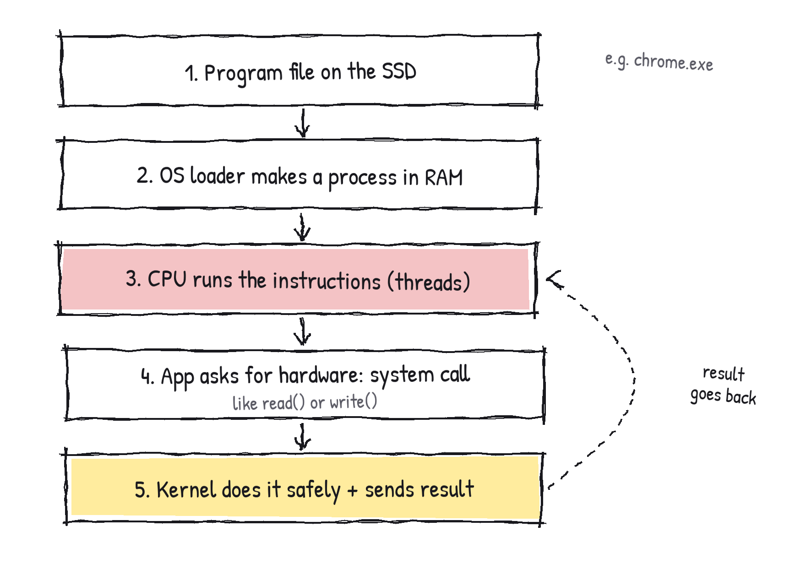
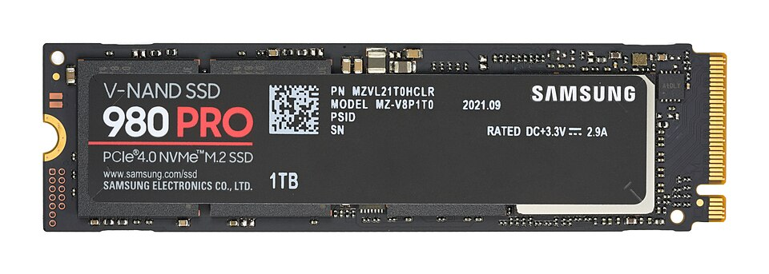
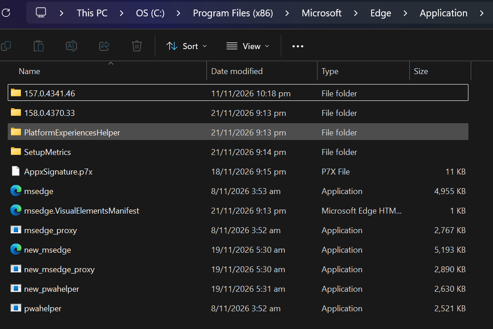
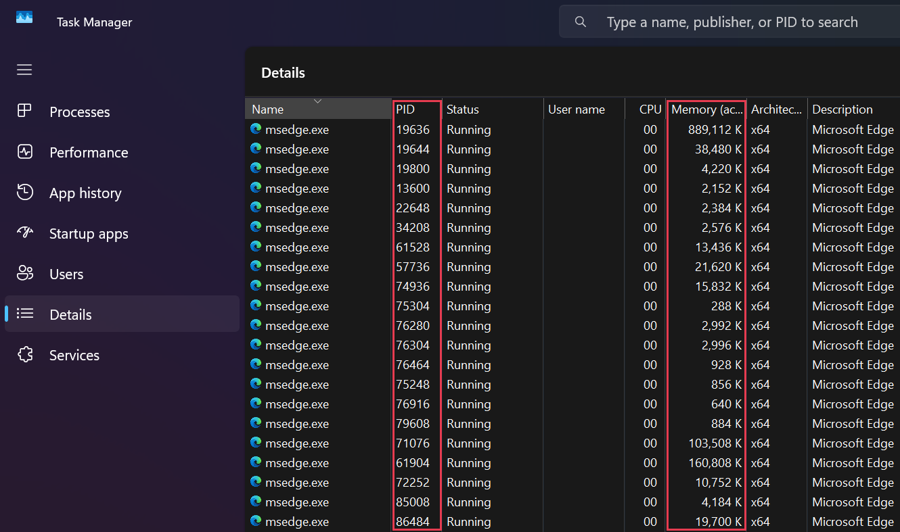

# 1.3 Application Software

**Team Member:** Lu My Ky (`@jojolu11`)

**In this section:** [What is Application Software?](#1-what-is-application-software) · [The Execution Lifecycle](#2-what-happens-when-you-open-an-app) · [Types of Applications](#3-types-of-application-software) · [How Apps Are Built](#4-how-apps-are-built-native-vs-web-vs-cross-platform) · [Lab 1.3: Follow an App from File to Process](#lab-13-follow-an-app-from-file-to-process) · [Practice Questions](#5-practice-questions-and-answers) · [References](#6-references)

**Learning goals.** By the end of this section you can:
* explain the difference between application software and system software;
* describe the five steps from double-clicking an app to the kernel sending back a result;
* compare native, web and cross-platform apps and choose one for a given job.

**Before you start:** read [1.1 System Software](01_System_Software.md) and [1.2 Operating Systems](02_Operating_Systems.md), especially processes (1.2 Section 6) and system calls (1.2 Section 7).

---

## 1. What is Application Software?
In [1.1 System Software](01_System_Software.md), we compared a computer to a restaurant: the hardware is the kitchen, and system software is the kitchen staff. **Application software** is the dishes you actually ordered. It is the reason you use the computer at all.

An **application** (or **app**) is a program made to help a person do a specific task: writing an essay in Word, editing a photo in Photoshop, or watching a video in Chrome. Apps run **on top of** the operating system. They do not control the hardware themselves; they ask the OS to do that for them.

The simplest way to tell the two kinds of software apart is to ask *who it works for*:
* **Application software** works for **you**. You open it on purpose to get something done.
* **System software** works for **the computer**. It runs in the background so that apps can work.

### Where Apps Live: User Space
Every app runs in a protected area of memory called **user space**. From there it cannot directly control devices, reach other programs' memory, or change protected CPU settings. Only the kernel, which runs in **kernel space**, has full access to the hardware. When an app needs something from the hardware, such as saving a file, it has to ask the kernel through a **system call**. (User mode, kernel mode, and system calls are explained in detail in [1.2 Section 7](02_Operating_Systems.md#7-system-calls-and-kernel-designs).)

---

## 2. What Happens When You Open an App
Double-clicking an icon feels instant, but behind the scenes the app goes through five steps (our summary, adapted from Arpaci-Dusseau & Arpaci-Dusseau, 2018). Let's follow what happens when you open Google Chrome.

*Figure 1.9: The 5 steps of running an app, from a file on the SSD to the kernel sending back a result.*

Figure 1.9 shows the five steps from top to bottom. The dashed arrow on the right is the loop: after the kernel sends back a result, the app goes back to running its instructions in Step 3.

### Step 1: The program file sits on the SSD
Before you click, Chrome is just a file on your drive (`chrome.exe` on Windows). It contains machine code and data, but it is not doing anything. It is like a recipe in a closed cookbook.

*Photo: an M.2 NVMe SSD (Samsung 980 PRO, 1 TB), the kind of drive where program files such as `chrome.exe` are stored. It keeps its data when the power is off. Photo by D-Kuru, [CC BY-SA 4.0](https://creativecommons.org/licenses/by-sa/4.0/), via Wikimedia Commons.*

### Step 2: The OS loader turns it into a process in RAM
When you click the icon, a part of the OS called the **loader** copies the program from the SSD into RAM, because RAM is far faster for the CPU to read. (In practice, the OS loads the program's pages only as they are needed: this is demand paging, from 1.2 Section 9.) The OS then creates a **process** (the running copy of the program) and a **Process Control Block (PCB)** to keep track of it.

The OS also gives the process its own memory, divided into four areas:
* **Code:** the program's instructions.
* **Data:** values that exist for the whole time the program runs.
* **Stack:** short-term memory for the function calls in progress (their local variables and where to return to). It grows and shrinks as functions start and finish.
* **Heap:** memory the program asks for while it runs, for example when you open a large photo.

### Step 3: The CPU runs the instructions
The OS scheduler gives the process a turn on the CPU. The CPU then repeats the same three-step cycle billions of times per second:
1. **Fetch** the next instruction from memory.
2. **Decode** it to work out what it means.
3. **Execute** it.

Inside the process, **threads** do the actual work. Chrome, for example, can use one thread to draw the page and another to download an image at the same time. Threads share their process's memory. Browsers use both: a separate process for each website, for safety, and several threads inside each process (Microsoft Edge, used in the lab below, is built on Chrome's engine, Chromium, and works the same way).

### Step 4: The app asks for hardware with a system call
Sooner or later the app needs the hardware. It might need to save a file, show a picture, or load a web page. Because it runs in user space, it cannot do this itself. Instead, it makes a **system call**, such as `open()` to open a file, `write()` to save one, or `socket()` to use the network. At this moment the CPU switches from **user mode** into **kernel mode**.

### Step 5: The kernel does the work safely and returns the result
The kernel first checks that the app is allowed to make the request. For example, is this app allowed to write to this folder? It then uses the right **device driver** to do the hardware work, sends the result back to the app, and switches the CPU back to user mode. The app continues from Step 3, and the loop repeats until you close it.

### Why Computers Work This Way
This might seem like a lot of steps just to save a file, but it gives three big benefits (Silberschatz et al., 2018):
* **Safety:** A buggy or harmful app cannot damage the hardware or read another app's memory, because each app has its own private memory space and the kernel checks every hardware request.
* **Sharing:** Many apps can use the same CPU, RAM, and devices at once, because the OS decides who gets what.
* **Simplicity for developers:** App makers do not need to write code for every printer or graphics card in the world. They ask the OS, and the drivers handle the details.

---

## 3. Types of Application Software
There are thousands of apps, but most of them fit into a few groups based on the job they help you do:

| Type | What it helps you do | Examples |
| :--- | :--- | :--- |
| **Word processing** | Write and format text documents | Microsoft Word, Google Docs, Apple Pages |
| **Spreadsheet** | Organize numbers in rows and columns and calculate with formulas | Microsoft Excel, Google Sheets, Apple Numbers |
| **Presentation** | Build slides for talks and lectures | PowerPoint, Google Slides, Keynote |
| **Multimedia** | Create, edit, and play audio and video | DaVinci Resolve, Audacity, VLC Media Player |
| **Web browser** | Open websites and web apps | Chrome, Firefox, Edge, Safari |
| **Educational** | Learn new skills and track progress | Duolingo, Khan Academy, Moodle |
| **Graphics** | Edit photos, draw, and design in 2D or 3D | Photoshop, Illustrator, Figma, Blender |
| **Simulation** | Model real situations to test them safely | MATLAB/Simulink, Microsoft Flight Simulator |

A few things to notice:
* **The type depends on the job, not the company.** Microsoft makes Word (word processing) and Excel (spreadsheet) and publishes Flight Simulator (simulation): three different types from one company.
* **Some apps fit more than one type.** Canva can make presentations *and* graphics. Blender is used for 3D graphics *and* animation.
* **Simulation software is used where real tests are expensive or dangerous.** Pilots train in flight simulators before flying a real plane, and engineers test a bridge design in software before building it.

---

## 4. How Apps Are Built: Native vs. Web vs. Cross-Platform
The same kind of app can be built in very different ways, and the choice affects how fast it runs, how much memory it uses, and which devices it works on.

### Native Apps
A **native app** is written for one specific operating system, usually in that platform's main language: **Swift** for iPhone and Mac, **C++ or C#** for Windows, and **Kotlin** for Android. It is built to fit that one OS. C++ and Swift are turned into code the CPU runs directly; C# and Kotlin usually run on a fast runtime that comes with the platform.
* **Pros:** It is usually the fastest option, uses the least memory, and has full access to the device's features (camera, GPU, sensors) through the OS.
* **Cons:** It only works on one OS. To support Windows, macOS, Android, and iPhone, the company must build and maintain four separate versions.
* **Examples:** Microsoft Word on Windows, Final Cut Pro on Mac.

### Web Apps
A **web app** runs inside a web browser and is built with **HTML, CSS, and JavaScript**. Usually there is nothing to install: you just open a link. (Some web apps can also be installed as a *progressive web app*, but they still run on the browser's engine.)
* **Pros:** It works on any device that has a browser, and everyone always has the latest version, because the app lives on the server.
* **Cons:** It usually needs an internet connection, has limited access to the hardware, and often runs slower than a native app because the browser sits in between.
* **Examples:** Google Docs, Canva, Figma in the browser.

### Cross-Platform Apps
A **cross-platform app** is written once and then runs on several operating systems. The two most common approaches work quite differently (Electron, n.d.; Flutter, n.d.).

**Electron (desktop)**
* Packs a web app together with its own copy of the Chrome browser engine (Chromium) and Node.js, so it can be installed like a normal desktop app.
* **Pros:** One codebase runs on Windows, macOS, and Linux, which saves a lot of time and money.
* **Cons:** Heavy. Every Electron app carries its own browser engine, so having Discord, Slack, and VS Code open is a bit like running three extra copies of Chrome.
* **Examples:** VS Code, Discord, Slack, Obsidian.

**Flutter and React Native (mainly mobile)**
* Let one codebase build apps for both Android and iPhone, without carrying a whole browser engine. **Flutter** draws the whole interface itself with its own engine (and can also target desktop and web); **React Native** runs JavaScript that controls the phone's own buttons and lists.
* **Pros:** One codebase for two platforms, and usually much closer to native speed than Electron.
* **Cons:** Brand-new phone features can take extra work to use, because the framework has to support them first.
* **Examples:** Google Pay (Flutter); parts of the Instagram and Facebook apps (React Native).

### Comparison

| Feature | Native | Web | Electron | Flutter / React Native |
| :--- | :--- | :--- | :--- | :--- |
| **Works on** | One OS | Any device with a browser | Windows, macOS, Linux | Mainly Android and iPhone |
| **Layers to the OS** | App → OS | App → browser → OS | App → its own Chromium → OS | App → framework → OS |
| **Speed** | Usually fastest | Slower | Similar to a web app | Close to native |
| **Memory use** | Lowest | Shares the browser you already have open | Highest (each app has its own engine) | Low to medium |
| **Hardware access** | Full (via OS APIs) | Limited | Good | Good |
| **Install needed?** | Yes | Usually no | Yes | Yes |

**The main trade-off:** the more layers sit between an app and the hardware (see the "Layers to the OS" row), the slower it usually runs; carrying its own engine, as Electron does, also makes it heavier on memory. The more native an app is, the faster it runs, but the more work it takes to support every platform. Companies choose based on what matters most to them. A video editor needs speed, so it is usually native. A chat app needs to be everywhere quickly, so it often uses Electron.

---

## Lab 1.3: Follow an App from File to Process

* **Goal:** See Steps 1 and 2 of Figure 1.9 on your own computer: one program file on the drive, and the processes the OS creates from it.
* **Preparation:** A Windows 10 or 11 computer with Microsoft Edge (it comes with Windows) and about 15 minutes; re-read §2. You only look, so nothing on your computer changes. On a Mac or on Linux, follow the notes at the end of the task. No computer? Use the screenshots from a team member's laptop below and the typical results in the feedback box.
* **Task:**

  **Step 1, predict:** you open Edge with one tab. How many processes will it use: 1, between 2 and 5, or more than 5?  
  **Step 2, count the processes:** open Edge with one tab. Press **Ctrl + Shift + Esc** to open Task Manager (if it opens as a small window, click **More details**). On the **Processes** page, find **Microsoft Edge**. The number in brackets after the name is how many processes it is using (Figure 1.4 in [1.2 Section 8](02_Operating_Systems.md#8-cpu-scheduling-and-deadlock) shows an example: *Microsoft Edge (19)*). Write it down.  
  **Step 3, find the program file (Step 1 of the lifecycle):** right-click **Microsoft Edge** and choose **Open file location**. File Explorer opens the folder that holds `msedge.exe`. Write down the folder path shown in the address bar.  
  **Step 4, see the processes (Step 2 of the lifecycle):** in Task Manager, open the **Details** page and click the **Name** column heading to sort the list. Scroll to `msedge.exe`. Count its rows, and look at the **PID** and **Memory** columns.  
  **Step 5, change something:** in Edge, open three new tabs with three different websites. Go back to the **Processes** page and read the number in brackets again. Then close those three tabs and read it once more.

  *On a Mac:* open **Activity Monitor** (press **Command + Space** and type *Activity Monitor*), open your browser with a few websites, and look for your browser's processes in the list. The browser's program file is in the **Applications** folder.

  *On Linux (for example Ubuntu with Firefox):* open Firefox with one tab, then open a **Terminal** (**Ctrl + Alt + T**). For Steps 2 and 5, `pgrep -c -f firefox` prints how many processes Firefox is using. For Step 3, `command -v firefox` shows the command that starts it; the real program file is the path at the start of the first line printed by `pgrep -a -f firefox`. For Step 4, `pgrep -a -f firefox` lists every Firefox process with its own PID. The **System Monitor** app shows the same processes with their memory, although the helpers have names such as *Isolated Web Co* instead of *firefox*.

  

  *Lab screenshot: Step 3 on a team member's laptop. The application `msedge` is the program file `msedge.exe` (Windows hides the `.exe` ending by default); the folders named with numbers hold files for each Edge version.*

  

  *Lab screenshot: Step 4 on a team member's laptop. Every msedge.exe row is a separate Edge process with its own PID and memory, and the list continues below. The User name column was blanked.*

* **Observation:** Record the number in brackets from Step 2 and from both parts of Step 5, the folder path from Step 3, and the number of `msedge.exe` rows from Step 4.
* **Reflection:**
  1. `msedge.exe` is stored only once on the drive, yet the Details page shows many `msedge.exe` rows. Which step of the lifecycle creates them, and what does the OS keep for each one?
  2. Every row has its own PID and its own memory. Why might a browser run each website in a separate process instead of as threads inside one process? (Hint: *Why Computers Work This Way* in §2, and Practice Question 5.)
  3. What happened to the number when you opened and closed tabs? What does this show about when processes start and end?
  4. If VS Code, Discord or Slack is installed, open it and find it on the Processes page. Why does it also show several processes and use a lot of memory (§4)?

<b>Feedback: check your findings</b>

* **Step 2:** Edge usually shows **more than 5** processes, even with one tab. It splits its work into a main browser process and helper processes, for example one for the graphics card, one for the network and one for each website you have open. The exact number depends on your Edge version and extensions.
* **Step 3:** The folder is usually `C:\Program Files (x86)\Microsoft\Edge\Application`, as in the screenshot. This is the program file of Step 1: machine code stored on the drive, doing nothing until it runs.
* **Step 4:** There is one `msedge.exe` row for each process, and every row has a different PID. The laptop in the screenshot had more than 40 `msedge.exe` rows.
* **Step 5:** The number usually goes up when you open new websites and down when you close them. It may not change by exactly one per tab, because Edge can let tabs from the same website share a process.
* **On Linux:** Firefox also splits its work into several processes, a main process plus helper and website processes, so `pgrep -a -f firefox` lists several lines, each with a different PID, even with one tab open.
* **Reflection answers:**
  1. **Step 2** of the lifecycle. Edge's main process asks the OS to create each new process, and the OS gives every one its own memory and its own **Process Control Block (PCB)**. The **PID** is the number the OS uses to tell the processes apart.
  2. Processes do not share memory. If one website crashes or contains harmful code, it cannot read or crash the other tabs: the **safety** benefit in §2. Threads inside one process share its memory (Practice Question 5), so one bad tab could break all of them.
  3. The OS creates a process when the browser needs one and ends it when the tab closes, freeing its memory (the *Terminated* state in 1.2 Section 6).
  4. They are **Electron** apps. Each one carries its own copy of Chromium, the browser engine inside Chrome and Edge, so it uses the same many-process design and needs extra memory.

---

## 5. Practice Questions and Answers
Try each question yourself first, then open the answers to check.

**Questions**
1. What is the simplest way to tell application software apart from system software?
2. You save a document in Word. At that moment, which step of the lifecycle is happening, and what does the CPU switch into?
3. Your app loads a large photo and asks for more memory while it is running. Which part of the process's memory does that come from: code, data, stack, or heap?
4. A music app wants to save a song to your drive. Why can't it just write to the SSD itself, and what does it do instead?
5. What is the difference between a process and a thread?
6. Which type of application is each of these: Duolingo, Excel, Blender, Microsoft Flight Simulator?
7. A small team wants its new app on Windows, macOS, and Linux as fast as possible, and does not mind if it uses more memory. Which way of building it fits best, and why?
8. Why do Discord and VS Code use more RAM than a similar native app?
9. Put these in the order they happen when you open an app: the CPU runs the instructions; the app makes a system call; the program file sits on the SSD; the kernel does the work and returns the result; the OS loader creates a process in RAM.
10. Which way of building an app fits best, and why? (a) A hospital app that runs only on iPads, must use the camera and must be as fast as possible. (b) A student timetable that should open on any device without installing anything.

<b>Show answers</b> (try the questions first!)

1. Ask who it works for. Application software works for you and does a task you chose. System software works for the computer and runs in the background so apps can work.
2. **Step 4**, a system call (such as `write()`). The CPU switches from user mode into **kernel mode**; then in Step 5 the kernel saves the file and switches back to user mode.
3. The **heap**, which holds memory that the program asks for while it is running.
4. It runs in **user space**, which has no direct access to the hardware, for safety. It makes a **system call** such as `write()`, and the kernel checks the request and saves the file using the right driver.
5. A **process** is a running program with its own memory. A **thread** is a worker inside a process; all the threads of one process share that process's memory.
6. Duolingo: educational. Excel: spreadsheet. Blender: graphics. Microsoft Flight Simulator: simulation.
7. A **cross-platform app with Electron**. One codebase runs on all three systems, which saves time, and the team has accepted the extra memory use.
8. They are built with **Electron**, so each one carries its own copy of the Chromium browser engine, which takes up a lot of RAM.
9. The program file sits on the SSD → the OS loader creates a process in RAM → the CPU runs the instructions (fetch, decode, execute) → the app makes a system call → the kernel does the work and returns the result. These are Steps 1 to 5 in §2.
10. (a) **Native:** it only needs one OS, it is usually the fastest, and it has full access to hardware such as the camera through the OS. (b) **Web app:** it works on any device with a browser and usually needs no installation (the table in §4).

---

## 6. References
1. Arpaci-Dusseau, R. H., & Arpaci-Dusseau, A. C. (2018). *Operating Systems: Three Easy Pieces*. Arpaci-Dusseau Books.
2. Electron. (n.d.). *Electron documentation*. https://www.electronjs.org/docs
3. Flutter. (n.d.). *Flutter documentation*. https://docs.flutter.dev
4. Silberschatz, A., Galvin, P. B., & Gagne, G. (2018). *Operating System Concepts* (10th ed.). Wiley.
5. BIT2026 Course Lecture Slides (Application Software Module).
