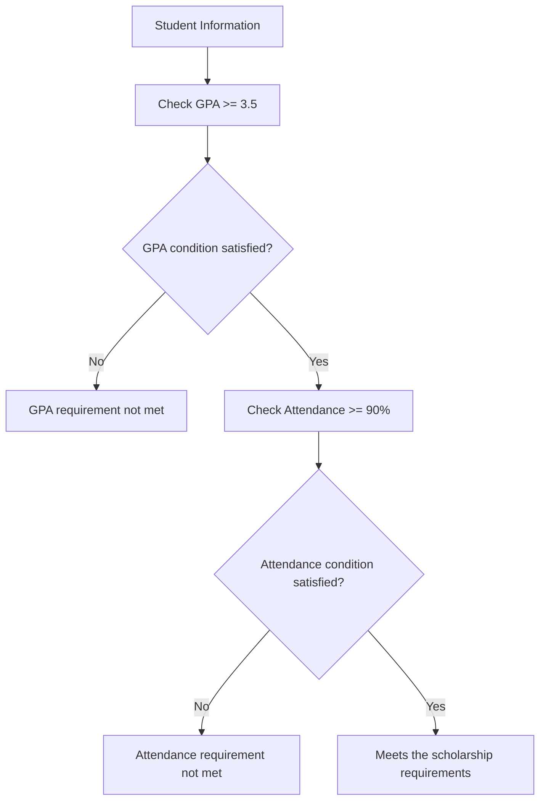

# 2.1 What Is Symbolic AI?

**Module:** Part 2 — Symbolic AI  
**Section:** 2.1  
**Status:** Reviewed  
**Difficulty:** Beginner

---

## Learning Objectives

By the end of this section, you should be able to:

1. Define Symbolic AI and explain its main idea.
2. Understand how symbols represent knowledge.
3. Distinguish between facts, rules, and reasoning.
4. Explain Good Old-Fashioned AI (GOFAI).
5. Identify real-world applications of Symbolic AI.

---

## 1. What Is Symbolic AI?

Imagine a university wants to build a system that determines whether students qualify for a scholarship.

The university gives the system two rules:

- A student must have a GPA of at least 3.5.
- A student must have an attendance rate of at least 90%.

The system receives a student's information, checks the rules, and produces a decision.

This is a simple example of **Symbolic AI**.

Symbolic AI is an approach to Artificial Intelligence that represents knowledge using symbols, facts, and logical rules. It uses these representations to reason about information and derive conclusions.

Instead of learning everything from large amounts of data, a symbolic system works with knowledge that has been explicitly represented or provided to it.

### The Main Idea

Symbolic AI follows a straightforward principle:

**Represent knowledge → Apply rules → Derive conclusions**

<!-- IMAGE: Insert a simple conceptual illustration here.
Suggested file: ../../images/part2/symbolic-ai-concept.png
Show a computer receiving facts, applying logical rules, and producing a conclusion.
Use a clean educational illustration rather than a decorative stock photo. -->

---

## 2. How Does Symbolic AI Represent Knowledge?

Symbolic AI represents information through symbols that stand for objects, concepts, properties, or relationships.

For example, consider these statements:

- Sammy is a student.
- Sammy has a GPA of 3.8.
- Students with a GPA of at least 3.5 qualify academically for a scholarship.

A symbolic system can represent this information using facts and rules.

### A. Symbols

A symbol is a representation of something in the real world.

For example:

| Symbol | Represents |
|---|---|
| `Sammy` | A particular student |
| `Student` | The concept of a student |
| `GPA` | A student's grade point average |
| `Scholarship` | A scholarship opportunity |

Symbols allow a computer to represent concepts in a structured form.

### B. Facts

A fact is a statement that the system treats as true within its knowledge base.

Examples:

```text
Student(Sammy)
GPA(Sammy, 3.8)
```

These statements tell the system that Sammy is a student and has a GPA of 3.8.

### C. Rules

A rule describes what conclusion should follow when certain conditions are satisfied.

Rules are commonly written in an IF–THEN format.

Example:

```text
IF GPA >= 3.5
THEN academically_eligible = TRUE
```

The system can apply this rule to the facts it already knows.

**Remember the difference:**

- Symbols represent things.
- Facts describe what the system knows.
- Rules describe how the system should reason.

---

## 3. How Does Symbolic AI Reason?

Symbolic AI does not simply store information. It can use logical rules to derive new conclusions.

Consider the scholarship example:

**Known facts:**

```text
Student = Sammy
GPA = 3.8
Attendance = 95%
```

**Rules:**

```text
IF GPA >= 3.5
AND Attendance >= 90%
THEN Scholarship_Eligible = TRUE
```

**Reasoning process:**

1. The system checks Sammy's GPA.
2. It compares 3.8 with the minimum requirement of 3.5.
3. The condition is satisfied.
4. The system checks attendance.
5. It compares 95% with the minimum requirement of 90%.
6. Both conditions are satisfied.
7. The system concludes that Sammy meets these scholarship requirements.

<details>
<summary><b>See the reasoning flow</b></summary>



</details>

This process is called **logical inference**: deriving a conclusion from existing facts and rules.

The system does not need to guess whether Sammy qualifies. It follows the conditions that have been provided.

*Note: This example only checks two scholarship requirements. A real university scholarship decision may involve additional conditions.*

---

## 4. Good Old-Fashioned AI (GOFAI)

You may come across the term **Good Old-Fashioned AI (GOFAI)** when studying Symbolic AI.

GOFAI is an informal term commonly used to describe early approaches to AI that relied heavily on symbols, explicit knowledge, and logical reasoning.

The central idea was that intelligent behaviour could be achieved by representing knowledge and manipulating symbols according to formal rules.

Early AI researchers explored whether computers could solve problems by using symbolic representations and logical operations.

### What Did GOFAI Focus On?

GOFAI commonly involved:

- Representing knowledge using symbols.
- Storing information as facts and relationships.
- Defining rules for solving problems.
- Using logical reasoning to derive conclusions.
- Solving problems through structured search and planning.

Symbolic AI became an important foundation for early AI research and knowledge-based systems.

<!-- IMAGE: Insert a historical or conceptual illustration here.
Suggested file: ../../images/part2/gofai-history.png
Show an early computer or symbolic reasoning concept alongside modern AI.
Keep it informative and historically accurate; avoid implying that all early AI used exactly the same methods. -->

### Symbolic AI and GOFAI

The terms are closely related, but they are not exactly interchangeable.

| Term | Meaning |
|---|---|
| Symbolic AI | An AI approach that represents and processes knowledge using symbols and formal rules. |
| GOFAI | An informal term for traditional, early approaches to AI that relied heavily on symbolic methods. |

In simple terms, GOFAI is strongly associated with the development of Symbolic AI.

---

## 5. Where Is Symbolic AI Used?

Symbolic AI is useful in situations where knowledge can be clearly represented and decisions can be made using defined rules.

Some examples include:

| Application | How Symbolic AI Is Used |
|---|---|
| Expert Systems | Uses stored expert knowledge and rules to provide recommendations. |
| Medical Decision Support | Applies medical rules to patient information to assist with diagnosis. |
| Rule-Based Chatbots | Uses predefined rules to respond to specific questions. |
| Automated Planning | Uses representations of actions, goals, and conditions to plan a sequence of steps. |
| Configuration Systems | Applies rules to determine compatible components and configurations. |

For example, a medical expert system may use symptoms and medical rules to suggest possible diagnoses.

However, it does not automatically understand medicine like a human doctor. Its conclusions depend on the knowledge and rules available to it.

---

## 6. Symbolic AI at a Glance

| Feature | Description |
|---|---|
| Knowledge Representation | Uses symbols, facts, and relationships. |
| Reasoning | Applies logical rules to derive conclusions. |
| Learning | Usually depends on knowledge explicitly provided or encoded by people. |
| Decisions | Often follows clearly defined rules and conditions. |
| Explainability | Can often show which facts and rules led to a conclusion. |

### A Simple Comparison

Think of Symbolic AI as a student following a clearly written instruction sheet.

If the instructions say:

```text
IF it is raining
THEN bring an umbrella.
```

The student checks whether it is raining and follows the instruction.

Symbolic AI works similarly: it uses represented knowledge and rules to determine what conclusion or action follows.

---

## 7. Key Takeaways

- Symbolic AI represents knowledge using symbols, facts, and rules.
- Symbols represent objects, concepts, and relationships.
- Facts describe information that the system treats as true.
- Rules define how the system should reason.
- Logical inference allows the system to derive new conclusions.
- GOFAI refers to traditional approaches to AI that relied heavily on symbolic methods.
- Symbolic AI is useful when knowledge and decision-making rules can be clearly defined.

**The main idea:** Symbolic AI attempts to make machines reason by representing knowledge explicitly and applying logical rules.

---

## 8. Quick Self-Check

Try answering these questions before revealing the answers.

### Question 1

What is the main idea behind Symbolic AI?

A. Learning entirely through trial and error.

B. Representing knowledge using symbols and logical rules.

C. Randomly generating possible answers.

D. Processing images without any stored knowledge.

<details>
<summary><b>Show answer</b></summary>

**Correct answer: B**

Symbolic AI represents knowledge using symbols, facts, and rules to support logical reasoning.

</details>

### Question 2

What is a fact in Symbolic AI?

A. A possible conclusion that has not been checked.

B. A random value generated by the system.

C. A statement that the system treats as true.

D. A rule that tells the system what to do.

<details>
<summary><b>Show answer</b></summary>

**Correct answer: C**

A fact represents information that the system accepts as true within its knowledge base.

</details>

### Question 3

Which statement best describes an IF–THEN rule?

A. It stores an image in memory.

B. It defines what conclusion follows when certain conditions are met.

C. It randomly selects an answer.

D. It automatically learns from every user interaction.

<details>
<summary><b>Show answer</b></summary>

**Correct answer: B**

An IF–THEN rule specifies a condition and the conclusion or action that follows when the condition is satisfied.

</details>

### Question 4

What does GOFAI refer to?

A. An informal term for traditional AI approaches heavily based on symbolic methods.

B. A programming language.

C. A type of computer hardware.

D. A modern neural network architecture.

<details>
<summary><b>Show answer</b></summary>

**Correct answer: A**

GOFAI stands for Good Old-Fashioned AI and is associated with traditional symbolic approaches to AI.

</details>

### Question 5 — Apply It

A system contains the following rule:

```text
IF temperature > 38°C
THEN fever = TRUE
```

The recorded temperature is 39°C.

What should the system conclude?

A. Fever = FALSE

B. Temperature is unknown.

C. Fever = TRUE

D. The rule cannot be applied.

<details>
<summary><b>Show answer</b></summary>

**Correct answer: C**

Since 39°C is greater than 38°C, the condition is satisfied. The system concludes that `fever = TRUE`.

</details>

---

## References

1. Russell, S. J., & Norvig, P. (2021). *Artificial Intelligence: A Modern Approach* (4th ed.). Pearson.
2. Haugeland, J. (1985). *Artificial Intelligence: The Very Idea*. MIT Press.
3. Newell, A., & Simon, H. A. (1976). Computer Science as Empirical Inquiry: Symbols and Search. *Communications of the ACM, 19*(3), 113–126.

---

*End of Section 2.1 — What Is Symbolic AI?*
