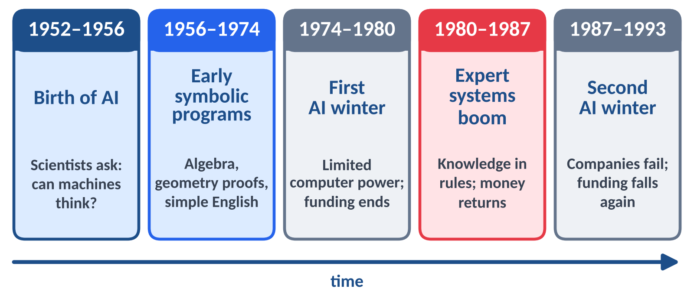
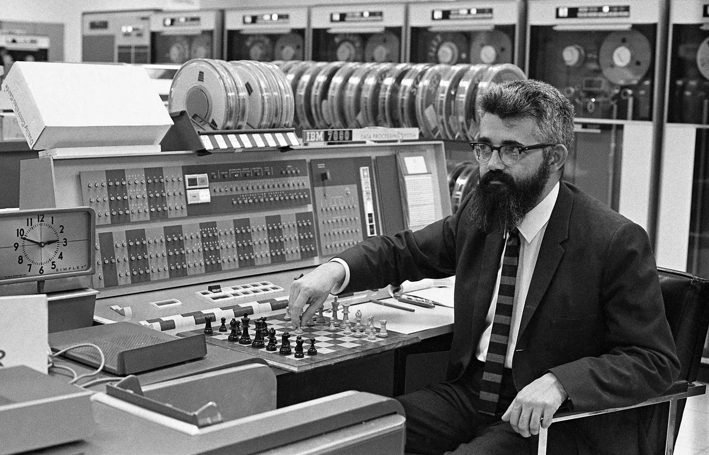

# 2.1 What Is Symbolic AI?

**Team Member:** Wong Hiu Chung Samuel (`@Samuel940398`)

**In this section:** [What Is Symbolic AI?](#1-what-is-symbolic-ai) · [How It Works](#2-how-it-works) · [GOFAI](#3-good-old-fashioned-ai-gofai) · [Where It Is Used](#4-where-is-it-used) · [Strengths and Limitations](#5-strengths-and-limitations) · [Summary](#6-summary) · [Lab: Chat with ELIZA](#lab-chat-with-eliza-a-chatbot-from-1966) · [Practice Questions](#7-practice-questions-and-answers) · [References](#8-references)

**Learning goals.** By the end of this section you can:
* explain what Symbolic AI is and name its three parts: symbols, facts and rules;
* trace how a rule-based system reaches a conclusion from facts;
* give two strengths and two limitations of Symbolic AI.

**Before you start:** no programming is needed. Part 1 helps but is not required.

---

## 1. What Is Symbolic AI?

The university's **Merit Scholarship** has two requirements: a GPA of at least 3.5 and attendance of at least 90%. Give those requirements to a computer, add a student's details, and it tells you whether the student qualifies.

That is **Symbolic AI**: an approach to AI that stores knowledge as symbols, facts and rules, then reasons with them to reach conclusions. It does not learn from huge amounts of data. It uses knowledge that people have written down for it.

| Part | What it is | Example |
| :--- | :--- | :--- |
| **Symbol** | Stands for a person, object or concept | `Sammy`, `Student`, `GPA` |
| **Fact** | Something the system treats as true | `GPA(Sammy, 3.8)` |
| **Rule** | Says what follows when conditions are met | `IF GPA >= 3.5 AND Attendance >= 90% THEN ScholarshipEligible` |

**In short:** symbols name things, facts say what is true, rules say what follows.

---

## 2. How It Works

Facts about Sammy:

```text
Student(Sammy)
GPA(Sammy, 3.8)
Attendance(Sammy, 95%)
```

The system reasons in four steps:

1. It reads Sammy's facts.
2. GPA: 3.8 is at least 3.5 ✓
3. Attendance: 95% is at least 90% ✓
4. Both conditions pass, so the rule fires: `ScholarshipEligible(Sammy)`.


*Figure 2.1: How Symbolic AI uses facts and rules to derive a conclusion.*

Deriving a new conclusion from known facts is called **logical inference**. The computer does not guess. It follows the rule.

This looks like an ordinary `if` statement, and for one rule it nearly is. The difference grows with many rules: in Symbolic AI the rules are stored as **data**, separate from the part that applies them, so rules can be added or changed without rewriting the program, and the system can show which rules gave each answer ([2.4](07_Expert_Systems.md) §5).

---

## 3. Good Old-Fashioned AI (GOFAI)

**GOFAI** is the informal name for the traditional approach to AI built on symbols, explicit knowledge and logical reasoning. The philosopher John Haugeland popularized the term in 1985 (Haugeland, 1985). Early researchers believed machines could think by manipulating symbols with formal rules.

Allen Newell and Herbert Simon stated this belief as the **Physical Symbol System Hypothesis** (Newell & Simon, 1976): a system that stores symbols and changes them according to rules has the necessary and sufficient means for general intelligent action. In other words, symbol manipulation is both needed for intelligence and enough for it. GOFAI was built on that idea, and the rest of Part 2 shows how far it goes: logic (2.2), knowledge representation (2.3), expert systems (2.4) and planning (2.5).



*Figure 2.2: Symbolic AI from the birth of AI (1952–1956) and its early programs (1956–1974), through the first AI winter (1974–1980) and the expert-systems boom (1980–1987), to the second AI winter (1987–1993).*



*Figure 2.3: An IBM 7090 mainframe set up to play chess. Early researchers used games like chess to test symbols, rules and search.*

An **AI winter** is a period when interest and funding for AI research fell sharply after promises were not met. Symbolic AI did not end in 1993: its ideas live on in rule engines, knowledge graphs and planners, and today they are often combined with machine learning (§5).

**Symbolic AI vs. GOFAI:** GOFAI is another name for classical Symbolic AI, the symbol-and-rule approach built from the 1950s to the 1980s.

---

## 4. Where Is It Used?

| Application | What it does |
| :--- | :--- |
| **Expert systems** | Uses expert knowledge and rules to give recommendations |
| **Medical decision support** | Matches patient symptoms to medical rules |
| **Rule-based chatbots** | Answers specific questions using preset rules |
| **Automated planning** | Works out a sequence of steps to reach a goal |
| **Configuration systems** | Checks which components work together |

These systems do not understand a field like a human expert. They only know what their rules say.

---

## 5. Strengths and Limitations

Symbolic AI showed that computers can solve problems using explicit knowledge and logic. Its biggest strength is **explainability**: you can follow its reasoning step by step.

```text
Fact:       GPA(Sammy, 3.8)
Rule:       IF GPA >= 3.5 THEN AcademicallyEligible
Conclusion: AcademicallyEligible(Sammy)
```

| Strengths | Limitations |
| :--- | :--- |
| **Explainable:** every conclusion can be traced back to the facts and rules that produced it. | **Brittle:** it fails on situations its rules do not cover. |
| **Consistent:** the same facts always give the same answer. | **Knowledge bottleneck:** experts must write every rule by hand, which is slow and expensive. |
| **Needs little data:** it uses knowledge people write down, not millions of examples. | **Struggles with vague or messy input,** such as images, speech or common sense. |
| **Easy to trace:** you can find the rule that caused a mistake and correct it. | **Search can explode:** problems with many possible steps quickly become too big to check (see 2.5). |
| | **Does not learn:** classic symbolic systems do not learn from new data on their own. |

These limitations are why modern AI often combines symbolic reasoning with machine learning. Section 2.2 (Section 11) and Section 2.4 (Sections 7 and 8) return to them: see [Limitations of Symbolic Reasoning](05_Logic_and_Reasoning.md#11-limitations-of-symbolic-reasoning) and [Limitations of Expert Systems](07_Expert_Systems.md#7-limitations-of-expert-systems).

---

## 6. Summary

| Concept | Meaning |
| :--- | :--- |
| **Symbolic AI** | AI that reasons with symbols, facts and rules |
| **Symbol** | Stands for an object, concept or relationship |
| **Fact** | A statement the system treats as true |
| **Rule** | Says what conclusion follows from certain conditions |
| **Logical inference** | Deriving new conclusions from facts and rules |
| **GOFAI** | Another name for classical Symbolic AI |
| **Explainability** | Being able to see how a conclusion was reached |

---

## Lab: Chat with ELIZA, a Chatbot from 1966

* **Goal:** Find the hidden rules inside one of the first chatbots, and test the strengths and limitations in §5.
* **Preparation:** A browser with internet and about 15 minutes; re-read §4 and §5. **ELIZA** was written by Joseph Weizenbaum at MIT and described in 1966 (Weizenbaum, 1966). It is a **rule-based chatbot** (§4): it looks for keywords in your sentence and answers with a reply pattern that belongs to that keyword. Open the free online copy at <https://www.masswerk.at/elizabot/eliza.html>, click **open ELIZA terminal**, type after `YOU:` and press **Enter** after each sentence. No internet? Use the chat in the screenshot below for Steps 2 to 5.
* **Task:**

  **Step 1, predict:** will ELIZA understand your sentences, or only react to certain words?  
  **Step 2, find a rule:** type `I am tired`, then `I am hungry`. Compare the two replies.  
  **Step 3, find another rule:** type `My mother cooks well`, then `My brother plays football`.  
  **Step 4, give it nothing to match:** type `The weather is nice today`.  
  **Step 5, test the limits:** type `I am a purple elephant made of cheese`.

  

  *Lab screenshot: a real chat with the online ELIZA, using sentences from Steps 2 to 5.*

* **Observation:** For each step, write down your sentence and ELIZA's reply, and underline any words ELIZA copied from you.
* **Reflection:**
  1. Write the rule you found in Step 2 as an IF–THEN rule, like the rules in §1.
  2. Which words in Step 3 do you think ELIZA reacted to?
  3. What did ELIZA do in Step 4, when your sentence had no keyword?
  4. Did ELIZA notice that Step 5 was nonsense? Which limitation in §5 does this show?
  5. Which strength from §5 does ELIZA have, once you know its rules?

<details>
<summary><b>Feedback: check your findings</b></summary>

* ELIZA keeps several replies for each keyword and picks one, so your exact replies may differ from a classmate's. The rules behind them are the same.
* **Step 2:** ELIZA looks for `I am` and copies the words after it into a reply, such as *"How long have you been tired?"* or *"Do you enjoy being hungry?"*.
* **Step 3:** ELIZA reacts to **my** followed by a family word (mother, father, brother, sister and a few more). Replies include *"Tell me more about your family."* and *"Your mother?"*. It also saves sentences that contain *my*, so it can bring them back later.
* **Step 4:** No keyword matched, so ELIZA gave a general reply, such as *"Please go on."*, or brought back a saved sentence, such as *"Earlier you said your mother cooks well."* in the screenshot.
* **Step 5:** ELIZA matched `I am` again and copied the words without noticing that they make no sense, for example *"Is it because you are a purple elephant made of cheese that you came to me?"*.
* **Reflection answers:**
  1. `IF the sentence contains "I am X" THEN reply "How long have you been X?"` (or another reply from the same list).
  2. **my** together with **mother** or **brother**.
  3. It used a fallback rule: a general reply, or a sentence it had saved earlier.
  4. No. ELIZA only matches words; it has no common sense and does not understand meaning. This is the limitation *struggles with vague or messy input, such as … common sense*, and it is also **brittle**: input its rules do not expect gets a silly reply.
  5. **Explainable:** once you know its rules, you can explain why ELIZA gave each reply. ELIZA shows rules and brittleness; it stores no facts and draws no conclusions, so it is a simple, early relative of the reasoning systems in 2.2 and 2.4.

</details>

---

## 7. Practice Questions and Answers

Try each question yourself first, then open the answers to check.

**Questions**

1. What is Symbolic AI, and what are its three main parts?
2. What is the difference between a fact and a rule?
3. A system has the rule `IF temperature > 38°C THEN fever = TRUE`. The recorded temperature is 39°C. What does it conclude?
4. What does GOFAI stand for, and what was its main approach?
5. **Find the error.** A student writes `IF GPA >= 3.5 THEN AcademicallyEligible` in a knowledge base and calls it a fact. What is wrong?
6. **Trace it.** Using the scholarship rule from Section 1, the system has these facts. What does it conclude, and why?

   ```text
   Student(Lee)
   GPA(Lee, 3.6)
   Attendance(Lee, 88%)
   ```

<details>
<summary><b>Show answers</b> (try the questions first!)</summary>

1. Symbolic AI represents knowledge and reasons with it. Its parts are symbols, facts and rules.
2. A fact is something the system treats as true. A rule says what follows when conditions are met.
3. `fever = TRUE`, because 39°C is greater than 38°C.
4. Good Old-Fashioned AI. It relied on symbols, explicit knowledge and logical reasoning.
5. It is a **rule**, not a fact, because it has an IF–THEN structure. A fact would be `GPA(Sammy, 3.8)`.
6. GPA 3.6 passes (at least 3.5), but attendance 88% fails (below 90%). The rule needs both conditions, so it does not fire. The system cannot conclude `ScholarshipEligible(Lee)`. This does not prove Lee is ineligible; it only means this rule does not derive it.

</details>

---

## 8. References

1. Russell, S. J., & Norvig, P. (2021). *Artificial Intelligence: A Modern Approach* (4th ed.). Pearson.
2. Haugeland, J. (1985). *Artificial Intelligence: The Very Idea*. MIT Press.
3. Newell, A., & Simon, H. A. (1976). Computer Science as Empirical Inquiry: Symbols and Search. *Communications of the ACM, 19*(3), 113–126.
4. BIT2026 Foundations of CS & AI, course lecture slides: Symbolic AI module (2026).
5. Weizenbaum, J. (1966). ELIZA: A computer program for the study of natural language communication between man and machine. *Communications of the ACM, 9*(1), 36–45.
6. Landsteiner, N. (2005). *ELIZA terminal* (online version of ELIZA, used in the lab). mass:werk. https://www.masswerk.at/elizabot/eliza.html
