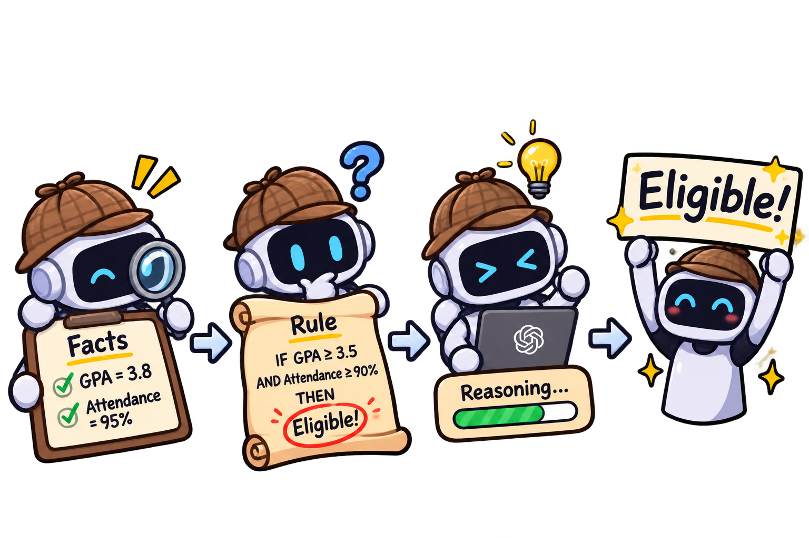

# 2.1 What Is Symbolic AI?

**Team Member:** Wong Hiu Chung Samuel (`@Samuel940398`)

**In this section:** What Is Symbolic AI · How It Works · GOFAI · Applications · Strengths and Limitations · Summary · Practice Questions

**Learning goals.** By the end of this section you can:
* explain what Symbolic AI is and name its three parts: symbols, facts and rules;
* trace how a rule-based system reaches a conclusion from facts;
* give two strengths and two limitations of Symbolic AI.

**Before you start:** no programming is needed. Part 1 helps but is not required.

---

## 1. What Is Symbolic AI?

The university's **Merit Scholarship** has two requirements: a GPA of at least 3.5 and attendance of at least 90%. Give those requirements to a computer, add a student's details, and it tells you whether the student qualifies.

That is **Symbolic AI**: an approach to AI that stores knowledge as symbols, facts and rules, then reasons with them to reach conclusions. It does not learn from huge amounts of data. It uses knowledge that people have written down for it.

| Part | What it is | Example |
| :--- | :--- | :--- |
| **Symbol** | Stands for a person, object or concept | `Sammy`, `Student`, `GPA` |
| **Fact** | Something the system treats as true | `GPA(Sammy, 3.8)` |
| **Rule** | Says what follows when conditions are met | `IF GPA >= 3.5 AND Attendance >= 90% THEN ScholarshipEligible` |

**In short:** symbols name things, facts say what is true, rules say what follows.

---

## 2. How It Works

Facts about Sammy:

```text
Student(Sammy)
GPA(Sammy, 3.8)
Attendance(Sammy, 95%)
```

The system reasons in four steps:

1. It reads Sammy's facts.
2. GPA: 3.8 is at least 3.5 ✓
3. Attendance: 95% is at least 90% ✓
4. Both conditions pass, so the rule fires: `ScholarshipEligible(Sammy)`.



*Figure 2.1: How Symbolic AI uses facts and rules to derive a conclusion.*

Deriving a new conclusion from known facts is called **logical inference**. The computer does not guess. It follows the rule.

---

## 3. Good Old-Fashioned AI (GOFAI)

**GOFAI** is the informal name for the traditional approach to AI built on symbols, explicit knowledge and logical reasoning. The philosopher John Haugeland popularised the term in 1985 (Haugeland, 1985). Early researchers believed machines could think by manipulating symbols with formal rules.

Allen Newell and Herbert Simon stated this belief as the **Physical Symbol System Hypothesis** (Newell & Simon, 1976): a system that stores symbols and changes them according to rules has the necessary and sufficient means for general intelligent action. In other words, symbol manipulation is both needed for intelligence and enough for it. GOFAI was built on that idea, and the rest of Part 2 shows how far it goes: logic (2.2), knowledge representation (2.3), expert systems (2.4) and planning (2.5).


*Figure 2.2: Symbolic AI from the birth of AI (1952–1956) and its early programs (1956–1974), through the first AI winter (1974–1980) and the expert-systems boom (1980–1987), to the second AI winter (1987–1993).*


*Figure 2.3: An IBM 7090 mainframe set up to play chess. Early researchers used games like chess to test symbols, rules and search.*

**Symbolic AI vs. GOFAI:** Symbolic AI is the approach. GOFAI is the name for its traditional, early form.

---

## 4. Where Is It Used?

| Application | What it does |
| :--- | :--- |
| **Expert systems** | Uses expert knowledge and rules to give recommendations |
| **Medical decision support** | Matches patient symptoms to medical rules |
| **Rule-based chatbots** | Answers specific questions using preset rules |
| **Automated planning** | Works out a sequence of steps to reach a goal |
| **Configuration systems** | Checks which components work together |

These systems do not understand a field like a human expert. They only know what their rules say.

---

## 5. Strengths and Limitations

Symbolic AI showed that computers can solve problems using explicit knowledge and logic. Its biggest strength is **explainability**: you can follow its reasoning step by step.

```text
Fact:       GPA(Sammy, 3.8)
Rule:       IF GPA >= 3.5 THEN AcademicallyEligible
Conclusion: AcademicallyEligible(Sammy)
```

| Strengths | Limitations |
| :--- | :--- |
| **Explainable:** every conclusion can be traced back to the facts and rules that produced it. | **Brittle:** it fails on situations its rules do not cover. |
| **Precise:** the same facts always give the same answer. | **Knowledge bottleneck:** experts must write every rule by hand, which is slow and expensive. |
| **Needs little data:** it uses knowledge people write down, not millions of examples. | **Struggles with vague or messy input,** such as images, speech or common sense. |
| **Easy to correct:** to fix a mistake, you change one rule. | **Search can explode:** problems with many possible steps quickly become too big to check (see 2.5). |
| | **Does not learn** from new data on its own. |

These limitations are why modern AI often combines symbolic reasoning with machine learning. Section 2.2 (Section 11) and Section 2.4 (Sections 7 and 8) return to them: see [Limitations of Symbolic Reasoning](05_Logic_and_Reasoning.md#11-limitations-of-symbolic-reasoning) and [Limitations of Expert Systems](07_Expert_Systems.md#7-limitations-of-expert-systems).

---

## 6. Summary

| Concept | Meaning |
| :--- | :--- |
| **Symbolic AI** | AI that reasons with symbols, facts and rules |
| **Symbol** | Stands for an object, concept or relationship |
| **Fact** | A statement the system treats as true |
| **Rule** | Says what conclusion follows from certain conditions |
| **Logical inference** | Deriving new conclusions from facts and rules |
| **GOFAI** | The traditional, early form of symbolic AI |
| **Explainability** | Being able to see how a conclusion was reached |

---

## 7. Practice Questions and Answers

Try each question yourself first, then check the answer.

**Questions**

1. What is Symbolic AI, and what are its three main parts?
2. What is the difference between a fact and a rule?
3. A system has the rule `IF temperature > 38°C THEN fever = TRUE`. The recorded temperature is 39°C. What does it conclude?
4. What does GOFAI stand for, and what was its main approach?
5. **Find the error.** A student writes `IF GPA >= 3.5 THEN AcademicallyEligible` in a knowledge base and calls it a fact. What is wrong?
6. **Trace it.** Using the scholarship rule from Section 1, the system has these facts. What does it conclude, and why?

   ```text
   Student(Lee)
   GPA(Lee, 3.6)
   Attendance(Lee, 88%)
   ```

**Answers**

1. Symbolic AI represents knowledge and reasons with it. Its parts are symbols, facts and rules.
2. A fact is something the system treats as true. A rule says what follows when conditions are met.
3. `fever = TRUE`, because 39°C is greater than 38°C.
4. Good Old-Fashioned AI. It relied on symbols, explicit knowledge and logical reasoning.
5. It is a **rule**, not a fact, because it has an IF–THEN structure. A fact would be `GPA(Sammy, 3.8)`.
6. GPA 3.6 passes (at least 3.5), but attendance 88% fails (below 90%). The rule needs both conditions, so it does not fire. The system cannot conclude `ScholarshipEligible(Lee)`.

---

## 8. References

1. Russell, S. J., & Norvig, P. (2021). *Artificial Intelligence: A Modern Approach* (4th ed.). Pearson.
2. Haugeland, J. (1985). *Artificial Intelligence: The Very Idea*. MIT Press.
3. Newell, A., & Simon, H. A. (1976). Computer Science as Empirical Inquiry: Symbols and Search. *Communications of the ACM, 19*(3), 113–126.
4. BIT2026 Foundations of CS & AI, course lecture slides: Symbolic AI module (2026).
