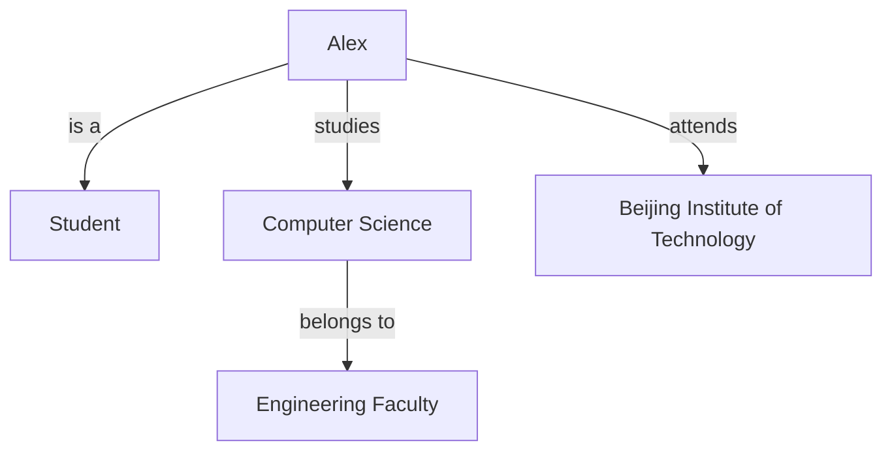
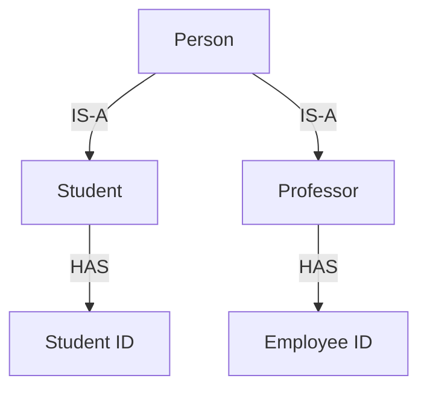
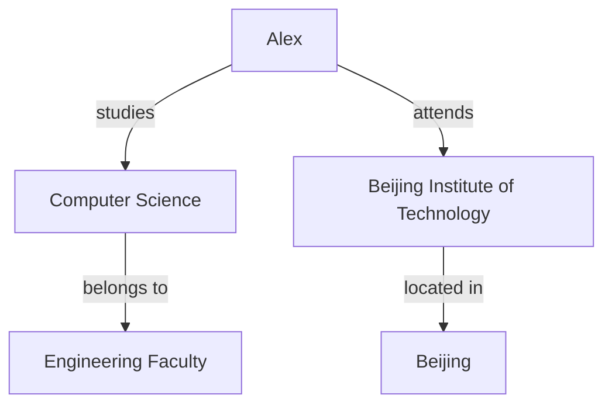
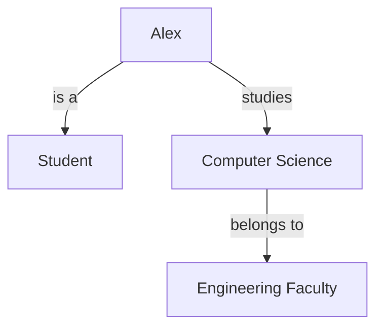

# 2.2 Knowledge Representation

**Status:** ✅  
**Team Member:** Cao Minh Tuan (`@mnhtnc`)

**In this section:** What is Knowledge Representation? · Facts and Data · Propositional Logic and Logical Equivalences · Predicate Logic · Semantic Networks · Frames and Scripts · Rule-Based Representation · Ontologies and Knowledge Graphs · Choosing a Representation · Applications · Practice Questions

---

## 1. Where We Are in the Module

In [2.1 What is Symbolic AI?](04_What_is_Symbolic_AI.md), we learned that Symbolic AI works by representing knowledge using symbols, facts and rules.

But this raises an important question:

**How does a computer actually store knowledge about the world?**

Imagine we want to build an AI system that helps students at a university library. The system needs to know things such as:

- Who are the students?
- Which books are available?
- Who has borrowed a particular book?
- What relationships exist between students and books?

A computer cannot simply rely on vague ideas. We need a structured way to represent this information so that the program can work with it.

This is called **Knowledge Representation (KR)**.

In this section, we explore several ways of representing knowledge. The next section, [2.3 How Symbolic AI Reasons](06_How_Symbolic_AI_Reasons.md), explains how a computer uses that knowledge to reach conclusions.

---

## 2. What is Knowledge Representation?

**Knowledge Representation (KR)** is the process of organising and storing information about the world in a form that a computer can use to solve problems, answer questions or make decisions.

In simpler words:

**Knowledge Representation is how we teach a computer what it needs to know about something.**

Let's use a simple example.

Imagine we want a computer to know about a student named Alex.

We could represent the information like this:

```text
Name: Alex
Age: 19
University: Beijing Institute of Technology
Major: Computer Science
```

This is already a basic representation of knowledge.

However, we can make it more useful by describing relationships:

```text
Alex is a student.
Alex studies Computer Science.
Alex attends Beijing Institute of Technology.
```

Now the computer has information about both an object (Alex) and its relationships with other things.

### Why Do We Need Knowledge Representation?

Without a structured representation, a computer would have difficulty working with information.

For example, consider these two statements:

1. Alex is a student.
2. Alex studies Computer Science.

A human can easily understand that these statements describe the same person.

However, a computer needs the information to be represented in a way that allows it to identify Alex as the subject of both statements.

Knowledge Representation makes this possible.

It allows computers to:

- Store information in an organised way.
- Identify relationships between different things.
- Retrieve specific information.
- Use stored knowledge when solving problems.
- Support reasoning and decision-making.

> **Important:** Knowledge Representation does not automatically mean that a computer understands something like a human. It means that information has been organised into a structure that a program can process.

---

## 3. Data, Information and Knowledge

Before exploring different representations, we need to understand three related terms.

Although people sometimes use them interchangeably, they have different meanings.

| Term | Meaning | Example |
|---|---|---|
| Data | Raw values without much context | `19`, `Computer Science`, `Alex` |
| Information | Data organised into meaningful context | Alex is 19 years old and studies Computer Science. |
| Knowledge | Information organised in a way that supports understanding, relationships or decisions | Computer Science students belong to the university's Computer Science department. |

Think about it this way:

- **Data:** Individual puzzle pieces.
- **Information:** Puzzle pieces arranged into a picture.
- **Knowledge:** Understanding what the picture represents and how its parts relate.

### Example

Suppose a university database contains:

```text
Student: Alex
Age: 19
Major: Computer Science
```

This is organised information.

Now suppose the system also knows:

```text
IF a student studies Computer Science
THEN the student belongs to the Computer Science department.
```

The system can use this rule together with Alex's information to establish a new fact:

```text
Alex belongs to the Computer Science department.
```

This illustrates how knowledge can support further conclusions.

We will explore the reasoning process in Section 2.3.

---

## 4. Different Ways to Represent Knowledge

There is no single way to represent all knowledge.

Different problems require different structures.

For example, representing a person's age is relatively simple. Representing the relationships between thousands of people, universities and courses is much more complicated.

Let's explore five important approaches.

### 4.1 Propositional Logic

**Propositional Logic** represents knowledge using statements that can be either TRUE or FALSE.

A statement that has a definite truth value is called a **proposition**.

For example:

```text
P: Alex is a student.
Q: Alex studies Computer Science.
```

Each proposition represents a statement about the world.

We can assign truth values:

```text
P = TRUE
Q = TRUE
```

This tells the computer that both statements are considered true.

#### Logical Connectives

We can combine propositions using logical operators.

| Operator | Meaning | Example |
|---|---|---|
| AND (∧) | Both statements must be true | P ∧ Q |
| OR (∨) | At least one statement must be true | P ∨ Q |
| NOT (¬) | Reverses the truth value | ¬P |
| IMPLIES (→) | If one statement is true, another follows | P → Q |

Let's examine them using an example.

Suppose:

```text
P: Alex is a student.
Q: Alex has a university ID.
```

**AND (∧)**

```text
P ∧ Q
```

Means Alex is a student AND has a university ID.

Both statements must be true for the whole expression to be true.

**OR (∨)**

```text
P ∨ Q
```

Means Alex is a student OR has a university ID.

At least one statement must be true.

**NOT (¬)**

```text
¬P
```

Means Alex is NOT a student.

If P is TRUE, ¬P is FALSE.

**IMPLIES (→)**

```text
P → Q
```

Means if Alex is a student, then Alex has a university ID.

This is a logical relationship between two propositions.

#### Truth Table

A truth table shows every possible combination of truth values.

For AND:

| P | Q | P ∧ Q |
|---|---|---|
| TRUE | TRUE | TRUE |
| TRUE | FALSE | FALSE |
| FALSE | TRUE | FALSE |
| FALSE | FALSE | FALSE |

For OR:

| P | Q | P ∨ Q |
|---|---|---|
| TRUE | TRUE | TRUE |
| TRUE | FALSE | TRUE |
| FALSE | TRUE | TRUE |
| FALSE | FALSE | FALSE |

For IMPLIES:

| P | Q | P → Q |
|---|---|---|
| TRUE | TRUE | TRUE |
| TRUE | FALSE | FALSE |
| FALSE | TRUE | TRUE |
| FALSE | FALSE | TRUE |

Notice that an implication is only FALSE when P is TRUE and Q is FALSE.

**IF AND ONLY IF (↔)**

```text
P ↔ Q
```

This is called a **biconditional**. It means P and Q are always both TRUE or both FALSE. For example: "A student may enter the exam hall (P) **if and only if** they show their student card (Q)." The card is needed, and it is also enough.

| P | Q | P ↔ Q |
|---|---|---|
| TRUE | TRUE | TRUE |
| TRUE | FALSE | FALSE |
| FALSE | TRUE | FALSE |
| FALSE | FALSE | TRUE |

#### Logical Equivalences

Two statements are **logically equivalent** (written ≡) if they have the same truth value in every possible situation. Equivalences let a system rewrite a statement into a simpler or more useful form without changing its meaning.

| Name | Equivalence | In words |
|---|---|---|
| **Double negation** | ¬(¬P) ≡ P | "It is not true that Alex is not a student" means "Alex is a student". |
| **De Morgan's law (AND)** | ¬(P ∧ Q) ≡ ¬P ∨ ¬Q | "Not (fine paid AND book returned)" means "fine not paid OR book not returned". |
| **De Morgan's law (OR)** | ¬(P ∨ Q) ≡ ¬P ∧ ¬Q | "Not (has fever OR has cough)" means "no fever AND no cough". |

We can check De Morgan's law (AND) with a truth table. The two bold columns match in every row, so the statements are equivalent:

| P | Q | P ∧ Q | **¬(P ∧ Q)** | ¬P | ¬Q | **¬P ∨ ¬Q** |
|---|---|---|---|---|---|---|
| TRUE | TRUE | TRUE | **FALSE** | FALSE | FALSE | **FALSE** |
| TRUE | FALSE | FALSE | **TRUE** | FALSE | TRUE | **TRUE** |
| FALSE | TRUE | FALSE | **TRUE** | TRUE | FALSE | **TRUE** |
| FALSE | FALSE | FALSE | **TRUE** | TRUE | TRUE | **TRUE** |

> **Tip for remembering De Morgan's laws:** when you move a NOT inside the brackets, NOT goes onto each part and AND and OR swap places.

#### When Is Propositional Logic Useful?

Propositional Logic is useful when we want to represent simple statements and their logical relationships.

Examples include:

- Checking whether a student is eligible for an examination.
- Representing simple conditions in a program.
- Checking whether a user has permission to access a system.

However, propositional logic has a limitation.

It treats each statement as a whole.

It cannot easily describe individual objects, their properties or relationships between different objects.

For that, we need Predicate Logic.

---

### 4.2 Predicate Logic

**Predicate Logic**, also called First-Order Logic (FOL), is an extension of propositional logic.

While propositional logic represents complete statements, predicate logic allows us to represent:

- Objects.
- Properties of objects.
- Relationships between objects.
- General statements about groups of objects.

Let's use our university example again.

In propositional logic:

```text
P: Alex is a student.
Q: Alex studies Computer Science.
```

In predicate logic, we can represent these statements more structurally:

```text
Student(Alex)

Studies(Alex, ComputerScience)
```

Here:

- `Student` is a predicate describing a property.
- `Studies` is a predicate describing a relationship.
- `Alex` and `ComputerScience` are objects, also called constants.

The computer can now distinguish between different people and their relationships.

#### Understanding Predicates

A **predicate** describes a property or relationship that can be evaluated as TRUE or FALSE.

Examples:

```text
Student(Alex)

Professor(Michael)

Studies(Alex, ComputerScience)

Teaches(Michael, ArtificialIntelligence)
```

Notice that some predicates contain one object, while others contain two.

| Predicate | Meaning |
|---|---|
| Student(Alex) | Alex is a student. |
| Professor(Michael) | Michael is a professor. |
| Studies(Alex, ComputerScience) | Alex studies Computer Science. |
| Teaches(Michael, Mathematics) | Michael teaches Mathematics. |

This makes it easier to represent complicated relationships.

#### Quantifiers

Predicate logic also introduces something called **quantifiers**.

Quantifiers tell us how many objects a statement applies to.

There are two important quantifiers:

**1. Universal Quantifier (∀)**

The symbol ∀ means "for all" or "every".

Example:

```text
∀x (Student(x) → HasStudentID(x))
```

In plain English:

Every student has a student ID.

The variable `x` represents any object in the domain being considered.

**2. Existential Quantifier (∃)**

The symbol ∃ means "there exists at least one".

Example:

```text
∃x (Student(x) ∧ Studies(x, ComputerScience))
```

In plain English:

There is at least one student who studies Computer Science.

#### Universal vs Existential Quantifiers

| Symbol | Name | Meaning | Example |
|---|---|---|---|
| ∀ | Universal | Every object | Every student has an ID. |
| ∃ | Existential | At least one object | At least one student studies AI. |

#### Why Is Predicate Logic Better for Complex Knowledge?

Imagine a university has 10,000 students.

Using propositional logic, we would need to create separate statements for many individual facts.

Predicate logic allows us to describe general relationships using variables.

For example:

```text
∀x (Student(x) → HasStudentID(x))
```

One expression describes a rule that applies to every student in the domain.

This makes predicate logic more expressive and useful for representing complex knowledge.

> **Remember:** Propositional logic describes complete statements. Predicate logic describes objects, their properties and their relationships.

---

### 4.3 Semantic Networks

A **Semantic Network** represents knowledge as a network of connected concepts.

Instead of writing everything as sentences, we represent information using:

- **Nodes:** Represent objects or concepts.
- **Edges:** Represent relationships between nodes.

Think of it like a social network.

Each person is a node, and their friendships are connections between those nodes.

A semantic network works similarly, except the connections represent meaningful relationships.

#### Example: University Knowledge

Imagine we want to represent the following information:

- Alex is a student.
- Alex studies Computer Science.
- Computer Science belongs to the Engineering faculty.
- Alex attends Beijing Institute of Technology.

We can represent this using a network:



The nodes represent concepts, while the arrows describe how those concepts are connected.

#### Understanding Relationships

Different edges can represent different relationships.

| Relationship | Meaning | Example |
|---|---|---|
| IS-A | Represents a category relationship | Student IS-A Person |
| PART-OF | Represents membership or composition | Computer Science PART-OF Engineering Faculty |
| HAS-A | Represents possession or attributes | Student HAS-A Student ID |
| STUDIES | Represents an academic relationship | Alex STUDIES Computer Science |

The relationship names are labels chosen for the knowledge model.

#### Inheritance

One interesting feature of some semantic networks is **inheritance**.

Inheritance means that a concept can receive properties from a more general concept.

For example:



If all people have a name, then students and professors can inherit that property from Person.

This avoids repeating the same information for every category.

#### Advantages

- Easy to visualise.
- Makes relationships between concepts clear.
- Helps organise large amounts of connected knowledge.
- Supports inheritance in suitable network designs.

#### Limitations

- Large networks can become difficult to manage.
- Relationship meanings need to be clearly defined.
- Complex logical conditions may be harder to express than in formal logic.

---

### 4.4 Frames

A **Frame** is a way of representing knowledge by organising information about an object or concept into a structured collection of attributes and values.

Think of a frame like a form or profile.

For example, when you create a student profile, you might have:

- Name
- Age
- University
- Major
- Student ID

Each of these is an attribute, and each attribute has a value.

#### Example: Student Frame

```text
FRAME: Student

Name: Alex
Age: 19
University: Beijing Institute of Technology
Major: Computer Science
Student ID: BIT2026
```

Here:

- `Student` is the frame.
- `Name`, `Age`, `University`, `Major` and `Student ID` are called slots.
- `Alex`, `19`, and the other values are the slot values.

A frame can also contain default values.

For example:

```text
FRAME: Student

Name: Unknown
Age: Unknown
University: Unknown
Major: Undeclared
```

If we create a student without specifying a major, the system can use the default value `Undeclared`.

The actual implementation depends on the frame system being used.

#### Inheritance in Frames

Frames can also inherit information from other frames.

For example:

```text
FRAME: Person

Name: Unknown
Age: Unknown
```

```text
FRAME: Student

IS-A: Person
University: Unknown
Major: Undeclared
```

The Student frame inherits the Name and Age slots from Person.

This means we do not need to define those attributes again.

#### When Are Frames Useful?

Frames are particularly useful when representing objects that have multiple attributes.

Examples include:

- Student profiles.
- Employee records.
- Vehicle descriptions.
- Medical patient records.
- Product information.

#### Advantages and Limitations

| Advantages | Limitations |
|---|---|
| Easy to organise information | Not ideal for every type of relationship |
| Natural representation of objects | Complex reasoning may require additional mechanisms |
| Supports default values | Inheritance can become complicated |
| Supports reusable structures | Different systems may implement frames differently |

#### Scripts

A frame describes one object or situation. A **script** is a **sequence of frames** that describes a typical series of events. It tells the system what usually happens, and in what order.

```text
SCRIPT: Borrowing a Library Book

1. Student enters the library.
2. Student finds the book on the shelf.
3. Student takes the book to the counter.
4. Librarian scans the student card and the book.
5. Student leaves with the book.
```

Because the system knows the script, it can fill in missing steps. If it is told "Alex took a book to the counter and then left the library", it can infer that the librarian scanned Alex's card, even though nobody said so.

---

### 4.5 Rule-Based Representation

**Rule-based representation** stores knowledge as **production rules**: IF-THEN statements that capture conditions and the actions or conclusions that follow. The system uses these rules to infer new knowledge from what it already knows.

For example, a medical diagnosis system might contain:

```text
IF the patient has a fever
AND the patient has a cough
THEN consider the possibility of a respiratory infection.
```

If the system knows that a patient has a fever and a cough, it applies the rule and concludes that a respiratory infection is possible.

Rule-based representation is easy for people to read and update, because each rule is one piece of knowledge. How a system chooses and applies its rules is explained in [2.3 How Symbolic AI Reasons](06_How_Symbolic_AI_Reasons.md), and full rule-based systems are explained in [2.4 Expert Systems](07_Expert_Systems.md).

---

## 5. Ontologies and Knowledge Graphs

So far, we have explored several ways to represent knowledge.

However, when a system becomes larger, we need to think about how concepts are organised and how their meanings are defined.

Two important ideas are **Ontologies** and **Knowledge Graphs**.

### 5.1 Ontologies

An **Ontology** is a formal description of the concepts in a particular domain and the relationships between them.

In simpler words:

An ontology defines what things exist in a particular subject area and how they are related.

Imagine we are designing a university information system.

We might define these concepts:

```text
Student
Professor
Course
Department
University
```

Then we define relationships:

```text
Student ENROLLED-IN Course

Professor TEACHES Course

Course BELONGS-TO Department

Department PART-OF University
```

An ontology does more than simply list concepts.

It also defines what those concepts mean and establishes constraints about how they can be related.

For example:

- A Student is a type of Person.
- A Professor is a type of Person.
- A Course must belong to a Department.
- A Professor can teach multiple Courses.

These definitions help different parts of a system use the same terminology.

#### Why Are Ontologies Useful?

Imagine two university systems.

One system uses the word `Student`, while another uses `Learner`.

If both systems have different definitions, combining their information can become difficult.

An ontology can establish a shared vocabulary and define how these concepts relate.

Ontologies are commonly used in:

- Healthcare information systems.
- Scientific research.
- Knowledge-based systems.
- Semantic Web applications.
- Enterprise data management.

---

### 5.2 Knowledge Graphs

A **Knowledge Graph** represents information as a network of entities and their relationships.

An entity is something that exists or can be identified, such as:

- A person.
- A university.
- A course.
- A company.
- A location.

Knowledge graphs commonly represent information using triples:

```text
Subject → Predicate → Object
```

Let's look at an example:

```text
Alex → studies → Computer Science

Alex → attends → Beijing Institute of Technology

Computer Science → belongs to → Engineering Faculty
```

Each statement connects two entities through a relationship.

#### Visual Example



This network allows a computer to retrieve information by following relationships.

For example:

Question: Which faculty does Alex's major belong to?

The system can follow:

```text
Alex
  ↓ studies
Computer Science
  ↓ belongs to
Engineering Faculty
```

Answer:

Alex's major belongs to the Engineering Faculty.

This is a simple example of retrieving information through a knowledge graph.

The actual reasoning process is explored further in Section 2.3.

#### Ontology vs Knowledge Graph

These two concepts are related, but they are not the same.

| Ontology | Knowledge Graph |
|---|---|
| Defines concepts and their relationships | Stores connected entities and facts |
| Establishes rules and constraints for a domain | Represents actual information about entities |
| Describes how knowledge should be organised | Contains knowledge organised into a graph |
| Example: A Student is a type of Person. | Example: Alex is a Student. |

Think of it this way:

An ontology provides the blueprint, while a knowledge graph contains the connected information built using that blueprint.

Not every knowledge graph requires a formal ontology, but ontologies can provide structure and meaning to knowledge graphs.

---

## 6. Comparing Knowledge Representation Methods

We have now explored several ways to represent knowledge.

Let's compare them.

| Method | Main Idea | Best Used For |
|---|---|---|
| Propositional Logic | True or false statements | Simple logical conditions |
| Predicate Logic | Objects, properties and relationships | More expressive logical statements |
| Semantic Networks | Connected nodes and relationships | Visualising connected concepts |
| Frames and Scripts | Objects with attributes, and typical sequences of events | Structured object descriptions and everyday situations |
| Rule-Based Representation | IF-THEN production rules | Conditions that lead to conclusions or actions |
| Ontologies | Formal concepts and their definitions | Defining a shared domain vocabulary |
| Knowledge Graphs | Connected entities and facts | Linking and retrieving related information |

### Which One Should We Use?

There is no universally best method.

The choice depends on the problem.

For example:

- If we only need to check whether a student is eligible, propositional logic may be sufficient.
- If we need to describe relationships between students and courses, predicate logic can help.
- If we want to visualise how concepts connect, semantic networks are useful.
- If we want to store student profiles, frames are a natural choice.
- If we need a shared definition of university concepts, an ontology is useful.
- If we need to connect information across thousands of entities, a knowledge graph may be appropriate.

In real-world systems, multiple representation methods can be combined.

### Where Is Knowledge Representation Used?

| Application | How knowledge representation helps |
|---|---|
| Medical diagnosis | Captures symptoms, diseases and medical expertise to help with diagnosis. |
| Natural language understanding | Represents knowledge about language so AI systems can understand and generate it (see [2.7](10_NLP_in_Symbolic_AI.md)). |
| Robotics | Represents space, objects and tasks so robots can reason about where things are, handle objects and plan tasks (see [2.6](09_Planning_and_Problem_Solving.md)). |
| Expert systems | Represents knowledge from a specific field so the system can give expert-level advice (see [2.4](07_Expert_Systems.md)). |

---

## 7. Putting Everything Together: A University Knowledge System

Let's imagine we are building a knowledge-based system for Beijing Institute of Technology.

The system needs to store information about students, professors, courses and departments.

Here is how different knowledge representation methods could describe the same university.

**Propositional Logic**

```text
P: Alex is a student.
Q: Alex has a student ID.
```

**Predicate Logic**

```text
Student(Alex)

Studies(Alex, ComputerScience)

∀x (Student(x) → HasStudentID(x))
```

**Semantic Network**



**Frame**

```text
FRAME: Student

Name: Alex
Age: 19
University: Beijing Institute of Technology
Major: Computer Science
```

**Ontology**

```text
Student IS-A Person

Professor IS-A Person

Student ENROLLED-IN Course

Professor TEACHES Course
```

**Knowledge Graph**

```text
Alex → studies → Computer Science

Alex → attends → Beijing Institute of Technology

Computer Science → belongs to → Engineering Faculty
```

Notice that all these methods describe aspects of the same world.

However, they organise information differently depending on what the system needs to accomplish.

This is the main idea behind Knowledge Representation.

---

## 8. Common Misunderstandings

| Misunderstanding | What Is Actually True |
|---|---|
| "Knowledge Representation is just storing data." | It involves organising information into meaningful structures that a computer can process. |
| "Propositional Logic and Predicate Logic are the same." | Predicate Logic is more expressive because it can represent objects, properties, relationships and quantified statements. |
| "A semantic network and a knowledge graph are exactly the same." | Both represent connected concepts, but knowledge graphs commonly use more formally defined entities and relationships. |
| "An ontology is the same as a database." | An ontology defines concepts and their meanings, while a database primarily stores and manages data. |
| "Frames and tables are identical." | Frames represent structured objects and can include inheritance and default values. A simple table does not automatically provide these features. |
| "A knowledge graph can automatically understand everything connected to it." | A graph stores structured relationships. Additional reasoning mechanisms are needed to derive new conclusions. |
| "There is only one correct representation method." | Different problems require different representations, and real systems often combine multiple approaches. |

---

## 9. Practice Questions and Answers

Try answering each question yourself before reading the answers.

### Questions

**1. Understanding Knowledge Representation**

What is Knowledge Representation, and why is it important in Symbolic AI?

**2. Data, Information and Knowledge**

Explain the difference between data, information and knowledge using an example of your own.

**3. Propositional Logic**

Suppose:

```text
P: Alex is a student.
Q: Alex has a university ID.
```

Determine whether the following expressions are TRUE or FALSE when P = TRUE and Q = FALSE.

a. P ∧ Q

b. P ∨ Q

c. ¬P

d. P → Q

**4. Predicate Logic**

Translate the following statements into predicate logic.

a. Alex is a student.

b. Alex studies Mathematics.

c. Every student has a student ID.

d. At least one student studies Artificial Intelligence.

**5. Semantic Networks**

What are nodes and edges in a semantic network?

Give an example of a relationship between two concepts.

**6. Frames**

A university wants to store information about its professors.

Create a simple frame containing at least four attributes.

Explain what a slot and a slot value mean.

**7. Ontologies vs Knowledge Graphs**

Explain the difference between an ontology and a knowledge graph.

Why might a knowledge graph use an ontology?

**8. Choosing a Representation**

Choose the most appropriate knowledge representation method for each situation.

a. A program needs to determine whether two simple conditions are TRUE.

b. A system needs to store a person's name, age and occupation.

c. A university wants to visualise the relationships between students, professors and courses.

d. A system needs to define the meaning of concepts such as Student, Professor and Course.

e. A search engine needs to connect information about people, organisations and locations.

**9. Critical Thinking**

Why might a combination of different knowledge representation methods be more useful than relying on only one?

**10. Connecting to Section 2.1**

In Section 2.1, we learned that Symbolic AI uses facts and rules.

Explain how Knowledge Representation helps a Symbolic AI system store these facts and rules in an organised way.

### Answers

**1.** Knowledge Representation is the process of organising and storing knowledge in a form that a computer can use. It is important because a Symbolic AI system needs structured knowledge to retrieve information, apply rules and solve problems.

**2.** Example:

- Data: `Alex`, `19`, `Computer Science`.
- Information: Alex is 19 years old and studies Computer Science.
- Knowledge: Computer Science students belong to the Computer Science department.

**3.**

Given P = TRUE and Q = FALSE:

a. P ∧ Q = FALSE.

b. P ∨ Q = TRUE.

c. ¬P = FALSE.

d. P → Q = FALSE.

**4.**

a. `Student(Alex)`

b. `Studies(Alex, Mathematics)`

c. `∀x (Student(x) → HasStudentID(x))`

d. `∃x (Student(x) ∧ Studies(x, ArtificialIntelligence))`

**5.** Nodes represent objects or concepts, while edges represent the relationships connecting them.

Example:

`Alex → studies → Computer Science`

Alex and Computer Science are nodes, while studies is the relationship.

**6.**

Example:

```text
FRAME: Professor

Name: Michael
Age: 42
Department: Mathematics
University: Beijing Institute of Technology
```

A slot is an attribute within the frame, such as Name or Age. A slot value is the information assigned to that attribute, such as Michael or 42.

**7.** An ontology defines concepts, their meanings and the relationships that are valid within a domain. A knowledge graph represents connected entities and facts. A knowledge graph can use an ontology to provide consistent definitions and structure.

**8.**

a. Propositional Logic.

b. Frames.

c. Semantic Networks.

d. Ontologies.

e. Knowledge Graphs.

**9.** Different methods have different strengths. Combining them allows a system to represent simple logical conditions, structured objects, relationships and domain definitions more effectively.

**10.** Knowledge Representation provides structures for storing facts and rules. For example, predicate logic can represent facts about students, while a rule-based representation can describe conditions that lead to a conclusion. The inference engine can then use these representations to reason about the stored knowledge.

---

## 10. References

1. Brachman, R. J., & Levesque, H. J. (2004). *Knowledge Representation and Reasoning*. Morgan Kaufmann.

2. Russell, S., & Norvig, P. (2020). *Artificial Intelligence: A Modern Approach* (4th ed.). Pearson.

3. Sowa, J. F. (2000). *Knowledge Representation: Logical, Philosophical, and Computational Foundations*. Brooks/Cole.

4. Gruber, T. R. (1993). A translation approach to portable ontology specifications. *Knowledge Acquisition*, 5(2), 199–220.

5. Berners-Lee, T., Hendler, J., & Lassila, O. (2001). The Semantic Web. *Scientific American*, 284(5), 34–43.

6. W3C. (2014). *RDF 1.1 Concepts and Abstract Syntax*. https://www.w3.org/TR/rdf11-concepts/

7. W3C. (2012). *OWL 2 Web Ontology Language: Document Overview (Second Edition)*. https://www.w3.org/TR/owl2-overview/

