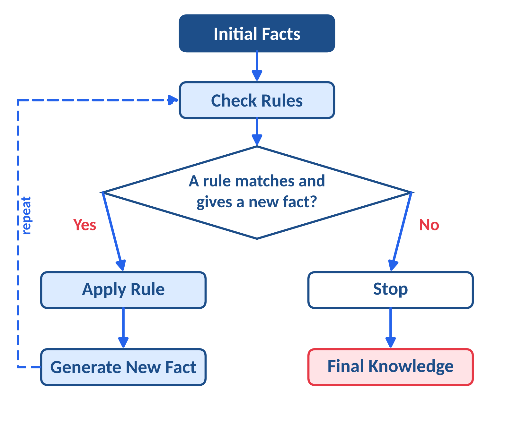

# 2.2 Logic and Reasoning

**Team Member:** Frederick Samuel Lesmana (`@Ti4nCi`)

**In this section:** Facts, Rules and Inference · Modus Ponens and Modus Tollens · Forward Chaining · Backward Chaining · Resolution and Unification · Conflict Resolution · Reasoning Under Uncertainty · Python Example · Limitations · Key Takeaways · Practice Questions and Answers

**Learning goals.** By the end of this section you can:
* use Modus Ponens and Modus Tollens to reach a conclusion, and spot the "affirming the consequent" mistake;
* trace forward chaining and backward chaining on a small set of rules;
* explain why a rule-based system needs conflict resolution and a way to handle uncertainty.

**Before you start:** read [2.1](04_What_is_Symbolic_AI.md). The logic symbols used in this section are listed in the table below; [2.3 Section 4](06_Knowledge_Representation.md) teaches them in full with truth tables.

**Logic symbols used in this section:**

| Symbol | Read it as | Example | Meaning of the example |
| :--- | :--- | :--- | :--- |
| `→` | "implies" or "if … then" | `Rain → WetGround` | If it rains, the ground is wet. |
| `¬` | "not" | `¬WetGround` | The ground is not wet. |
| `∧` | "and" | `Student(x) ∧ Suspended(x)` | x is a student and x is suspended. |
| `∨` | "or" | `P ∨ Q` | P is true, or Q is true, or both. |
| `∀x` | "for every x" | `∀x (Human(x) → Mortal(x))` | Every human is mortal. |
| `∴` | "therefore" | `∴ Q` | So Q must be true. |

---

## 1. Introduction

In [2.1](04_What_is_Symbolic_AI.md), we saw that Symbolic AI stores knowledge as symbols, facts and rules. But stored knowledge is not enough: an intelligent system must also use it to reach conclusions. This process is called **reasoning**. For example:

- Fact: Socrates is human.
- Rule: All humans are mortal.
- Conclusion: Socrates is mortal.

The system derives a new conclusion by applying a logical rule to existing knowledge.

---

## 2. Facts, Rules, and Inference

Three fundamental elements form the basis of symbolic reasoning.

### Facts

Facts are statements that a system accepts as true within its knowledge base.

Examples:

```text
Human(Socrates)
Student(Alex)
Studies(Alex, Mathematics)
```

### Rules

Rules describe relationships between conditions and conclusions. They are commonly expressed using IF–THEN statements.

Example:

```text
IF a person is human
THEN that person is mortal.
```

In predicate logic:

```text
∀x (Human(x) → Mortal(x))
```

Here, `x` stands for any individual, `∀x` means "for every x", and `→` means "implies". Inside a rule, the `∀x` is often left out, so `Human(x) → Mortal(x)` is read the same way.

### Inference

Inference is the process of deriving new conclusions from existing facts and rules.

Given:

- Fact: `Human(Socrates)`
- Rule: `IF Human(x), THEN Mortal(x)`

The system derives:

```text
Mortal(Socrates)
```

This allows a symbolic system to generate knowledge rather than simply store information.

---

## 3. Logical Inference

Logical inference provides formal methods for deriving valid conclusions.

Two fundamental inference rules are Modus Ponens and Modus Tollens.

### Modus Ponens

Modus Ponens follows this structure:

```text
P → Q
P
∴ Q
```

If P implies Q, and P is true, then Q must be true.

**Example:**

- Rule: If it rains, the ground becomes wet.
- Fact: It is raining.
- Conclusion: The ground is wet.

### Modus Tollens

Modus Tollens follows this structure:

```text
P → Q
¬Q
∴ ¬P
```

If P implies Q, but Q is false, then P must also be false.

**Example:**

- Rule: If a device is connected to electricity, its indicator is on.
- Observation: The indicator is not on.
- Conclusion: The device is not connected to electricity.

**Note:** This conclusion assumes the rule is always true. If the indicator can malfunction, the conclusion may be incorrect.

---

## 4. Forward Chaining

**Forward Chaining** is a data-driven reasoning method. It starts with known facts and applies relevant rules to generate new conclusions.

### Process

1. Read the available facts.
2. Find rules whose conditions match those facts.
3. Apply the matching rules.
4. Add new conclusions to the knowledge base.
5. Repeat until no rule adds a new fact. (A rule that has already fired would keep matching, so the system stops when nothing *new* can be added.)

### Example: University Scholarship System

This example uses the university's **Excellence Scholarship**, which has different rules from the Merit Scholarship in 2.1. Suppose a system contains these rules:

```text
Rule 1:
IF GPA(x) >= 3.8
THEN ExcellentAcademicPerformance(x).

Rule 2:
IF ExcellentAcademicPerformance(x)
AND CommunityService(x)
THEN ScholarshipEligible(x).
```

Initial facts (`GPA(Alex) = 3.9` is another way of writing `GPA(Alex, 3.9)`, the two-part form used for `GPA(Sammy, 3.8)` in 2.1):

```text
GPA(Alex) = 3.9
CommunityService(Alex)
```

The system applies Rule 1:

```text
ExcellentAcademicPerformance(Alex)
```

It then applies Rule 2:

```text
ScholarshipEligible(Alex)
```

It checks the rules once more. Both rules still match, but neither adds a fact that is not already known, so the system stops. It has reached a conclusion by working forward from known information.

### Forward Chaining Diagram


*Figure 2.4: Forward chaining repeats "match a rule, add a new fact" until no rule can add anything new.*

Read Figure 2.4 from the top. The dashed arrow on the left is the loop: every new fact sends the system back to check the rules again. The diamond is the stopping test.

### Applications

- Monitoring systems
- Automated decision-making
- Business rule engines
- Expert systems

---

## 5. Backward Chaining

**Backward Chaining** is a goal-driven reasoning method. Instead of starting with facts, it starts with a conclusion that the system wants to prove.

The system searches for rules and facts that support that conclusion.

### Process

1. Define the goal.
2. Find a rule that can establish the goal.
3. Identify the conditions required by that rule.
4. Check whether those conditions are known.
5. Search for additional rules if necessary.
6. Stop when the goal is proven or cannot be established.

### Example: Scholarship Eligibility

The system wants to prove:

```text
ScholarshipEligible(Alex)
```

It finds Rule 2:

```text
IF ExcellentAcademicPerformance(x)
AND CommunityService(x)
THEN ScholarshipEligible(x).
```

It now needs to establish two conditions:

```text
ExcellentAcademicPerformance(Alex)
CommunityService(Alex)
```

The second fact is already known.

To establish the first condition, the system uses Rule 1:

```text
IF GPA(x) >= 3.8
THEN ExcellentAcademicPerformance(x).
```

Since Alex's GPA is 3.9, the condition is satisfied.

Therefore:

```text
ScholarshipEligible(Alex)
```

The original goal has been proven.

### Backward Chaining Diagram


*Figure 2.5: Backward chaining starts from the goal and works down to known facts.*

Read Figure 2.5 from the top down: each question splits into the smaller questions it depends on, until every branch ends in a known fact.

### Applications

- Medical diagnosis
- Troubleshooting systems
- Logic programming
- Question-answering systems

---

## 6. Forward Chaining vs. Backward Chaining

| Feature | Forward Chaining | Backward Chaining |
|---|---|---|
| Approach | Data-driven | Goal-driven |
| Starting point | Known facts | Desired conclusion |
| Direction | Facts → Conclusions | Goal → Supporting facts |
| Main question | What can I conclude? | Can I prove this? |
| Best suited for | Discovering conclusions | Proving specific goals |

**Remember:**

- Forward Chaining starts with what the system knows.
- Backward Chaining starts with what the system wants to prove.

Neither method is universally better. The choice depends on the problem.

---

## 7. Resolution and Unification

Symbolic systems also use techniques to match logical statements and derive conclusions.

### Resolution

Resolution is an inference technique used in automated theorem proving. It combines logical statements by eliminating complementary expressions.

For example:

```text
P ∨ Q
¬P
∴ Q
```

Since P is false, Q must be true. This is the simplest case. Resolution works on statements made of terms joined by "or" (called **clauses**). More generally, resolution takes two statements with opposite terms, such as `P ∨ Q` and `¬P ∨ R`, and derives `Q ∨ R`.

Resolution is particularly important in automated proof systems, which use it to prove something by contradiction. To prove Q from `P ∨ Q` and `¬P`, the system adds the opposite, `¬Q`. Resolving `P ∨ Q` with `¬P` gives `Q`, and `Q` with `¬Q` leaves nothing at all (an empty clause). That means the facts contradict `¬Q`, so Q must be true.

### Unification

Unification finds substitutions that make two logical expressions identical.

Consider:

```text
Student(x)
Student(Alex)
```

These expressions can be matched using:

```text
x = Alex
```

This substitution is called a **unifier**.

Unification allows general rules to be applied to specific individuals.

Example:

```text
Rule:
IF Student(x)
THEN LibraryAccess(x).

Fact:
Student(Alex).
```

After unification, the system derives:

```text
LibraryAccess(Alex).
```

Unification is fundamental to logic programming languages such as Prolog.

---

## 8. Conflict Resolution

In a rule-based system, several rules can **match** the same facts at once. They are said to be *triggered*, and together they form the **conflict set**. The system must choose which one actually **fires** (runs).

Consider:

```text
Rule 1:
IF Student(x)
THEN LibraryAccess(x).

Rule 2:
IF Student(x) AND Suspended(x)
THEN NOT LibraryAccess(x).
```

For a suspended student, both rules match, and they recommend opposite things. If both fired, the knowledge base would contradict itself. The system needs a conflict resolution strategy to decide which rule fires.

Common strategies include:

| Strategy | Description |
|---|---|
| Rule Priority | Execute higher-priority rules first. |
| Specificity | Prefer more specific rules over general rules. |
| Recency | Prioritize rules triggered by more recently added information. |

Here, Rule 2 wins by **specificity**: it has all of Rule 1's conditions plus one more (`Suspended(x)`), so it describes a narrower, more specific case. It could also win because it is given a higher priority. Only Rule 2 fires, and the suspended student does not get library access.

Conflict resolution helps maintain consistent decision-making.

---

## 9. Reasoning Under Uncertainty

Classical logic treats every statement as either true or false. However, real-world information is often incomplete or uncertain.

Symbolic systems can incorporate additional methods to handle uncertainty.

### Certainty Factors

Certainty factors represent the degree of confidence associated with a conclusion.

Example:

```text
Possible infection: 0.75
```

This represents a confidence value of 0.75 within the system.

Certainty factors were used in expert systems such as MYCIN.

### Fuzzy Logic

Fuzzy Logic represents degrees of membership rather than restricting statements to completely true or false.

For example:

```text
Hot(30°C) = 0.8
```

This means that 30°C has a membership degree of 0.8 in the fuzzy category "Hot."

It is useful for representing vague concepts such as:

- Hot and cold
- Tall and short
- Fast and slow
- High and low risk

### Probabilistic Reasoning

Probabilistic reasoning uses probability theory to reason about uncertain information.

One common method is Bayes' theorem:

```text
P(H|E) = P(E|H) × P(H) / P(E)
```

Where:

- `H` = hypothesis.
- `E` = observed evidence.
- `P(H|E)` = probability of the hypothesis given the evidence.

For example, suppose 1 student in 100 has the flu (P(H) = 0.01). A flu test is positive for 90% of students who have flu (P(E|H) = 0.9), and 5 students in 100 test positive overall (P(E) = 0.05). Then a positive test means P(H|E) = 0.9 × 0.01 ÷ 0.05 = 0.18: only an 18% chance of flu, because most positive tests come from the many healthy students.

**Important distinction:** Fuzzy Logic represents degrees of membership in vague categories, while probability represents uncertainty about events or hypotheses.

---

## 10. Practical Implementation in Python

The following example demonstrates a simple rule-based system that determines scholarship eligibility.

```python
# Initial facts
gpa = 3.9
community_service = True

# Rule 1: Academic performance
if gpa >= 3.8:
    academic_excellence = True
else:
    academic_excellence = False

# Rule 2: Scholarship eligibility
if academic_excellence and community_service:
    scholarship_eligible = True
else:
    scholarship_eligible = False

# Final result
if scholarship_eligible:
    print("Student qualifies for the scholarship.")
else:
    print("Student does not qualify for the scholarship.")
```

**Output:**

```text
Student qualifies for the scholarship.
```

The developer explicitly defines the rules, and the program applies them to available facts.

Unlike machine learning, this system does not automatically learn its rules from training data.

---

## 11. Limitations of Symbolic Reasoning

Despite its strengths, symbolic reasoning has several limitations.

| Limitation | Explanation |
|---|---|
| Knowledge Dependency | The system depends on explicitly provided facts and rules. |
| Ambiguity | Vague information can be difficult to represent. |
| Knowledge Acquisition | Collecting and encoding expert knowledge can be time-consuming. |
| Limited Adaptability | Traditional systems do not automatically learn new rules from experience. |

These limitations explain why symbolic systems may struggle in complex environments where information constantly changes.

Combining symbolic reasoning with machine learning can help address some of these challenges.

---

## 12. Key Takeaways

| Concept | Meaning |
|---|---|
| Fact | Information accepted as true. |
| Rule | A logical relationship between conditions and conclusions. |
| Inference | Deriving new conclusions from existing knowledge. |
| Modus Ponens | If P implies Q and P is true, conclude Q. |
| Modus Tollens | If P implies Q and Q is false, conclude not P. |
| Forward Chaining | Starts with facts and derives conclusions. |
| Backward Chaining | Starts with a goal and searches for supporting facts. |
| Resolution | Combines logical statements to derive conclusions. |
| Unification | Matches expressions through substitutions. |
| Conflict Resolution | Determines which applicable rule takes priority. |
| Fuzzy Logic | Represents degrees of membership. |
| Probabilistic Reasoning | Uses probability to handle uncertainty. |

**Central idea:** Symbolic AI reasons by applying logical rules to explicitly represented knowledge, allowing systems to derive conclusions and make decisions.

---

## 13. Practice Questions and Answers

### Understanding

1. What is reasoning in Symbolic AI?
2. What is the difference between facts and rules?
3. Explain Modus Ponens and Modus Tollens.
4. What is the difference between Forward and Backward Chaining?
5. What is unification?

### Application

6. Given the following rule and fact, what conclusion can be derived?

```text
Rule:
IF a person is a student
THEN the person has library access.

Fact:
Student(Alex)
```

7. Why would Backward Chaining be suitable when investigating one specific conclusion?

8. Why might a rule-based system require conflict resolution?

9. How does Fuzzy Logic differ from probabilistic reasoning?

### Critical Thinking

10. Can a symbolic system reach an incorrect conclusion even when it applies its rules correctly? Explain.

11. Why might combining symbolic reasoning with machine learning be useful?

### Activities

12. **Trace it.** Use forward chaining on these rules and facts. List each step.

```text
Rule 1: IF A AND B THEN C
Rule 2: IF C THEN D
Rule 3: IF D AND E THEN F
Facts:  A, B, E
```

13. **Find the error.** A system reasons: "If it rains, the ground is wet. The ground is wet. Therefore, it rained." What is wrong?

### Answers

**1.** Reasoning is the process of using known facts and rules to derive new conclusions. For example, from `Human(Socrates)` and the rule `∀x (Human(x) → Mortal(x))`, the system derives `Mortal(Socrates)`.

**2.** A **fact** is a statement the system accepts as true, such as `Student(Alex)`. A **rule** describes what follows when certain conditions are true, such as `IF Student(x) THEN LibraryAccess(x)`. Facts describe the situation; rules describe how to reason about it.

**3.** **Modus Ponens:** if P → Q and P is true, then Q is true (it rains → the ground is wet; it is raining; so the ground is wet). **Modus Tollens:** if P → Q and Q is false, then P is false (if a device is connected, its indicator is on; the indicator is off; so the device is not connected).

**4.** **Forward chaining** starts from the known facts and applies rules to derive new facts until a conclusion is reached (data-driven). **Backward chaining** starts from a goal and works backward, looking for rules and facts that would prove it (goal-driven).

**5.** Unification finds a substitution that makes two logical expressions match. For example, `Student(x)` and `Student(Alex)` match with `x = Alex`, which lets a general rule about `x` be applied to Alex.

**6.** By unification (`x = Alex`) and Modus Ponens, the system derives `LibraryAccess(Alex)`: Alex has library access.

**7.** Backward chaining only explores the rules and facts that are relevant to the one goal being tested. It does not waste time deriving every possible conclusion from all the facts, so it is more efficient when there is a single question to answer, such as "Does this patient have condition X?".

**8.** Several rules can match the same facts and may recommend different or competing actions. For example, a suspended student matches both `IF Student(x) THEN LibraryAccess(x)` and `IF Student(x) AND Suspended(x) THEN NOT LibraryAccess(x)`, which contradict each other. Conflict resolution strategies, such as rule priority, specificity or recency, decide which matching rule fires, so that the system behaves consistently.

**9.** **Fuzzy logic** represents how much something belongs to a vague category, such as 30°C being "hot" to degree 0.8. **Probabilistic reasoning** represents how likely an uncertain event or hypothesis is, such as an 80% chance of rain. Fuzzy logic deals with vagueness; probability deals with uncertainty.

**10.** **Yes.** The reasoning can be logically valid but still reach a wrong conclusion if a fact is wrong or a rule is incomplete or outdated. For example, Modus Tollens concludes a device is unplugged when its indicator is off, but if the indicator bulb is broken, that conclusion is wrong. Correct reasoning only guarantees correct conclusions when the facts and rules are correct.

**11.** Machine learning is good at learning patterns from messy data, such as recognising images or speech, while symbolic reasoning is good at applying explicit rules and explaining its decisions. Combining them can give a system that both copes with real-world data and gives transparent, rule-checked answers. This is the idea behind neuro-symbolic AI (see [2.4](07_Expert_Systems.md)).

**12.** Step 1: A and B are true, so Rule 1 fires and adds C. Step 2: C is now true, so Rule 2 fires and adds D. Step 3: D and E are true, so Rule 3 fires and adds F. No rule can add a new fact, so the system stops. Final facts: A, B, E, C, D, F.

**13.** The system reversed the rule. "If it rains, the ground is wet" does not mean "if the ground is wet, it rained", because someone could have watered the garden. This mistake is called affirming the consequent. Modus Ponens needs P to be true, and Modus Tollens needs Q to be false.

---

## 14. References

1. Russell, S. J., & Norvig, P. (2021). *Artificial Intelligence: A Modern Approach* (4th ed.). Pearson.
2. Genesereth, M. R., & Nilsson, N. J. (1987). *Logical Foundations of Artificial Intelligence*. Morgan Kaufmann.
3. Poole, D., & Mackworth, A. (2017). *Artificial Intelligence: Foundations of Computational Agents* (2nd ed.). Cambridge University Press. [Online textbook](https://artint.info/2e/html/ArtInt2e.html)
4. Stanford Encyclopedia of Philosophy. [Classical Logic](https://plato.stanford.edu/entries/logic-classical/)
5. Stanford Encyclopedia of Philosophy. [Fuzzy Logic](https://plato.stanford.edu/entries/logic-fuzzy/)
