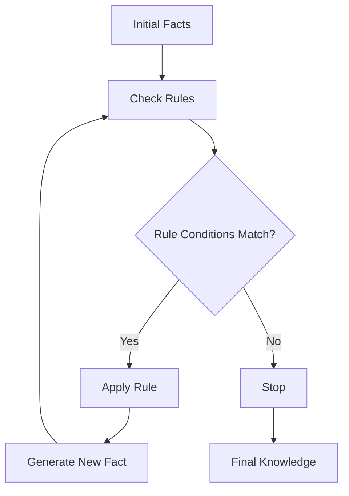
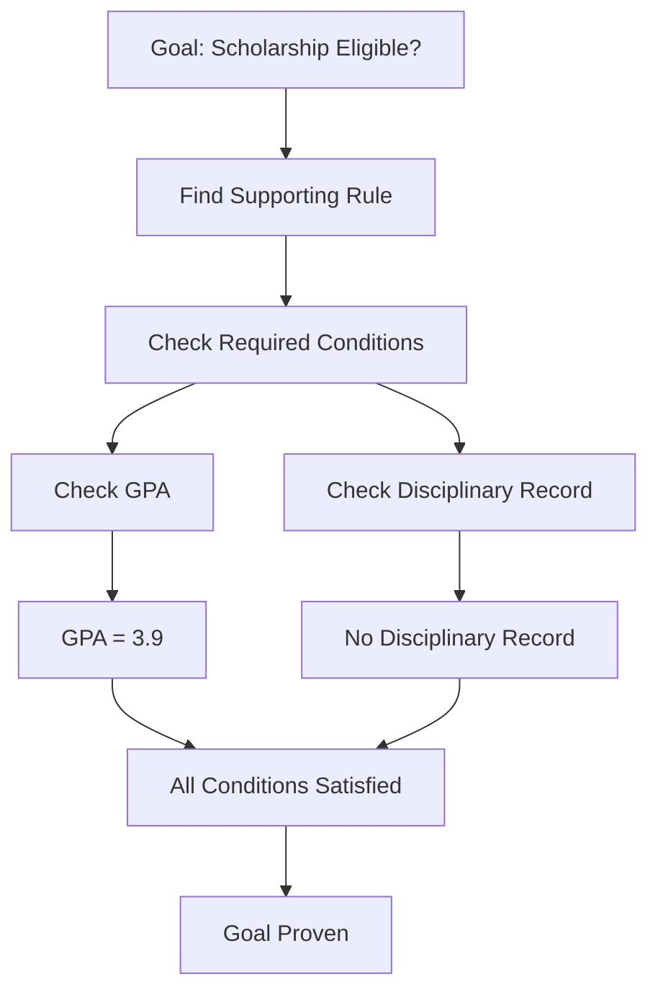

# 2.3 How Symbolic AI Reasons

**Status:** ✅ 
**Team Member:** Frederick Samuel Lesmana (@T1an_Ci)

---

## 1. Introduction

In the previous chapters, we explored how Symbolic AI represents knowledge through facts, rules, and logical structures.

However, storing knowledge is not enough. An intelligent system must also use that knowledge to reach conclusions.

This process is called **reasoning**.

For example:

- Fact: Socrates is human.
- Rule: All humans are mortal.
- Conclusion: Socrates is mortal.

The system derives a new conclusion by applying a logical rule to existing knowledge.

---

## 2. Facts, Rules, and Inference

Three fundamental elements form the basis of symbolic reasoning.

### 2.1 Facts

Facts are statements that a system accepts as true within its knowledge base.

Examples:

```text
Human(Socrates)
Student(Alex)
Studies(Alex, Mathematics)
```

### 2.2 Rules

Rules describe relationships between conditions and conclusions. They are commonly expressed using IF–THEN statements.

Example:

```text
IF a person is human
THEN that person is mortal.
```

In predicate logic:

\[
Human(x) \rightarrow Mortal(x)
\]

Here, \(x\) represents an individual, and \(\rightarrow\) means "implies."

### 2.3 Inference

Inference is the process of deriving new conclusions from existing facts and rules.

Given:

- Fact: `Human(Socrates)`
- Rule: `IF Human(x), THEN Mortal(x)`

The system derives:

```text
Mortal(Socrates)
```

This allows a symbolic system to generate knowledge rather than simply store information.

---

## 3. Logical Inference

Logical inference provides formal methods for deriving valid conclusions.

Two fundamental inference rules are Modus Ponens and Modus Tollens.

### 3.1 Modus Ponens

Modus Ponens follows this structure:

\[
P \rightarrow Q
\]

\[
P
\]

\[
\therefore Q
\]

If P implies Q, and P is true, then Q must be true.

**Example:**

- Rule: If it rains, the ground becomes wet.
- Fact: It is raining.
- Conclusion: The ground is wet.

### 3.2 Modus Tollens

Modus Tollens follows this structure:

\[
P \rightarrow Q
\]

\[
\neg Q
\]

\[
\therefore \neg P
\]

If P implies Q, but Q is false, then P must also be false.

**Example:**

- Rule: If a device is connected to electricity, its indicator is on.
- Observation: The indicator is not on.
- Conclusion: The device is not connected to electricity.

**Note:** This conclusion assumes the rule is always true. If the indicator can malfunction, the conclusion may be incorrect.

---

## 4. Forward Chaining

**Forward Chaining** is a data-driven reasoning method. It starts with known facts and applies relevant rules to generate new conclusions.

### Process

1. Read the available facts.
2. Find rules whose conditions match those facts.
3. Apply the matching rules.
4. Add new conclusions to the knowledge base.
5. Repeat until no more rules can be applied.

### Example: University Scholarship System

Suppose a system contains these rules:

```text
Rule 1:
IF GPA >= 3.8
THEN ExcellentAcademicPerformance.

Rule 2:
IF ExcellentAcademicPerformance
AND NoDisciplinaryRecord
THEN ScholarshipEligible.
```

Initial facts:

```text
GPA(Alex) = 3.9
NoDisciplinaryRecord(Alex)
```

The system applies Rule 1:

```text
ExcellentAcademicPerformance(Alex)
```

It then applies Rule 2:

```text
ScholarshipEligible(Alex)
```

The system reaches a conclusion by working forward from known information.

### Forward Chaining Diagram



### Applications

- Monitoring systems
- Automated decision-making
- Business rule engines
- Expert systems

---

## 5. Backward Chaining

**Backward Chaining** is a goal-driven reasoning method. Instead of starting with facts, it starts with a conclusion that the system wants to prove.

The system searches for rules and facts that support that conclusion.

### Process

1. Define the goal.
2. Find a rule that can establish the goal.
3. Identify the conditions required by that rule.
4. Check whether those conditions are known.
5. Search for additional rules if necessary.
6. Stop when the goal is proven or cannot be established.

### Example: Scholarship Eligibility

The system wants to prove:

```text
ScholarshipEligible(Alex)
```

It finds Rule 2:

```text
IF ExcellentAcademicPerformance(x)
AND NoDisciplinaryRecord(x)
THEN ScholarshipEligible(x).
```

It now needs to establish two conditions:

```text
ExcellentAcademicPerformance(Alex)
NoDisciplinaryRecord(Alex)
```

The second fact is already known.

To establish the first condition, the system uses Rule 1:

```text
IF GPA(x) >= 3.8
THEN ExcellentAcademicPerformance(x).
```

Since Alex's GPA is 3.9, the condition is satisfied.

Therefore:

```text
ScholarshipEligible(Alex)
```

The original goal has been proven.

### Backward Chaining Diagram



### Applications

- Medical diagnosis
- Troubleshooting systems
- Logic programming
- Question-answering systems

---

## 6. Forward Chaining vs. Backward Chaining

| Feature | Forward Chaining | Backward Chaining |
|---|---|---|
| Approach | Data-driven | Goal-driven |
| Starting point | Known facts | Desired conclusion |
| Direction | Facts → Conclusions | Goal → Supporting facts |
| Main question | What can I conclude? | Can I prove this? |
| Best suited for | Discovering conclusions | Proving specific goals |

**Remember:**

- Forward Chaining starts with what the system knows.
- Backward Chaining starts with what the system wants to prove.

Neither method is universally better. The choice depends on the problem.

---

## 7. Resolution and Unification

Symbolic systems also use techniques to match logical statements and derive conclusions.

### 7.1 Resolution

Resolution is an inference technique used in automated theorem proving. It combines logical statements by eliminating complementary expressions.

For example:

\[
P \lor Q
\]

\[
\neg P
\]

Therefore:

\[
Q
\]

Since P is false, Q must be true.

Resolution is particularly important in formal logic and automated proof systems.

### 7.2 Unification

Unification finds substitutions that make two logical expressions identical.

Consider:

\[
Student(x)
\]

\[
Student(Alex)
\]

These expressions can be matched using:

\[
x = Alex
\]

This substitution is called a **unifier**.

Unification allows general rules to be applied to specific individuals.

Example:

```text
Rule:
IF Student(x)
THEN LibraryAccess(x).

Fact:
Student(Alex).
```

After unification, the system derives:

```text
LibraryAccess(Alex).
```

Unification is fundamental to logic programming languages such as Prolog.

---

## 8. Conflict Resolution

In a rule-based system, multiple rules may be triggered simultaneously.

Consider:

```text
Rule 1:
IF a student has GPA >= 3.8
THEN ExcellentStudent.

Rule 2:
IF a student has a disciplinary record
THEN FlagForReview.
```

A student may satisfy both conditions.

If the rules prescribe competing actions, the system needs a conflict resolution strategy.

Common strategies include:

| Strategy | Description |
|---|---|
| Rule Priority | Execute higher-priority rules first. |
| Specificity | Prefer more specific rules over general rules. |
| Recency | Prioritize rules triggered by more recently added information. |

For example, a rule concerning a suspended student may override a general rule granting library access to students.

Conflict resolution helps maintain consistent decision-making.

---

## 9. Reasoning Under Uncertainty

Traditional classical logic generally treats statements as true or false. However, real-world information is often incomplete or uncertain.

Symbolic systems can incorporate additional methods to handle uncertainty.

### 9.1 Certainty Factors

Certainty factors represent the degree of confidence associated with a conclusion.

Example:

```text
Possible infection: 0.75
```

This represents a confidence value of 0.75 within the system.

Certainty factors were used in expert systems such as MYCIN.

### 9.2 Fuzzy Logic

Fuzzy Logic represents degrees of membership rather than restricting statements to completely true or false.

For example:

\[
\mu_{Hot}(30^\circ C) = 0.8
\]

This means that 30°C has a membership degree of 0.8 in the fuzzy category "Hot."

It is useful for representing vague concepts such as:

- Hot and cold
- Tall and short
- Fast and slow
- High and low risk

### 9.3 Probabilistic Reasoning

Probabilistic reasoning uses probability theory to reason about uncertain information.

One common method is Bayes' theorem:

\[
P(H|E)=\frac{P(E|H)P(H)}{P(E)}
\]

Where:

- \(H\) = hypothesis.
- \(E\) = observed evidence.
- \(P(H|E)\) = probability of the hypothesis given the evidence.

**Important distinction:** Fuzzy Logic represents degrees of membership in vague categories, while probability represents uncertainty about events or hypotheses.

---

## 10. Practical Implementation in Python

The following example demonstrates a simple rule-based system that determines scholarship eligibility.

```python
# Initial facts
gpa = 3.9
community_service = True

# Rule 1: Academic performance
if gpa >= 3.8:
    academic_excellence = True
else:
    academic_excellence = False

# Rule 2: Scholarship eligibility
if academic_excellence and community_service:
    scholarship_eligible = True
else:
    scholarship_eligible = False

# Final result
if scholarship_eligible:
    print("Student qualifies for the scholarship.")
else:
    print("Student does not qualify for the scholarship.")
```

**Output:**

```text
Student qualifies for the scholarship.
```

The developer explicitly defines the rules, and the program applies them to available facts.

Unlike machine learning, this system does not automatically learn its rules from training data.

---

## 11. Limitations of Symbolic Reasoning

Despite its strengths, symbolic reasoning has several limitations.

| Limitation | Explanation |
|---|---|
| Knowledge Dependency | The system depends on explicitly provided facts and rules. |
| Ambiguity | Vague information can be difficult to represent. |
| Knowledge Acquisition | Collecting and encoding expert knowledge can be time-consuming. |
| Limited Adaptability | Traditional systems do not automatically learn new rules from experience. |

These limitations explain why symbolic systems may struggle in complex environments where information constantly changes.

Combining symbolic reasoning with machine learning can help address some of these challenges.

---

## 12. Key Takeaways

| Concept | Meaning |
|---|---|
| Fact | Information accepted as true. |
| Rule | A logical relationship between conditions and conclusions. |
| Inference | Deriving new conclusions from existing knowledge. |
| Modus Ponens | If P implies Q and P is true, conclude Q. |
| Modus Tollens | If P implies Q and Q is false, conclude not P. |
| Forward Chaining | Starts with facts and derives conclusions. |
| Backward Chaining | Starts with a goal and searches for supporting facts. |
| Resolution | Combines logical statements to derive conclusions. |
| Unification | Matches expressions through substitutions. |
| Conflict Resolution | Determines which applicable rule takes priority. |
| Fuzzy Logic | Represents degrees of membership. |
| Probabilistic Reasoning | Uses probability to handle uncertainty. |

**Central idea:** Symbolic AI reasons by applying logical rules to explicitly represented knowledge, allowing systems to derive conclusions and make decisions.

---

## 13. Review Questions

### Understanding

1. What is reasoning in Symbolic AI?
2. What is the difference between facts and rules?
3. Explain Modus Ponens and Modus Tollens.
4. What is the difference between Forward and Backward Chaining?
5. What is unification?

### Application

6. Given the following rule and fact, what conclusion can be derived?

```text
Rule:
IF a person is a student
THEN the person has library access.

Fact:
Student(Alex)
```

7. Why would Backward Chaining be suitable when investigating one specific conclusion?

8. Why might a rule-based system require conflict resolution?

9. How does Fuzzy Logic differ from probabilistic reasoning?

### Critical Thinking

10. Can a symbolic system reach an incorrect conclusion even when it applies its rules correctly? Explain.

11. Why might combining symbolic reasoning with machine learning be useful?

---

## 14. References

1. Russell, S. J., & Norvig, P. (2021). *Artificial Intelligence: A Modern Approach* (4th ed.). Pearson.
2. Genesereth, M. R., & Nilsson, N. J. (1987). *Logical Foundations of Artificial Intelligence*. Morgan Kaufmann.
3. Poole, D., & Mackworth, A. (2017). *Artificial Intelligence: Foundations of Computational Agents* (2nd ed.). Cambridge University Press. [Online textbook](https://artint.info/2e/html/ArtInt2e.html)
4. Stanford Encyclopedia of Philosophy. [Classical Logic](https://plato.stanford.edu/entries/logic-classical/)
5. Stanford Encyclopedia of Philosophy. [Fuzzy Logic](https://plato.stanford.edu/entries/logic-fuzzy/)

