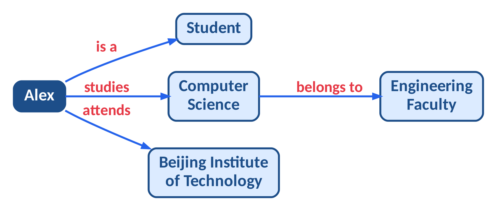
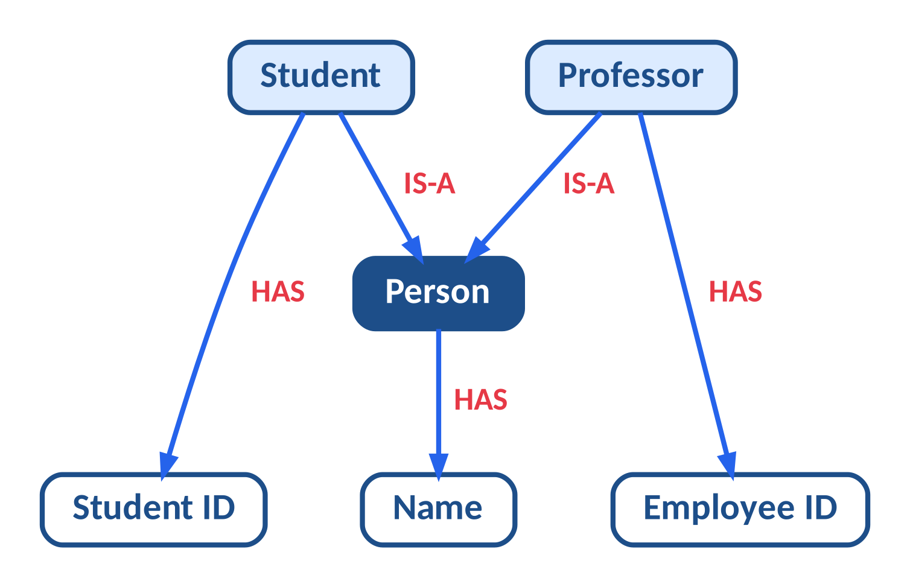
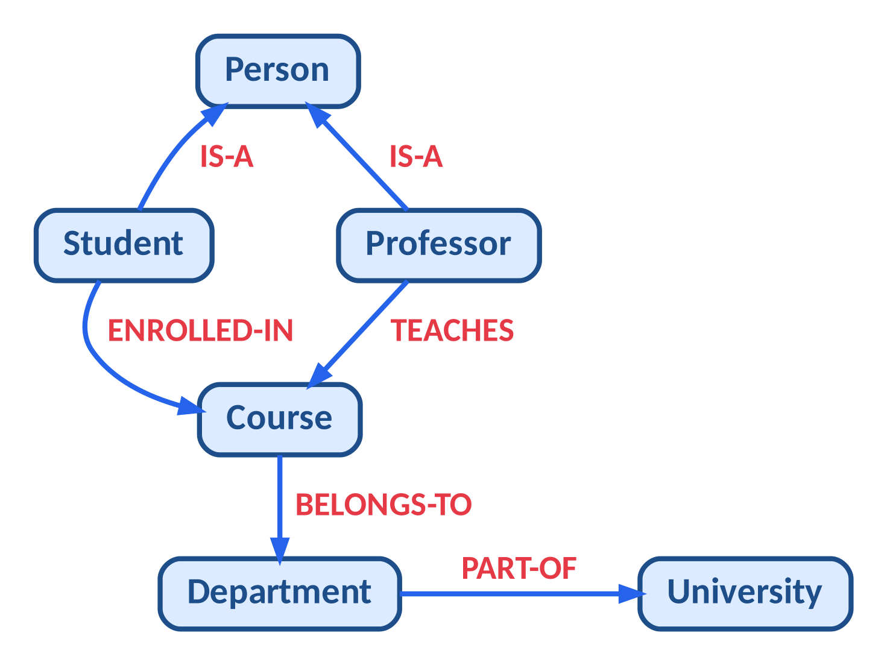
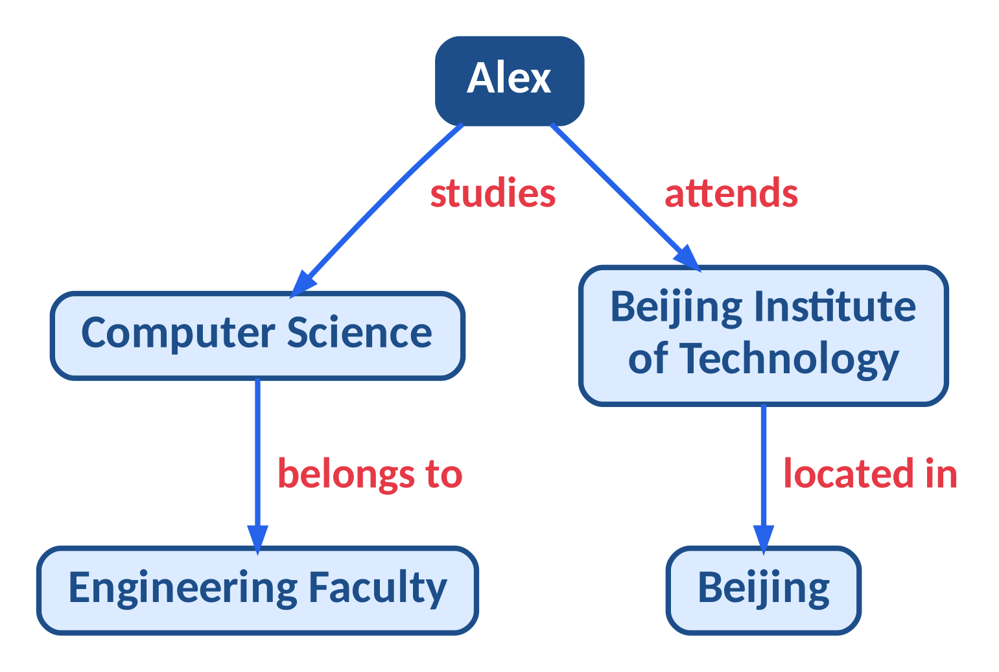
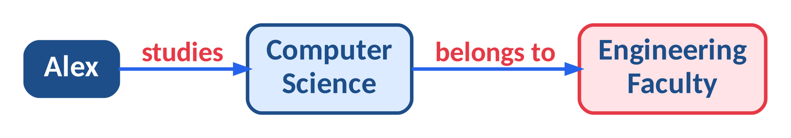

# 2.3 Knowledge Representation

**Team Member:** Cao Minh Tuan (`@mnhtnc`)

**In this section:** [Where We Are](#1-where-we-are-in-the-module) · [What is Knowledge Representation?](#2-what-is-knowledge-representation) · [Data, Information and Knowledge](#3-data-information-and-knowledge) · [Ways to Represent Knowledge](#4-different-ways-to-represent-knowledge) · [Propositional Logic and Logical Equivalences](#41-propositional-logic) · [Predicate Logic](#42-predicate-logic) · [Semantic Networks](#43-semantic-networks) · [Frames and Scripts](#44-frames) · [Rule-Based Representation](#45-rule-based-representation) · [Ontologies and Knowledge Graphs](#5-ontologies-and-knowledge-graphs) · [Comparing Methods](#6-comparing-knowledge-representation-methods) · [Where KR Is Used](#where-is-knowledge-representation-used) · [Putting It Together](#7-putting-everything-together-a-university-knowledge-system) · [Common Misunderstandings](#8-common-misunderstandings) · [Key Takeaways](#9-key-takeaways) · [Lab 2.3: Build a Knowledge Web](#lab-23-build-a-knowledge-web) · [Practice Questions](#10-practice-questions-and-answers) · [References](#11-references)

**Learning goals.** By the end of this section, you can:
* explain the difference between data, information and knowledge;
* write simple facts in propositional and predicate logic;
* store the same facts as a semantic network, a frame and a knowledge graph, and say which suits which job;
* answer a question by following the links in a knowledge graph.

**Before you start:** read [2.1 What is Symbolic AI?](04_What_is_Symbolic_AI.md) first, so that *symbol*, *fact* and *rule* are familiar. No maths is needed beyond "true or false". The logic symbols →, ∧, ∨ and ¬ are taught in §4.1–4.2 and also used in [2.2 Logic and Reasoning](05_Logic_and_Reasoning.md).

> **Pixel's Mission**  
> Byte works at the library desk. A student asks: *"Which faculty is Alex's major in?"* Byte starts reading 500 loose sentences, one by one.  
> **Predict first:** Which is fastest for answering: a list of sentences, a table, or linked facts? Write down your guess, then check it in §5.2, the lab and §10.

---

## 1. Where We Are in the Module

[2.1](04_What_is_Symbolic_AI.md) showed that Symbolic AI uses facts and rules; [2.2](05_Logic_and_Reasoning.md) showed how it reasons with them. This section asks **how a computer stores that knowledge**, for example the students, books and loans a library assistant must know. Reasoning (2.2) runs on top of this storage, and [2.4 Expert Systems](07_Expert_Systems.md) combines both.

---

## 2. What is Knowledge Representation?

**Knowledge Representation (KR)** is organizing and storing information about the world in a form a computer can use to answer questions, solve problems or make decisions. A record such as `Name: Alex, Age: 19, Major: Computer Science` is already a representation. Stating relationships (*Alex is a student; Alex studies Computer Science; Alex attends Beijing Institute of Technology*) makes it more useful: the computer now knows an object and how it relates to other things.

### Why Do We Need Knowledge Representation?

A human sees at once that "Alex is a student" and "Alex studies Computer Science" describe the same person; a computer knows it only if the structure marks Alex as the subject of both. With that structure it can store, retrieve, relate and reason.

> **Important:** KR does not mean the computer *understands* like a human. It means the information is organized so that a program can process it.

---

## 3. Data, Information and Knowledge

| Term | Meaning | Example | Puzzle picture |
|---|---|---|---|
| Data | Raw values without context | `19`, `Computer Science`, `Alex` | Loose pieces |
| Information | Data in a meaningful context | Alex is 19 and studies Computer Science. | Pieces arranged into a picture |
| Knowledge | Information organized to support relationships and decisions | Computer Science students belong to the Computer Science department. | Understanding what the picture shows |

**Example.** The record `Student: Alex, Age: 19, Major: Computer Science` is information. Add the rule

```text
IF a student studies Computer Science
THEN the student belongs to the Computer Science department.
```

and the system can conclude a new fact: **Alex belongs to the Computer Science department** (Modus Ponens, from [2.2](05_Logic_and_Reasoning.md)).

---

## 4. Different Ways to Represent Knowledge

No single structure suits every problem, so here are five approaches.

### 4.1 Propositional Logic

**Propositional Logic** stores knowledge as **propositions**: statements that are either TRUE or FALSE, such as `P: Alex is a student`. Writing `P = TRUE` tells the computer to treat P as true.

#### Logical Connectives

**Connectives** (logical operators) combine propositions. Let P = "Alex is a student" and Q = "Alex has a university ID":

| Operator | Written | In words | True when |
|---|---|---|---|
| AND | P ∧ Q | Alex is a student **and** has an ID. | both are true |
| OR | P ∨ Q | Alex is a student **or** has an ID (or both). | at least one is true |
| NOT | ¬P | Alex is **not** a student. | P is false (NOT reverses the value) |
| IMPLIES | P → Q | **If** Alex is a student, **then** Alex has an ID. | every case except P true and Q false |
| IF AND ONLY IF | P ↔ Q | Alex is a student **exactly when** Alex has an ID. | both true or both false |

#### Truth Table

A **truth table** lists the value of each expression for every combination of P and Q. The last two columns are used in the equivalences below.

| P | Q | P ∧ Q | P ∨ Q | P → Q | P ↔ Q | ¬(P ∧ Q) | ¬P ∨ ¬Q |
|---|---|---|---|---|---|---|---|
| TRUE | TRUE | TRUE | TRUE | TRUE | TRUE | FALSE | FALSE |
| TRUE | FALSE | FALSE | TRUE | **FALSE** | FALSE | TRUE | TRUE |
| FALSE | TRUE | FALSE | TRUE | TRUE | FALSE | TRUE | TRUE |
| FALSE | FALSE | FALSE | FALSE | TRUE | TRUE | TRUE | TRUE |

An implication is FALSE only when P is TRUE and Q is FALSE. If P is FALSE, the rule "if P then Q" has not been broken, so P → Q counts as TRUE. P ↔ Q is a **biconditional**: "A student may enter the exam hall (P) **if and only if** they show their student card (Q)" means the card is both needed and enough.

#### Logical Equivalences

Two statements are **logically equivalent** (≡) if they have the same truth value in every situation, so a system can swap one for the other without changing the meaning.

| Name | Equivalence | In words |
|---|---|---|
| **Double negation** | ¬(¬P) ≡ P | "It is not true that Alex is not a student" means "Alex is a student". |
| **De Morgan's law (AND)** | ¬(P ∧ Q) ≡ ¬P ∨ ¬Q | "Not (fine paid AND book returned)" means "fine not paid OR book not returned". |
| **De Morgan's law (OR)** | ¬(P ∨ Q) ≡ ¬P ∧ ¬Q | "Not (has fever OR has cough)" means "no fever AND no cough". |

The truth table proves De Morgan's law (AND): its last two columns, ¬(P ∧ Q) and ¬P ∨ ¬Q, match in every row. (¬(P ∧ Q) is the opposite of the P ∧ Q column; ¬P ∨ ¬Q is TRUE whenever P or Q is FALSE.)

> **Tip for remembering De Morgan's laws:** when you move a NOT inside the brackets, NOT goes onto each part and AND and OR swap places.

#### When Is Propositional Logic Useful?

It suits simple conditions, such as exam eligibility or system access. Its limit: each statement is one whole. "Alex is a student" is just P, so the logic cannot see the object Alex, its properties or its relationships. Predicate logic can.

### 4.2 Predicate Logic

**Predicate Logic** (First-Order Logic, FOL) extends propositional logic to objects, their properties, their relationships, and statements about groups of objects.

#### Understanding Predicates

A **predicate** names a property or a relationship. Applied to particular objects, it makes a statement that is TRUE or FALSE. The objects in brackets are the **arguments**; named objects such as `Alex` are **constants**.

| Predicate statement | Meaning | Kind |
|---|---|---|
| `Student(Alex)` | Alex is a student. | Property (one object) |
| `Professor(Michael)` | Michael is a professor. | Property (one object) |
| `Studies(Alex, ComputerScience)` | Alex studies Computer Science. | Relationship (two objects) |
| `Teaches(Michael, ArtificialIntelligence)` | Michael teaches Artificial Intelligence. | Relationship (two objects) |

#### Quantifiers

A **quantifier** says how many objects a statement covers. A **variable** such as `x` stands for any object in the domain (the set of things we are talking about).

| Symbol | Name and meaning | Example | In plain English |
|---|---|---|---|
| ∀ | Universal: "for all", "every" | `∀x (Student(x) → HasStudentID(x))` | For every x, if x is a student, x has a student ID. |
| ∃ | Existential: "there exists at least one" | `∃x (Student(x) ∧ Studies(x, ComputerScience))` | At least one x is a student and studies Computer Science. |

> **A common trap:** ∀ usually goes with →, and ∃ with ∧. Writing ∀x (Student(x) ∧ HasStudentID(x)) would claim that *everything* in the domain is a student.

#### Why Is Predicate Logic Better for Complex Knowledge?

For 10,000 students, propositional logic needs one statement per student ("Alex has an ID", "Bella has an ID", …). In predicate logic, the single rule ∀x (Student(x) → HasStudentID(x)) covers them all. Predicate logic is more **expressive**: it says more with fewer statements.

### 4.3 Semantic Networks

A **Semantic Network** stores knowledge as **nodes** (objects or concepts) joined by **edges** (labeled relationships), like a social network whose every connection is labeled with its meaning.

The facts "Alex is a student", "Alex studies Computer Science", "Computer Science belongs to the Engineering Faculty" and "Alex attends Beijing Institute of Technology" become this network:



*Figure 2.6: A semantic network about Alex. Boxes are concepts; labeled arrows are relationships.*

#### Understanding Relationships

The edge labels are chosen by whoever designs the model. Common ones:

| Relationship | Meaning | Example |
|---|---|---|
| IS-A | Category ("is a kind of") | Student IS-A Person |
| PART-OF | Membership or composition | Computer Science PART-OF Engineering Faculty (drawn as "belongs to" in Figure 2.6) |
| HAS-A | Possession or attribute | Student HAS-A Student ID |
| STUDIES | Academic relationship | Alex STUDIES Computer Science |

#### Inheritance

**Inheritance** means a concept receives the properties of a more general concept it is linked to by IS-A.



*Figure 2.7: Inheritance. Student and Professor inherit "has a Name" from Person.*

IS-A arrows point from specific to general (a Student IS-A Person). Properties pass the opposite way, from general to specific: every person has a name, so Student and Professor inherit Name and it is stored once. Person does not get Student ID from Student.

Inherited properties are **defaults**: a more specific node's own value wins, which is how a network handles **exceptions**. If Student had the default "lives in: Campus Dorm" but Alex's node said "lives in: Family Home", the system would use Family Home for Alex and Campus Dorm for every other student.

- **Advantages:** easy to visualize; makes relationships clear; organizes lots of connected knowledge; supports inheritance (in suitable designs).
- **Limitations:** large networks become hard to manage; each relationship's meaning must be clearly defined; complex logical conditions are harder to express than in formal logic.

### 4.4 Frames

A **Frame** stores one object or concept as a set of attributes and values, like a form or a profile.

```text
FRAME: Student

Name: Alex
Age: 19
University: Beijing Institute of Technology
Major: Computer Science
Student ID: BIT2026
```

`Name`, `Age` and the other attributes are **slots**; `Alex`, `19` and so on are **slot values**. Strictly, this is one filled-in copy, an **instance**, of the Student frame; the general Student frame is the empty template, like a blank form.

#### Default Values and Inheritance

A slot can have a **default value**, used whenever no other value is given. A frame can also inherit slots from a more general frame through an IS-A slot:

```text
FRAME: Person
Name: (empty)
Age: (empty)

FRAME: Student
IS-A: Person
University: (empty)
Major: Undeclared   (default value)
```

Student inherits Name and Age from Person, so they are not defined again. A student created without a major gets the default `Undeclared`; a value given for one student **overrides** it, so Alex's `Major: Computer Science` is used.


*Figure 2.8: Frames as forms. The templates are blank forms; Alex's frame is one filled-in copy that gets Name and Age from Person and replaces the default major.*

Frames suit objects with several attributes: student profiles, employee records, patient records, product information.

- **Advantages:** easy to organize; a natural way to describe objects; supports default values and reusable structures.
- **Limitations:** not ideal for every relationship; complex reasoning needs extra mechanisms; inheritance can get complicated.

#### Scripts

A **script** is a **sequence of frames** describing a typical series of events: what usually happens, in what order.

```text
SCRIPT: Borrowing a Library Book

1. Student enters the library.
2. Student finds the book on the shelf.
3. Student takes the book to the counter.
4. Librarian scans the student card and the book.
5. Student leaves with the book.
```

The script lets the system fill in missing steps: told "Alex took a book to the counter and then left the library", it infers that the librarian scanned Alex's card.


*Figure 2.9: The library script as a timeline. Alex's story mentions steps 3 and 5; the script fills in step 4.*

### 4.5 Rule-Based Representation

**Rule-based representation** stores knowledge as **production rules**: IF-THEN statements linking conditions to conclusions or actions. The system applies them to infer new knowledge. A medical diagnosis system might contain:

```text
IF the patient has a fever
AND the patient has a cough
THEN consider the possibility of a respiratory infection.
```

Given a patient with a fever and a cough, the system concludes that a respiratory infection is possible. Each rule is one piece of knowledge, so rules are easy to read and update. How rules are chosen and applied (forward and backward chaining, conflict resolution) is in [2.2](05_Logic_and_Reasoning.md); complete rule-based systems are in [2.4](07_Expert_Systems.md).

---

## 5. Ontologies and Knowledge Graphs

### 5.1 Ontologies

An **Ontology** is a formal description of the concepts in a domain (what kinds of things exist), what they mean, and how they may relate, so every part of a large system uses the same terms. A university ontology might define Student, Professor, Course, Department and University and relate them: Student ENROLLED-IN Course, Professor TEACHES Course, Course BELONGS-TO Department, Department PART-OF University (Figure 2.10). It also sets constraints:

- A Student is a type of Person, and so is a Professor.
- A Course must belong to a Department.
- A Professor can teach several Courses.



*Figure 2.10: A small university ontology. Every box is a general concept (a kind of thing), not one particular student or course.*

#### Why Are Ontologies Useful?

If one university system says `Student` and another says `Learner`, each with its own definition, combining their data is hard. A shared ontology fixes the vocabulary ("Learner means the same as Student"), so the systems can exchange data. Ontologies are used in healthcare, scientific research, knowledge-based systems, the Semantic Web and enterprise data management.

### 5.2 Knowledge Graphs

A **Knowledge Graph** stores information as a network of **entities** (identifiable things: a person, a university, a course, a place) and their relationships, usually as **triples**:

```text
Subject → Predicate → Object
```

The "predicate" is the relationship, as `Studies` is in `Studies(Alex, ComputerScience)`. Each triple links two entities:

```text
Alex → studies → Computer Science
Alex → attends → Beijing Institute of Technology
Computer Science → belongs to → Engineering Faculty
Beijing Institute of Technology → located in → Beijing
```



*Figure 2.11: A small knowledge graph built from subject–predicate–object triples.*

A computer retrieves information by following relationships. **Question:** Which faculty does Alex's major belong to? The system follows two links:



*Figure 2.12: Following two relationships answers the question.*

**Answer:** the Engineering Faculty. No single triple stores this answer; the chain of links does. To store it as a **new fact** ("Alex is in the Engineering Faculty"), the system needs a rule such as "IF x studies y as their major AND y belongs to z THEN x is in z", applied with the reasoning methods in [2.2 Logic and Reasoning](05_Logic_and_Reasoning.md).

#### Ontology vs Knowledge Graph

| Ontology | Knowledge Graph |
|---|---|
| Defines concepts and their relationships | Stores connected entities and facts |
| Sets the rules and constraints of a domain | Represents actual information about entities |
| Describes how knowledge should be organized | Contains knowledge organized as a graph |
| Example: A Student is a type of Person. | Example: Alex is a Student. |

An ontology is the blueprint; a knowledge graph holds the information built from it. A graph does not always need a formal ontology, but one gives it consistent structure and meaning.

---

## 6. Comparing Knowledge Representation Methods

No method is best overall; the choice depends on the problem, and real systems often combine several.

| Method | Main idea | Best used for |
|---|---|---|
| Propositional Logic | TRUE/FALSE statements | Simple conditions (is this student eligible?) |
| Predicate Logic | Objects, properties, relationships | Expressive statements (which students take which courses) |
| Semantic Networks | Nodes joined by labeled edges | Visualizing connected concepts |
| Frames and Scripts | Objects with slots; typical event sequences | Profiles and records; everyday situations |
| Rule-Based Representation | IF-THEN production rules | Conditions that lead to conclusions or actions |
| Ontologies | Formal concepts and definitions | A shared vocabulary for a domain |
| Knowledge Graphs | Entities linked by triples | Linking and retrieving facts across many entities |

### Where Is Knowledge Representation Used?

- **Medical diagnosis:** symptoms, diseases and medical expertise.
- **Natural language understanding:** knowledge about language, to understand and generate it.
- **Robotics:** space, objects and tasks, to locate and handle objects and plan (see [2.5](08_Planning_and_Problem_Solving.md)).
- **Expert systems:** one field's knowledge, for expert-level advice (see [2.4](07_Expert_Systems.md)).

---

## 7. Putting Everything Together: A University Knowledge System

Sections 4–5 described one university (Beijing Institute of Technology, BIT) in seven ways. Each organizes the same knowledge for a different job; this is the main idea of Knowledge Representation.

| Method | BIT example |
|---|---|
| Propositional logic | P: Alex is a student. Q: Alex has an ID. |
| Predicate logic | `Student(Alex)`, ∀x (Student(x) → HasStudentID(x)) |
| Semantic network | Alex —studies→ Computer Science (Figure 2.6) |
| Frame | Alex's filled-in Student frame |
| Rule | If a student studies CS, then they belong to the CS department |
| Ontology | Student IS-A Person |
| Knowledge graph | Alex → attends → BIT |

---

## 8. Common Misunderstandings

| Misunderstanding | What is actually true |
|---|---|
| "KR is just storing data." | It organizes information into structures a program can process. |
| "Propositional and predicate logic are the same." | Predicate logic also describes objects, properties, relationships and quantifiers. |
| "A semantic network is exactly a knowledge graph." | Both link concepts, but knowledge graphs define entities and relationships more formally. |
| "An ontology is a database." | An ontology defines concepts and meanings; a database stores and manages data. |
| "Frames are just tables." | Frames can have inheritance and default values; a plain table cannot. |
| "A knowledge graph understands everything linked to it." | It only stores relationships; rules are needed to derive new conclusions. |

---

## 9. Key Takeaways

* **Data → information → knowledge:** raw values gain context, then support relationships and decisions.
* **Propositional logic** combines whole TRUE/FALSE statements; **predicate logic** adds objects, properties, relationships and quantifiers (∀ with →, ∃ with ∧).
* **Semantic networks** (labeled links, IS-A inheritance), **frames** (slots, defaults), **scripts** (typical event sequences) and **IF-THEN rules** each structure knowledge for a different job.
* An **ontology** defines a domain's concepts; a **knowledge graph** stores facts as triples and answers questions by following links. Real systems combine methods (§6).

---

## Lab 2.3: Build a Knowledge Web

* **Goal:** Store the same facts as a knowledge graph and as a frame, then answer questions by following links instead of reading every sentence.
* **Preparation:** Paper and pen, about 15 minutes, no computer. Re-read §4.3 (inheritance), §4.4 (frames) and §5.2 (triples).
* **Task:** Byte's library desk has nine facts about a new student, Mei:
  1. Mei is a Student.
  2. Mei studies Artificial Intelligence.
  3. Mei lives in Dorm 5.
  4. Mei borrowed the book *Logic for Beginners*.
  5. *Logic for Beginners* is shelved on Library Floor 3.
  6. Artificial Intelligence belongs to the Computing Faculty.
  7. The Computing Faculty is part of BIT.
  8. Student IS-A Person.
  9. Every Person has a Name and an Age.

  **Step 1, predict:** how many links must Byte follow to answer "Which faculty is Mei's major in?"  
  **Step 2, build the graph:** rewrite every fact as a triple, `subject → relationship → object` (fact 9 gives two). A list is enough; drawing is optional.  
  **Step 3, follow the links:** answer each question and write down your path.  
  a. Which faculty is Mei's major in?  
  b. On which floor is the book Mei borrowed?  
  c. Which university is Mei's major part of?  
  d. Does Mei have a Name slot? Which links tell you so?  
  **Step 4, build a frame:** fill in a frame for Mei as in §4.4, with an `INSTANCE-OF` slot (Mei is one student, like Alex in Figure 2.8) and one slot per fact about Mei. What does it give for her Age?
* **Observation:** For each Step 3 question, record the number of links and the relationship names used. Compare with reading the nine sentences from the top.
* **Reflection:**
  1. Why is following links faster than reading 500 loose sentences?
  2. Which question was easier with the frame, and which with the graph?
  3. A student asks Byte: "Is Mei's book overdue?" Can your graph answer this? What would you need to add?

<details>
<summary><b>Feedback: check your knowledge web</b></summary>

* **Triples (Step 2):** `Mei → is a → Student`, `Mei → studies → Artificial Intelligence`, `Mei → lives in → Dorm 5`, `Mei → borrowed → Logic for Beginners`, `Logic for Beginners → shelved on → Library Floor 3`, `Artificial Intelligence → belongs to → Computing Faculty`, `Computing Faculty → part of → BIT`, `Student → IS-A → Person`, `Person → has → Name`, `Person → has → Age`. Names may differ; what matters is one subject, relationship and object per triple. Drawn, the graph looks like Figure 2.13.

  

  *Figure 2.13: Mei's facts as a knowledge web. Mei is the hub; every question in Step 3 is a path along the arrows.*
* **Answers (Step 3):**  
  a. Mei → studies → Artificial Intelligence → belongs to → Computing Faculty: **2 links**, **Computing Faculty**. This is Byte's Mission question, asked about Mei.  
  b. Mei → borrowed → Logic for Beginners → shelved on → Library Floor 3: **2 links**, **Floor 3**.  
  c. Mei → studies → Artificial Intelligence → belongs to → Computing Faculty → part of → BIT: **3 links**, **BIT**.  
  d. **Yes.** Mei → is a → Student → IS-A → Person → has → Name: **3 links**. Mei inherits the Name slot through the IS-A chain (§4.3); no fact names her directly.
* **Frame (Step 4):**

  ```text
  FRAME: Mei
  INSTANCE-OF: Student
  Name: Mei
  Age: (inherited from Person, empty)
  Major: Artificial Intelligence
  Lives in: Dorm 5
  Borrowed: Logic for Beginners
  ```

  Mei has **Name** and **Age** slots, both inherited from Person through Student. Name is filled in (*Mei*), but Age is **empty**: no fact gives her age. The system should report "unknown", not guess.
* **What it shows:** reading from the top, Byte needs 6 sentences to answer question a, because the faculty link is fact 6; with 500 sentences it could need hundreds. With linked facts, Byte starts at Mei and follows only the arrows that matter. The frame is best for "tell me everything about Mei" (one lookup gives all her slots); the graph is best for questions that cross from one thing to another (Mei → major → faculty → university).
* **Reflection answers:** (1–2) See *What it shows* above. (3) **No.** The graph stores only the links you gave it, and none mention a due date or today's date. You would need new facts (`Logic for Beginners → due on → 1 December`, today's date) plus a rule: "IF the due date is before today THEN the book is overdue". Applying that rule is reasoning ([2.2](05_Logic_and_Reasoning.md)), not just following links.

</details>

---

## 10. Practice Questions and Answers

**Mission check.** Linked facts are the easiest to follow: in 500 loose sentences nothing tells Byte which one matters. (A well-designed database with a join could answer this one question just as quickly; a graph's real advantage is that new kinds of link can be added and followed across many steps without redesigning tables.) In the knowledge graph (§5.2), Byte follows two links from Alex to the **Engineering Faculty**. A table or frame holds one student's details, but this question also needs the major-to-faculty link, which a graph stores (as you saw with Mei in the lab).

Try each question yourself first, then open the answers to check.

### Questions

**1.** *Understanding KR.* What is Knowledge Representation, and why is it important in Symbolic AI?

**2.** *Data, Information and Knowledge.* Explain the difference using an example of your own.

**3.** *Propositional Logic.* Let P: "Alex is a student" and Q: "Alex has a university ID". With P = TRUE and Q = FALSE, is each expression TRUE or FALSE?  
a. P ∧ Q  b. P ∨ Q  c. ¬P  d. P → Q

**4.** *Predicate Logic.* Translate into predicate logic:  
a. Alex is a student.  
b. Alex studies Mathematics.  
c. Every student has a student ID.  
d. At least one student studies Artificial Intelligence.

**5.** *Semantic Networks.* What are nodes and edges in a semantic network? Give an example of a relationship between two concepts.

**6.** *Frames.* Create a Professor frame for one professor with at least four slots, and explain what a slot and a slot value are.

**7.** *Ontologies vs Knowledge Graphs.* Explain the difference. Why might a knowledge graph use an ontology?

**8.** *Choosing a Representation.* Choose the best method for each situation and give a one-line reason.  
a. A program must decide whether two simple conditions are TRUE.  
b. A system must store a person's name, age and occupation.  
c. A university wants a diagram of how the concepts Student, Professor and Course are related.  
d. A system must define what concepts such as Student, Professor and Course mean.  
e. A search engine must connect facts about millions of real people, organizations and locations.

**9.** *Critical Thinking.* Why might combining several representation methods be better than relying on one?

**10.** *Connecting to 2.1.* Symbolic AI uses facts and rules (2.1). How does Knowledge Representation help a system store them in an organized way?

<details>
<summary><b>Show answers</b> (try the questions first!)</summary>

**1.** KR is organizing and storing knowledge in a form a computer can use. Symbolic AI needs this structure to retrieve information, apply rules and solve problems.

**2.** Your example will differ. A model answer from a weather app:
- *Data:* `32`, `Beijing`, `July 10`: raw values with no context.
- *Information:* the temperature in Beijing on July 10 was 32 °C: the values are organized and have meaning.
- *Knowledge:* above 30 °C, outdoor sports classes move indoors. This links the information to a decision, so a system could conclude "move today's class indoors".

**3.** a. **FALSE**: AND needs both parts TRUE, and Q is FALSE. b. **TRUE**: OR needs only one, and P is TRUE. c. **FALSE**: NOT reverses P. d. **FALSE**: P TRUE with Q FALSE is the only FALSE row of IMPLIES.

**4.** a. `Student(Alex)`: a property of one object. b. `Studies(Alex, Mathematics)`: a relationship between two objects. c. `∀x (Student(x) → HasStudentID(x))`: "every" uses ∀ with →. d. `∃x (Student(x) ∧ Studies(x, ArtificialIntelligence))`: "at least one" uses ∃ with ∧.

**5.** Nodes are objects or concepts; edges are the labeled relationships between them. In `Alex → studies → Computer Science`, Alex and Computer Science are nodes and "studies" is the edge.

**6.** Example:

```text
FRAME: Professor (instance for Michael)
Name: Michael
Age: 42
Department: Mathematics
University: Beijing Institute of Technology
```

A slot is an attribute, such as Name or Age; a slot value is what fills it, such as Michael or 42.

**7.** An ontology defines a domain's concepts, meanings and valid relationships; a knowledge graph stores connected entities and facts. A graph uses an ontology to keep its definitions and structure consistent.

**8.** a. **Propositional logic**: simple TRUE/FALSE conditions, no objects needed. b. **Frames**: one object with several slots. c. **Semantic network**: concepts as nodes, relationships as labeled edges. d. **Ontology**: it defines what concepts mean and how they may relate. e. **Knowledge graph**: millions of entities linked by triples that can be followed to answer questions.

**9.** Methods have different strengths: frames store Alex's profile neatly, IF-THEN rules state the scholarship conditions, and an ontology makes two systems agree on what "Student" means. No single method does all three well, so real systems combine them.

**10.** KR gives facts and rules a structure: predicate logic stores facts such as `Student(Alex)`, and rule-based representation stores rules such as "IF a student studies Computer Science THEN the student belongs to the Computer Science department". Because both use the same symbols, the reasoning of 2.2 (and an expert system's inference engine, 2.4) can match facts against rules to reach new conclusions.

</details>

---

## 11. References

1. Brachman, R. J., & Levesque, H. J. (2004). *Knowledge Representation and Reasoning*. Morgan Kaufmann.
2. Russell, S. J., & Norvig, P. (2021). *Artificial Intelligence: A Modern Approach* (4th ed.). Pearson.
3. Sowa, J. F. (2000). *Knowledge Representation: Logical, Philosophical, and Computational Foundations*. Brooks/Cole.
4. Gruber, T. R. (1993). A translation approach to portable ontology specifications. *Knowledge Acquisition*, 5(2), 199–220.
5. Berners-Lee, T., Hendler, J., & Lassila, O. (2001). The Semantic Web. *Scientific American*, 284(5), 34–43.
6. W3C. (2014). *RDF 1.1 Concepts and Abstract Syntax*. https://www.w3.org/TR/rdf11-concepts/
7. W3C. (2012). *OWL 2 Web Ontology Language: Document Overview (Second Edition)*. https://www.w3.org/TR/owl2-overview/

