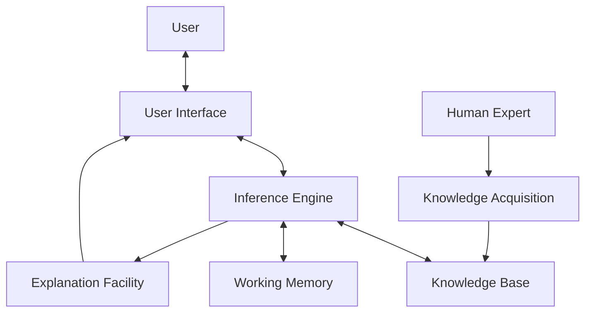

# 2.4 Expert Systems

**Status:** ✅  
**Team Member:** Lu My Ky (`@jojolu11`)

**In this section:** How Expert Systems Work · How an Expert System Makes Decisions · MYCIN, DENDRAL and XCON · Expert Systems vs. Traditional Programs · Advantages · Limitations · Expert Systems and Modern AI · Key Takeaways · Review Questions and Answers 

---

## 1. Introduction

An **Expert System** is a type of AI that uses stored knowledge and logical rules to solve problems within a specific domain.

It attempts to imitate the decision-making ability of a human expert.

For example, a medical expert system can analyze symptoms and medical knowledge to suggest possible diagnoses.

Unlike general-purpose AI, expert systems are designed for specific tasks and rely heavily on explicitly defined knowledge.

They are one of the most important practical applications of Symbolic AI.

---

## 2. How Expert Systems Work

An expert system combines a knowledge base with a reasoning mechanism to produce conclusions.

Its main components include:

1. Knowledge Base
2. Inference Engine
3. Working Memory
4. User Interface
5. Explanation Facility
6. Knowledge Acquisition Component

### 2.1 Expert System Architecture



### 2.2 Main Components

| Component | Function |
|---|---|
| Knowledge Base | Stores facts, rules, and domain knowledge. |
| Inference Engine | Applies logical rules to derive conclusions. |
| Working Memory | Stores information about the current problem. |
| User Interface | Allows users to interact with the system. |
| Explanation Facility | Explains how the system reached a conclusion. |
| Knowledge Acquisition | Collects and organizes knowledge from experts. |

Each component contributes to the system's ability to make decisions.

### 2.3 Knowledge Base

The knowledge base contains the information required to solve problems in a particular domain.

It commonly includes:

- Facts: Information about the domain.
- Rules: Logical relationships used to reach conclusions.

Example:

```text
Fact:
Patient has a fever.

Rule:
IF a patient has a fever
AND a persistent cough
THEN consider a respiratory infection.
```

The quality of an expert system depends heavily on the accuracy and completeness of its knowledge base.

### 2.4 Inference Engine

The inference engine is responsible for applying rules to available information.

It determines which rules are relevant and uses them to derive conclusions.

Two common reasoning methods are:

- Forward Chaining: Starts with known facts and derives conclusions.
- Backward Chaining: Starts with a goal and searches for supporting facts.

These methods were discussed in [2.3 How Symbolic AI Reasons](06_How_Symbolic_AI_Reasons.md).

### 2.5 Explanation Facility

An explanation facility allows users to understand why the system reached a particular conclusion.

For example:

```text
Conclusion:
Possible respiratory infection.

Explanation:
1. The patient has a fever.
2. The patient has a persistent cough.
3. Both conditions match an existing rule.
```

This improves transparency and helps users evaluate the system's recommendations.

---

## 3. How an Expert System Makes Decisions

Consider a simple university expert system that determines whether a student qualifies for an academic scholarship.

The system contains these rules:

```text
Rule 1:
IF GPA >= 3.8
THEN ExcellentAcademicPerformance.

Rule 2:
IF ExcellentAcademicPerformance
AND CommunityService
THEN ScholarshipEligible.
```

The system receives:

```text
Student: Alex
GPA: 3.9
CommunityService: True
```

Using Forward Chaining:

**Step 1:** The system checks Alex's GPA.

Since 3.9 is greater than 3.8, it derives:

```text
ExcellentAcademicPerformance(Alex)
```

**Step 2:** The system checks the second rule.

Both conditions are satisfied, so it derives:

```text
ScholarshipEligible(Alex)
```

**Final result:**

```text
Alex qualifies for the scholarship.
```

The system reaches this conclusion by applying predefined knowledge and logical rules.

---

## 4. Real-World Examples of Expert Systems

Expert systems have been used in medicine, engineering, business, and scientific research.

### 4.1 MYCIN

**MYCIN** was an early medical expert system developed at Stanford University during the 1970s.

It was designed to assist physicians in identifying certain bacterial infections and recommending appropriate antibiotics.

Its knowledge was represented through rules and certainty factors.

MYCIN demonstrated how a knowledge-based system could perform specialized tasks that required considerable human expertise.

### 4.2 DENDRAL

**DENDRAL** was an early expert system developed to assist scientists in identifying molecular structures.

It analyzed chemical information and helped determine possible molecular structures.

It demonstrated the potential of symbolic reasoning in scientific research.

### 4.3 XCON

**XCON**, also known as R1, was an expert system developed for Digital Equipment Corporation (DEC).

It helped configure computer systems by selecting compatible components based on customer requirements.

It demonstrated how expert systems could automate complex business and engineering decisions.

### Comparison

| System | Domain | Main Purpose |
|---|---|---|
| MYCIN | Medicine | Assist with bacterial infection diagnosis and treatment recommendations. |
| DENDRAL | Chemistry | Identify possible molecular structures. |
| XCON | Computer Engineering | Configure computer systems. |

These examples show that expert systems can provide valuable assistance in specialized domains.

---

## 5. Expert Systems vs. Traditional Programs

Although expert systems are computer programs, their approach to problem-solving differs from traditional software.

| Feature | Traditional Programs | Expert Systems |
|---|---|---|
| Logic | Usually embedded in program code. | Represented through explicit knowledge and rules. |
| Knowledge | Often mixed with program instructions. | Stored separately in a knowledge base. |
| Decision-making | Follows predefined procedures. | Applies rules to available facts. |
| Explanation | Often difficult to explain individual decisions. | Can provide explanations through an explanation facility. |
| Flexibility | Changes may require modifying program code. | Knowledge can often be updated separately. |

The separation between knowledge and reasoning is one of the defining characteristics of expert systems.

---

## 6. Advantages of Expert Systems

Expert systems offer several benefits:

| Advantage | Explanation |
|---|---|
| Consistency | Applies the same rules to similar situations. |
| Availability | Can operate without requiring a human expert to be present. |
| Knowledge Preservation | Stores specialized knowledge for future use. |
| Efficiency | Can process rule-based decisions quickly. |
| Explainability | Can show which rules contributed to a conclusion. |

They are particularly useful when specialized knowledge needs to be applied repeatedly.

---

## 7. Limitations of Expert Systems

Despite their advantages, expert systems have important limitations.

| Limitation | Explanation |
|---|---|
| Limited Domain | Usually designed for a specific problem area. |
| Knowledge Acquisition | Collecting expert knowledge can be difficult and time-consuming. |
| Limited Learning | Traditional expert systems do not automatically learn from new experiences. |
| Maintenance | Rules must be updated when knowledge or conditions change. |
| Uncertainty | Incomplete or conflicting information can make decisions difficult. |

An expert system can also produce incorrect conclusions if its knowledge base contains inaccurate rules.

Therefore, expert systems should not automatically replace human experts, particularly in high-risk decisions.

---

## 8. Expert Systems and Modern AI

Traditional expert systems rely on explicitly programmed knowledge and logical rules.

Modern AI systems, particularly machine learning models, learn patterns from data.

Their approaches are different:

| Feature | Expert Systems | Machine Learning |
|---|---|---|
| Knowledge | Explicitly represented rules. | Patterns learned from data. |
| Development | Requires domain knowledge and rule creation. | Requires training data and learning algorithms. |
| Adaptability | Usually requires manual knowledge updates. | Can improve through additional training. |
| Explanation | Rules can provide traceable reasoning. | Explanations may be more difficult. |
| Best suited for | Well-defined domains with established rules. | Problems where patterns can be learned from data. |

### 8.1 Hybrid AI Systems

Modern AI can combine symbolic reasoning with machine learning.

This approach is often called **Neuro-Symbolic AI**.

For example:

1. A machine learning model analyzes medical images.
2. It identifies patterns that may indicate a disease.
3. A symbolic reasoning system applies medical knowledge and clinical rules.
4. The system produces a recommendation with supporting information.

This combination brings together the pattern-recognition capabilities of machine learning and the structured reasoning of Symbolic AI.

---

## 9. Key Takeaways

| Concept | Meaning |
|---|---|
| Expert System | AI designed to solve problems in a specialized domain using expert knowledge. |
| Knowledge Base | Stores facts and rules. |
| Inference Engine | Applies rules to derive conclusions. |
| Working Memory | Stores information about the current problem. |
| Explanation Facility | Explains how conclusions were reached. |
| Knowledge Acquisition | Collects and organizes expert knowledge. |
| MYCIN | Medical expert system for bacterial infections. |
| DENDRAL | Expert system for chemical structure analysis. |
| XCON | Expert system for computer configuration. |
| Neuro-Symbolic AI | Combines symbolic reasoning with machine learning. |

**Central idea:** Expert systems apply specialized knowledge and logical rules to solve domain-specific problems, demonstrating how Symbolic AI can be used in real-world applications.

---

## 10. Review Questions and Answers

### Understanding

1. What is an expert system?
2. What are the main components of an expert system?
3. What is the role of the inference engine?
4. Why is a knowledge base important?
5. What is the purpose of an explanation facility?

### Application

6. How would an expert system determine whether a student qualifies for a scholarship?

7. What is the difference between Forward Chaining and Backward Chaining in an expert system?

8. How did MYCIN, DENDRAL, and XCON apply expert knowledge to different domains?

### Critical Thinking

9. Why might an expert system produce an incorrect conclusion?

10. Why are traditional expert systems limited when dealing with constantly changing information?

11. How could combining expert systems with machine learning improve AI applications?

### Answers

**1.** An expert system is a computer program that uses stored expert knowledge and an inference engine to solve problems in a specific domain, such as medicine or engineering, in a way that imitates a human expert's decisions.

**2.** The main components are the **knowledge base** (facts and rules), the **inference engine** (applies the rules), **working memory** (facts about the current case), the **user interface** (how users enter information and see results) and the **explanation facility** (shows how a conclusion was reached). Many systems also have a **knowledge acquisition** component for adding and updating knowledge.

**3.** The inference engine applies the rules in the knowledge base to the facts in working memory to derive new facts and conclusions. It decides which rules to use, in what order, using methods such as forward or backward chaining.

**4.** The knowledge base holds the expert knowledge that the whole system depends on. If the knowledge base is incomplete or wrong, the system cannot reach correct conclusions, however good its inference engine is.

**5.** The explanation facility shows users **how** and **why** the system reached a conclusion, for example by listing the rules and facts it used. This builds trust and lets experts check and correct the system's reasoning.

**6.** The knowledge base would store eligibility rules, such as `IF GPA >= 3.8 THEN ExcellentAcademicPerformance` and `IF ExcellentAcademicPerformance AND CommunityService THEN ScholarshipEligible`. The student's details go into working memory. The inference engine applies the rules (for example by forward chaining), derives `ScholarshipEligible(Alex)` if the conditions hold, and the explanation facility shows which rules were used.

**7.** **Forward chaining** starts with the facts entered by the user and applies rules until it reaches a conclusion; it suits problems where all the data is known first, such as configuration. **Backward chaining** starts from a possible conclusion and asks for the facts needed to prove it; it suits diagnosis, where the system tests one hypothesis at a time.

**8.** **MYCIN** applied medical knowledge, as rules with certainty factors, to identify bacterial infections and recommend antibiotics. **DENDRAL** applied chemistry knowledge to identify possible molecular structures from chemical data. **XCON** applied engineering knowledge to select compatible components and configure DEC computer systems from customer orders.

**9.** It may have missing, incorrect or outdated rules or facts, the user may enter wrong information, or the situation may fall outside the knowledge it was built for. The inference engine follows its rules exactly, so wrong knowledge leads to wrong conclusions.

**10.** Their knowledge is written and updated by people. When information changes often, the rules quickly become outdated and must be updated by hand, which is slow and expensive. Traditional expert systems cannot learn new rules from experience by themselves.

**11.** Machine learning could learn patterns from data, such as recognising symptoms in medical images, or suggest new rules from past cases, while the expert system applies explicit rules and explains its decisions. Together they can handle messy real-world data and still give transparent answers that experts can check.

---

## 11. References

1. Russell, S. J., & Norvig, P. (2021). *Artificial Intelligence: A Modern Approach* (4th ed.). Pearson.
2. Buchanan, B. G., & Shortliffe, E. H. (1984). *Rule-Based Expert Systems: The MYCIN Experiments of the Stanford Heuristic Programming Project*. Addison-Wesley.
3. Feigenbaum, E. A. (1977). The art of artificial intelligence: Themes and case studies of knowledge engineering. *Proceedings of the Fifth International Joint Conference on Artificial Intelligence*.
4. Jackson, P. (1998). *Introduction to Expert Systems* (3rd ed.). Addison-Wesley.
5. Poole, D., & Mackworth, A. (2017). *Artificial Intelligence: Foundations of Computational Agents* (2nd ed.). Cambridge University Press. [Online textbook](https://artint.info/2e/html/ArtInt2e.html)

