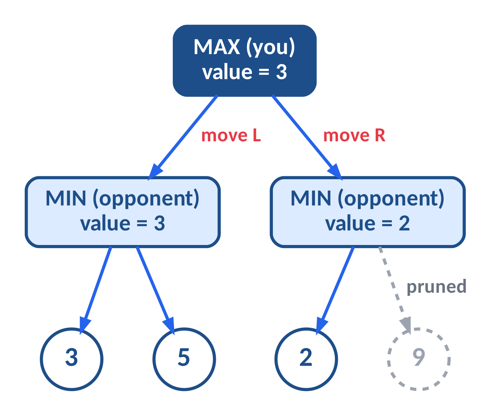
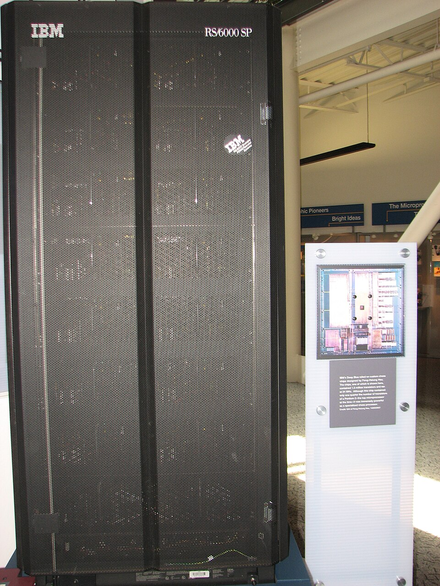

# 2.5 Planning and Problem Solving

**Team Member:** Yeo Shih Jie (`@ysjie03`)

**In this section:** [What Is Planning?](#2-what-is-planning) · [Describing a Problem as a Search](#3-describing-a-problem-as-a-search) · [Uninformed Search](#4-uninformed-search) · [Informed Search](#5-informed-search) · [Adversarial Search](#6-adversarial-search) · [Local Search](#7-local-search) · [Comparing the Methods](#8-comparing-the-methods) · [Common Misunderstandings](#9-common-misunderstandings) · [Key Takeaways](#10-key-takeaways) · [Lab: The River Crossing](#lab-the-river-crossing) · [Practice Questions](#11-practice-questions-and-answers)

**Learning goals.** By the end of this section, you can:
* describe a problem as a search: initial state, actions, goal test and path cost;
* trace breadth-first, depth-first, uniform-cost, greedy and A\* search on a small map, and say which ones find the cheapest route;
* use minimax to choose a move in a small game, and explain why hill climbing can get stuck;
* solve a puzzle by searching its states, and explain why some tempting moves fail.

**Before you start:** read [2.2 Logic and Reasoning](05_Logic_and_Reasoning.md) and [2.3 Knowledge Representation](06_Knowledge_Representation.md) first, so that symbolic facts such as `At(Robot, Dorm)` look familiar. You need only simple addition and no programming.

> **Pixel's Mission**  
> Byte must row a wolf, a goat and a cabbage across a river. The boat fits Byte and one passenger. Left alone, the wolf eats the goat and the goat eats the cabbage. Byte takes the wolf first. Chaos!  
> **Predict first:** What is the fewest number of crossings? Is there just one way? Write down your guess, then solve it in the River Crossing lab and check it in §11.

---

## 1. Where We Are in the Module

In [2.2](05_Logic_and_Reasoning.md) and [2.4](07_Expert_Systems.md), rules answered one question, such as "Is Alex eligible for a scholarship?". Many problems need a **sequence of actions** instead: a robot's route across campus, a chess program's moves, a factory's machine order. Symbolic AI describes the world with symbols ([2.3](06_Knowledge_Representation.md)), lists the allowed actions, and **searches** for a series of actions that reaches the goal.

> **Think of it like a maze:** you are at the entrance (the start), you want the exit (the goal), and at every junction you choose a path (an action). Planning is working out the whole route before you start walking.

---

## 2. What Is Planning?

**Planning** is finding a sequence of actions that changes a starting situation into a goal situation. It is one kind of **problem solving**: solving complex, often abstract, problems by computation (searching, reasoning about actions, evaluating outcomes).

| Term | Meaning | Campus robot example |
|---|---|---|
| **State** | The world at one moment | The robot is at the Dorm and the parcel is at the Library. |
| **Initial state** | Where we start | `At(Robot, Dorm)`, `At(Parcel, Library)`, `HandEmpty(Robot)` |
| **Goal state** | What must be true at the end | `At(Parcel, TeachingBuilding)` |
| **Action** | Something the agent does that changes the state | `Move`, `PickUp`, `Drop` |
| **Plan** | The action sequence from initial state to goal | Move → PickUp → Move → Drop |

### Describing Actions and Their Effects

Each action has **preconditions** (what must be true *before* it can be used) and **effects** (what becomes true or false *after* it).

| Action | Preconditions | Effects |
|---|---|---|
| `Move(x, y)` | `At(Robot, x)` and there is a path from x to y | `At(Robot, y)` becomes true; `At(Robot, x)` becomes false |
| `PickUp(p, x)` | `At(Robot, x)`, `At(p, x)`, `HandEmpty(Robot)` | `Holding(p)` becomes true; `At(p, x)` and `HandEmpty(Robot)` become false |
| `Drop(p, x)` | `At(Robot, x)`, `Holding(p)` | `At(p, x)` and `HandEmpty(Robot)` become true; `Holding(p)` becomes false |

This way of writing actions has a name: **STRIPS** (Fikes & Nilsson, 1971). In STRIPS, an action's effects are split into an **add list** (facts that become true) and a **delete list** (facts that become false). It was built for Shakey, one of the first mobile robots to plan its own actions.

A planner picks an action whose preconditions are true now, applies its effects, and repeats until the goal is true. For our robot:

```text
1. Move(Dorm, Library)
2. PickUp(Parcel, Library)
3. Move(Library, TeachingBuilding)
4. Drop(Parcel, TeachingBuilding)
```

After step 4, `At(Parcel, TeachingBuilding)` is true: goal reached. As elsewhere in Part 2, the world is symbols and actions are rules that change them. The new part is choosing **which action to try next**, which is a search problem.

---

## 3. Describing a Problem as a Search

A search problem has five parts:

| Part | Question it answers | Campus map example |
|---|---|---|
| **Initial state** | Where do we start? | The Dorm (S) |
| **Actions** | What moves are allowed from each state? | Walk along a path to a connected building |
| **Transition model** | Where does each action lead? | Walking from S along the path to A leads to A |
| **Goal test** | Have we arrived? | Are we at the Teaching Building (G)? |
| **Path cost** | How expensive is a route? | Total walking time in minutes |

All possible states and the actions between them form the **state space**. For a map, it is easy to draw:


*Figure 2.15: A small campus map. Each building is a state and each path is an action. The number on each path is the walking time in minutes. We want to get from the Dorm (S) to the Teaching Building (G).*

The cheapest route is **S → A → C → G**: 4 + 3 + 3 = **10 minutes**. Which search methods find it?

In every trace below, the computer keeps a **frontier**: the places discovered but not yet explored. It also remembers explored places and never explores one twice. The goal test runs when a place is **explored**, not when it is first discovered, which is why a search can still find a cheaper way to G after G has been added to the frontier. Ties go to the place that comes first in the alphabet.

---

## 4. Uninformed Search

**Uninformed search** (**blind search**) knows only the map and the goal test, not where the goal is, so it explores in a fixed, systematic order.

### 4.1 Breadth-First Search (BFS)

BFS explores **level by level**: every place one step away, then two steps away, and so on. Its frontier is a **queue** (first in, first out), like a line at the canteen.

| Step | Explore | Not goal, so add new neighbours | Frontier after this step |
|---|---|---|---|
| 1 | S | A, B | A, B |
| 2 | A | C, G | B, C, G |
| 3 | B | (C and G are already in the frontier) | C, G |
| 4 | C | (G is already in the frontier) | G |
| 5 | G | Goal reached | — |

G was discovered from A, and A from S, so BFS returns **S → A → G**: only **2 steps**, but **4 + 15 = 19 minutes**. BFS always finds the route with the **fewest steps**, not always the **cheapest**, and it uses a lot of memory because it stores a whole level at once.

### 4.2 Depth-First Search (DFS)

DFS goes **as deep as possible** down one path before backing up. Its frontier is a **stack** (last in, first out), like a pile of plates: the most recently discovered place is explored next. Neighbours are pushed in reverse alphabetical order, so the alphabetically first one comes off the stack first. At a place with no unexplored neighbour, DFS backs up to the previous place on the stack.

Trace: from **S** the first unexplored neighbour is **A**; from A it is **C**; from C it is **B**; from B the only one is **G**. Goal reached.

DFS returns **S → A → C → B → G**: **4 + 3 + 8 + 10 = 25 minutes**. It uses little memory, because it mainly needs the current path (our traces also keep a list of explored places, which DFS needs on maps with loops), but it can wander down a long route and return a poor answer, as here. On a map with loops and no record of visited places, it could go round in circles forever.

### 4.3 Uniform-Cost Search (UCS)

UCS always explores the place with the **lowest total cost so far**, written *g* (the cost from the start to that place).

| Step | Explore | Updates to the frontier | Frontier after this step (g) |
|---|---|---|---|
| 1 | S (g = 0) | A = 4, B = 2 | B 2, A 4 |
| 2 | B (g = 2) | C = 2 + 8 = 10, G = 2 + 10 = 12 | A 4, C 10, G 12 |
| 3 | A (g = 4) | C = 4 + 3 = **7** (cheaper than 10, so replace it); G = 4 + 15 = 19 (worse, ignore) | C 7, G 12 |
| 4 | C (g = 7) | G = 7 + 3 = **10** (cheaper than 12, so replace it) | G 10 |
| 5 | G (g = 10) | Goal reached | — |

UCS returns **S → A → C → G** at **10 minutes**. It is guaranteed to find the cheapest route as long as no step has a negative cost, but it may explore many places in every direction first.

---

## 5. Informed Search

**Informed search** uses a **heuristic**, written *h*: a rule-of-thumb estimate of how far each place is from the goal, like "the maze exit is to the north, so try north first". For our map, a campus app estimates the walking time to G:

| Building | S | A | B | C | G |
|---|---|---|---|---|---|
| Estimate to G (*h*) | 8 | 6 | 7 | 2 | 0 |

### 5.1 Greedy Best-First Search

Greedy search always explores the place that **looks closest to the goal** (smallest *h*), ignoring how far it has already walked.

1. Explore **S**. Add A (h = 6) and B (h = 7).
2. Explore **A** (smallest h). Add C (h = 2) and G (h = 0).
3. Explore **G** (smallest h). Goal reached.

Greedy returns **S → A → G** at **19 minutes**. It was fast (three places explored) but fooled: G looked close from A, yet the A–G path is long.

### 5.2 A* Search

**A\*** ("A-star") combines UCS and greedy search (Hart, Nilsson & Raphael, 1968). It always explores the place with the **smallest f**, where

```text
f = g + h
f = (cost so far) + (estimated cost still to go)
```

| Step | Explore | Updates (g + h = f) | Frontier after this step (f) |
|---|---|---|---|
| 1 | S (0 + 8 = 8) | A: 4 + 6 = 10; B: 2 + 7 = 9 | B 9, A 10 |
| 2 | B (f = 9) | C: g = 2 + 8 = 10, f = 10 + 2 = 12; G: g = 2 + 10 = 12, f = 12 + 0 = 12 | A 10, C 12, G 12 |
| 3 | A (f = 10) | C: 7 + 2 = **9** (better, replace); G: 19 + 0 = 19 (worse, ignore) | C 9, G 12 |
| 4 | C (f = 9) | G: 10 + 0 = **10** (better, replace) | G 10 |
| 5 | G (f = 10) | Goal reached | — |

A\* returns **S → A → C → G** at **10 minutes**. It is guaranteed to find the cheapest route **if the heuristic never overestimates** the true remaining cost; such a heuristic is **admissible**. Ours is: the true remaining costs are S 10 (h = 8), A 6 (h = 6), B 10 (h = 7) and C 3 (h = 2).

> **Going further (not examined):** because our traces never explore a place twice, the guarantee strictly needs *consistency*: h must never drop by more than a step's cost. Ours is not consistent (A → C costs 3, but h drops 6 → 2); A\* still succeeds because it lowered C's cost (step 3) *before* exploring C. With an admissible but inconsistent h, A\* should re-explore a place when it finds a cheaper route to it.

Here A\* explores as many places as UCS, but on a city map the heuristic stops it wasting time on streets leading away from the goal, which is why route planners and video games use it.

---

## 6. Adversarial Search

In games such as chess, an **opponent** chooses moves that are bad for you; searching against an opponent is **adversarial search**.

### 6.1 Minimax

**Minimax** assumes both players play their best: **MAX** (you) picks the **highest** score, and **MIN** (the opponent) picks the **lowest**. End positions are scored; high is good for you.



*Figure 2.16: A small game tree. You (MAX) choose move L or R, then the opponent (MIN) replies. The numbers at the bottom are the scores of the final positions. The value 2 under R is the plain minimax value; with alpha-beta pruning (Section 6.2), the 9 is skipped and R is only known to be worth 2 or less.*

Work from the bottom up:

1. After **L**, the opponent can leave you 3 or 5 and picks **3**.
2. After **R**, the opponent can leave you 2 or 9 and picks **2**.
3. You pick the higher of 3 and 2: **move L**, guaranteed score **3**.

The 9 makes R look tempting, but a good opponent would never allow it.

### 6.2 Alpha-Beta Pruning

**Alpha-beta pruning** gives the same answer as minimax while checking fewer positions (Knuth & Moore, 1975). In Figure 2.16, once L guarantees 3, you check R. Its first result is 2, so the opponent can hold you to 2 or less after R, and R can never beat 3. The 9 need not be checked: that branch is **pruned**.

**In real games.** Chess has far too many positions to search to the end, so a chess program searches a few moves ahead and gives each position it reaches a score. In 1997, IBM's **Deep Blue** beat the world chess champion Garry Kasparov in a six-game match this way: it used minimax with alpha-beta pruning and special chess chips to check over 100 million positions per second (Campbell et al., 2002).

<p align="center"></p>

*Photo: Deep Blue, the IBM chess computer that beat Garry Kasparov in 1997, on display. The panel beside it shows one of its special chess chips. Photo by Erik Pitti, [CC BY 2.0](https://creativecommons.org/licenses/by/2.0/), via Wikimedia Commons.*

---

## 7. Local Search

When only a **good final state** matters, not the route (a clash-free timetable, a good room layout), **local search** starts with one solution and improves it with small changes.

### 7.1 Hill Climbing

**Hill climbing** moves to the best neighbouring solution, as long as it is better than the current one, like climbing a hill in thick fog by always stepping uphill. Suppose seven solutions are lined up with these scores:

| Position | 1 | 2 | 3 | 4 | 5 | 6 | 7 |
|---|---|---|---|---|---|---|---|
| Score | 2 | 4 | **6** | 5 | 3 | 7 | **9** |

From position 1 (score 2) it moves to 2 (4), then 3 (6). Both neighbours of 3 score lower (4 and 5), so it **stops at 6**, although position 7 scores 9. Position 3 is a **local maximum**: higher than its neighbours but not the highest overall. Getting stuck there is hill climbing's main weakness.


*Figure 2.17: The scores from the table drawn as a landscape. Hill climbing (blue) stops on the first hill; simulated annealing (red, Section 7.2) accepts two downhill moves and reaches the highest point.*

### 7.2 Simulated Annealing

**Simulated annealing** sometimes accepts a **worse** move on purpose, to escape a local maximum (Kirkpatrick, Gelatt & Vecchi, 1983). It accepts bad moves often at first, then less and less, until it behaves like hill climbing. The name comes from metalwork: hot metal cooled slowly lets its atoms settle into a strong structure. Above, accepting the downhill steps 3 → 4 (score 5) and 4 → 5 (score 3) lets the search climb to 6 (score 7) and then 7, the best score of 9.

---

## 8. Comparing the Methods

| Method | Type | Chooses by | Finds the cheapest answer? | Main weakness |
|---|---|---|---|---|
| Breadth-first search | Uninformed | Fewest steps first | Only if every step costs the same | Uses a lot of memory |
| Depth-first search | Uninformed | Deepest place first | No | Can return a long route or get lost |
| Uniform-cost search | Uninformed | Lowest cost so far (*g*) | Yes | Explores in every direction |
| Greedy best-first | Informed | Smallest estimate to goal (*h*) | No | Fooled by misleading estimates |
| A\* | Informed | Smallest *g* + *h* | Yes, if *h* never overestimates | Needs a good heuristic and memory |
| Minimax and alpha-beta | Adversarial | Best move against a best opponent | Best guaranteed result | Game trees grow very fast |
| Hill climbing | Local | Best neighbouring solution | No | Stops at local maxima |
| Simulated annealing | Local | Sometimes accepts worse moves | Often near the best | Slower; needs tuning |

---

## 9. Common Misunderstandings

| Misunderstanding | What is actually true |
|---|---|
| "Planning and search are unrelated." | Planning describes the problem with states and actions; search finds the plan. |
| "BFS always finds the best route." | It finds the fewest steps; with unequal step costs it can miss the cheapest route (campus example). |
| "A heuristic is always correct." | It is only an estimate: greedy search can be fooled, and A\* is safe only if h never overestimates. |
| "A\* is always fastest." | It usually explores fewer places, but with a poor heuristic it is no better than UCS. |
| "Minimax assumes the opponent makes mistakes." | It assumes the opponent plays perfectly, which gives you a guaranteed result. |
| "Hill climbing always finds the best solution." | It can get stuck at a local maximum. |

---

## 10. Key Takeaways

* **Planning** = an action sequence from initial state to goal; actions have **preconditions** and **effects**.
* A search problem = **initial state**, **actions**, **transition model**, **goal test**, **path cost**.
* The §8 table summarises the methods. Key results: BFS gives fewest steps; UCS and A\* (admissible *h*) give the cheapest route; minimax gives the best guaranteed result; hill climbing can stop at a local maximum. Greedy search can be quick and DFS uses little memory, but neither guarantees the cheapest route.

---

## Lab: The River Crossing

* **Goal:** Solve Byte's river puzzle by searching its states as a computer would, and link your search to breadth-first search (§4.1).
* **Preparation:** Paper and pen, optionally four cards labelled F, W, G and C; about 20 minutes, no computer. Re-read §2 (states, actions, preconditions) and §3 (the five parts of a search problem).
* **Task:** F is Byte (the farmer in the classic puzzle, who rows), W the wolf, G the goat, C the cabbage. Write each **state** as left bank `~~` right bank. Start: `F W G C ~~ (empty)`; goal: `(empty) ~~ F W G C`. Rules:
  * Only Byte rows, and the boat carries Byte plus **at most one** passenger.
  * Neither the wolf and goat nor the goat and cabbage may be on a bank without Byte.

  **Step 1, predict:** the fewest crossings, and whether there is only one way.  
  **Step 2, describe the search:** write the initial state, goal test, actions (Byte crosses alone, or with W, G or C) and path cost (1 per crossing). Write the rule that makes a state **safe**; a rule every state must obey is a **constraint**.  
  **Step 3, test the first moves:** for each of the four possible first crossings, write the new state and say whether it is safe; if not, who gets eaten?  
  **Step 4, search:** from the safe state, list the possible crossings, cross out any that give an unsafe or already-seen state (like the explored list in §3), and pick one of the rest. Repeat until the goal. Write your plan as numbered crossings.  
  **Step 5, link to BFS:** group states by how many crossings reach them (level 0 is the start, level 1 every safe state after one crossing, …). At which level does the goal first appear?
* **Observation:** Record your plan, the number of crossings, any dead ends, and any step with a real choice between two safe moves.
* **Reflection:**
  1. Why do the three tempting first moves fail?
  2. At one point Byte must carry a passenger *back* to the start bank. Why is this necessary, even though it looks like a step backwards?
  3. Why is BFS guaranteed to find the fewest crossings here, when on the campus map (§4.1) it did not find the quickest route?

<details>
<summary><b>Feedback: check your crossing plan</b></summary>

* **The search (Step 2):** initial state `F W G C ~~ (empty)`. Goal test: are all four on the right bank? Actions: Byte crosses alone or with one passenger from his bank. Path cost: 1 per crossing. Constraint: a bank without Byte must not hold both W and G, or both G and C.
* **First moves (Step 3):**
  * Byte alone: `W G C ~~ F`. The wolf eats the goat and the goat eats the cabbage. Unsafe.
  * With the wolf: `G C ~~ F W`. The goat eats the cabbage. Unsafe (the chaos in Pixel's Mission).
  * With the cabbage: `W G ~~ F C`. The wolf eats the goat. Unsafe.
  * With the goat: `W C ~~ F G`. Safe, because wolves do not eat cabbage. **The goat is the only safe first move.**
* **A shortest plan (Step 4), 7 crossings:**
  1. Byte takes the goat across: `W C ~~ F G`
  2. Byte returns alone: `F W C ~~ G`
  3. Byte takes the wolf across: `C ~~ F W G`
  4. Byte brings the goat back: `F G C ~~ W`
  5. Byte takes the cabbage across: `G ~~ F W C`
  6. Byte returns alone: `F G ~~ W C`
  7. Byte takes the goat across: `(empty) ~~ F W G C`. Goal reached.

  There is exactly **one other** 7-crossing plan: swap steps 3 and 5 (cabbage first, then wolf). Both plans start and end with the goat.
* **BFS levels (Step 5):** the goal first appears at level 7 (Figure 2.18). The search is one chain that splits into two branches after level 2 and rejoins at level 5; the branches are the two plans. Only 10 of the 16 ways to split the four across the river are safe, and the search reaches all 10.

  ![Breadth-first search levels for the river crossing. Level 0: everyone on the start bank. Level 1: W C on the start bank, F G across (goat over). Level 2: F W C, with G across (Byte returns alone). Level 3 splits: C with F W G across (wolf over), or W with F G C across (cabbage over). Level 4: F G C with W across, or F W G with C across (goat back in both). Level 5 rejoins: G with F W C across (cabbage or wolf over). Level 6: F G with W C across (Byte returns alone). Level 7: everyone on the far bank (goat over), the goal](../images/river_crossing_bfs.png)

  *Figure 2.18: The ten safe states, grouped by level. Each box shows the start bank above the dashed river and the far bank below.*
* **Reflection answers:**
  1. Each tempting move leaves a dangerous pair alone on the start bank. The goat is in both pairs, so it must go first.
  2. After step 3, the wolf and goat share the far bank; left alone, the wolf would eat the goat. Bringing the goat back is the only safe move that makes progress (bringing the wolf back is also safe but just repeats an earlier state). Scored by "passengers on the far bank", step 4 looks backwards, so hill climbing (§7.1), which accepts only better-looking moves, would get stuck; BFS, which keeps a frontier of every safe state, does not.
  3. Every crossing costs 1, so the fewest steps is also the cheapest, and BFS finds the fewest steps. On the campus map, paths have different costs, so the fewest steps (S → A → G, 19 minutes) is not the quickest: the "only if every step costs the same" entry in §8.

</details>

---

## 11. Practice Questions and Answers

**Mission check.** The fewest is **7** crossings, and there are exactly **two** shortest plans, both starting with the goat. Taking the wolf first leaves the goat with the cabbage, and Byte must bring the goat back once, midway. The lab feedback shows the full plan and the BFS levels.

Try each question yourself first, then open the answers to check.

### Questions

**1.** What is planning in Symbolic AI? Name the three things a planner needs to know before it starts (a shorter list than the five parts of a search problem in §3).

**2.** Write the preconditions and effects of `PickUp(Book, Library)` for a robot, in the style of Section 2.

**3.** What is the difference between uninformed and informed search?

**4.** On the campus map (Figure 2.15), a new 5-minute path is built from S straight to C. What is now the cheapest route from S to G, and how long does it take?

**5.** Why did greedy best-first search return a 19-minute route on the campus map, while A\* returned a 10-minute route?

**6.** In Figure 2.16, change the leaf scores under move R from (2, 9) to (4, 9). Which move should MAX choose now, and what is its guaranteed score?

**7.** A heuristic says the walking time from A to G is 8 minutes, but the true cheapest time is 6. Is it admissible? What could go wrong if A\* used it?

**8.** A timetable program uses hill climbing and gets stuck with two clashes, although a clash-free timetable exists. Why, and what method would do better?

<details>
<summary><b>Show answers</b> (try the questions first!)</summary>

**1.** Planning is finding a sequence of actions that changes the initial state into a goal state. The planner needs the **initial state**, the **goal state** and the allowed **actions** (with their preconditions and effects).

**2.** **Preconditions:** `At(Robot, Library)`, `At(Book, Library)`, `HandEmpty(Robot)`. **Effects:** `Holding(Book)` becomes true; `At(Book, Library)` and `HandEmpty(Robot)` become false.

**3.** Uninformed search knows only the map and the goal test, so it explores in a fixed order (for example, level by level in BFS). Informed search also uses a **heuristic**, an estimate of each state's distance to the goal, to explore promising states first.

**4.** **S → C → G**, 5 + 3 = **8 minutes**, beating the old 10 (S → A → C → G). Re-run UCS: C is now reached at g = 5 (cheaper than 7 via A), so G = 5 + 3 = 8, while the other ways into G cost 12 (via B) or 19 (via A).

**5.** Greedy looks only at *h*. From A, G had h = 0, so greedy went straight there, ignoring that the A–G path costs 15 minutes. A\* uses *g* + *h*, so it counted the 19 minutes that route really costs and kept looking until it found the 10-minute route through C.

**6.** After R, the opponent now picks the lower of 4 and 9: **4**. After L, the value is still 3. MAX picks the higher, so **move R**, guaranteed score **4**.

**7.** **No:** it overestimates (8 > 6). A\* might think the route through A is worse than it is, explore another route first, and return a route that is **not the cheapest**. On this map it happens to still find 10 minutes: f(A) becomes 4 + 8 = 12, tying with G (12, via B), and only the alphabetical tie-break explores A first; with G first, A\* would return S → B → G (12 minutes). With an overestimating heuristic, the cheapest answer is no longer guaranteed.

**8.** Hill climbing accepts only improvements. It reached a **local maximum**, where every small change made things worse, so it stopped although a better timetable existed. **Simulated annealing** helps, because it sometimes accepts a worse change early on and so can escape the local maximum.

</details>

---

## 12. References

1. Campbell, M., Hoane, A. J., & Hsu, F.-H. (2002). Deep Blue. *Artificial Intelligence*, 134(1–2), 57–83.
2. Fikes, R. E., & Nilsson, N. J. (1971). STRIPS: A new approach to the application of theorem proving to problem solving. *Artificial Intelligence*, 2(3–4), 189–208.
3. Hart, P. E., Nilsson, N. J., & Raphael, B. (1968). A formal basis for the heuristic determination of minimum cost paths. *IEEE Transactions on Systems Science and Cybernetics*, 4(2), 100–107.
4. Kirkpatrick, S., Gelatt, C. D., & Vecchi, M. P. (1983). Optimization by simulated annealing. *Science*, 220(4598), 671–680.
5. Knuth, D. E., & Moore, R. W. (1975). An analysis of alpha-beta pruning. *Artificial Intelligence*, 6(4), 293–326.
6. Poole, D., & Mackworth, A. (2017). *Artificial Intelligence: Foundations of Computational Agents* (2nd ed.). Cambridge University Press. [Online textbook](https://artint.info/2e/html/ArtInt2e.html)
7. Russell, S. J., & Norvig, P. (2021). *Artificial Intelligence: A Modern Approach* (4th ed.). Pearson.
8. BIT2026 Foundations of CS & AI, course lecture slides, Chapter 4: Symbolic AI (Planning and Problem Solving) (2026).
