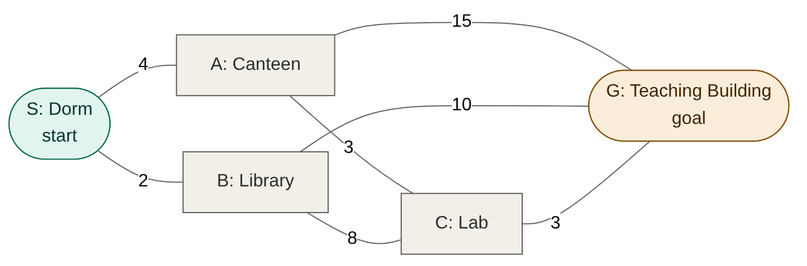

# 2.5 Planning and Problem Solving

**Status:** ✅   
**Team Member:** Yeo Shih Jie (`@ysjie03`)

**In this section:** Where We Are · What Is Planning? · Describing a Problem as a Search · Uninformed Search · Informed Search · Adversarial Search · Local Search · Comparing the Methods · Common Misunderstandings · Key Takeaways · Practice Questions

---

## 1. Where We Are in the Module

In [2.3 How Symbolic AI Reasons](06_How_Symbolic_AI_Reasons.md), the system used rules to answer a question such as "Is Alex eligible for a scholarship?". The answer was a single conclusion.

Many real problems need more than one conclusion. They need a **sequence of actions**:

* What route should a delivery robot take across campus?
* What moves should a chess program make?
* In what order should a factory run its machines?

This section explains how Symbolic AI finds such sequences. The idea is simple: describe the world with symbols (as in [2.2 Knowledge Representation](05_Knowledge_Representation.md)), list the actions that are allowed, and then **search** for a series of actions that leads to the goal.

> **Think of it like a maze.** You are at the entrance (the start), you want the exit (the goal), and at every junction you must choose a path (an action). Planning is working out the whole route before you start walking.

---

## 2. What Is Planning?

**Planning** is the process of finding a sequence of actions that changes a starting situation into a goal situation.

**Problem solving** is the wider idea: finding solutions to complex, often abstract, problems using computational methods. It includes searching for solutions, reasoning about possible actions and evaluating the possible outcomes. Planning is one kind of problem solving.

| Term | Meaning | Campus robot example |
|---|---|---|
| **State** | A description of the world at one moment | The robot is at the Dorm and the parcel is at the Library. |
| **Initial state** | Where we start | `At(Robot, Dorm)`, `At(Parcel, Library)`, `HandEmpty(Robot)` |
| **Goal state** | What we want to be true at the end | `At(Parcel, TeachingBuilding)` |
| **Action** | Something the agent can do that changes the state | `Move`, `PickUp`, `Drop` |
| **Plan** | The sequence of actions from the initial state to the goal | Move → PickUp → Move → Drop |

### Describing Actions and Their Effects

Planning means reasoning about actions and their effects on the state of the world. Each action is written with:

* **Preconditions:** what must be true *before* the action can be used.
* **Effects:** what becomes true or false *after* the action.

| Action | Preconditions | Effects |
|---|---|---|
| `Move(x, y)` | `At(Robot, x)` and there is a path from x to y | `At(Robot, y)` becomes true; `At(Robot, x)` becomes false |
| `PickUp(p, x)` | `At(Robot, x)`, `At(p, x)`, `HandEmpty(Robot)` | `Holding(p)` becomes true; `At(p, x)` and `HandEmpty(Robot)` become false |
| `Drop(p, x)` | `At(Robot, x)`, `Holding(p)` | `At(p, x)` and `HandEmpty(Robot)` become true; `Holding(p)` becomes false |

A planner looks for actions whose preconditions are true in the current state, applies their effects, and repeats until the goal is true. For our robot, it finds:

```text
1. Move(Dorm, Library)
2. PickUp(Parcel, Library)
3. Move(Library, TeachingBuilding)
4. Drop(Parcel, TeachingBuilding)
```

After step 4, `At(Parcel, TeachingBuilding)` is true, so the goal is reached.

Notice that this is the same symbolic idea as the rest of Part 2: the world is described with symbols such as `At(Robot, Dorm)`, and the actions are rules that change those symbols. The only new part is that the system must choose **which action to try next**. That choice is a search problem.

---

## 3. Describing a Problem as a Search

To let a computer search, we describe the problem with five parts:

| Part | Question it answers | Campus map example |
|---|---|---|
| **Initial state** | Where do we start? | The Dorm (S) |
| **Actions** | What moves are allowed from each state? | Walk along a path to a connected building |
| **Transition model** | Where does each action lead? | Walking from S along the path to A leads to A |
| **Goal test** | Have we arrived? | Are we at the Teaching Building (G)? |
| **Path cost** | How expensive is a route? | Total walking time in minutes |

All the possible states and the actions between them form the **state space**. For a map, the state space is easy to draw:



*Figure 2.4: A small campus map. Each building is a state and each path is an action. The number on each path is the walking time in minutes. We want to get from the Dorm (S) to the Teaching Building (G).*

The cheapest route is **S → A → C → G**, which takes 4 + 3 + 3 = **10 minutes**. Let us see which search methods find it.

In every trace below, the computer keeps a **frontier**: the list of places it has discovered but not yet explored. It also remembers places it has already explored, so it never explores the same place twice. When two choices are equal, it picks the one that comes first in the alphabet.

---

## 4. Uninformed Search

**Uninformed search** (also called **blind search**) has no extra knowledge about where the goal is. It only knows the map and the goal test. It explores in a fixed, systematic order.

### 4.1 Breadth-First Search (BFS)

BFS explores **level by level**: first every place one step away, then every place two steps away, and so on. Its frontier is a **queue** (first in, first out), like a line at the canteen.

| Step | Explore | Not goal, so add new neighbours | Frontier after this step |
|---|---|---|---|
| 1 | S | A, B | A, B |
| 2 | A | C, G | B, C, G |
| 3 | B | (C and G are already in the frontier) | C, G |
| 4 | C | (G is already in the frontier) | G |
| 5 | G | Goal reached | — |

G was discovered from A, and A from S, so BFS returns **S → A → G**: only **2 steps**, but **4 + 15 = 19 minutes**.

BFS always finds the route with the **fewest steps**, but not always the **cheapest** one. It also uses a lot of memory, because it stores a whole level of places at once.

### 4.2 Depth-First Search (DFS)

DFS goes **as deep as possible** down one path before backing up. Its frontier is a **stack** (last in, first out), like a pile of plates.

1. Start at **S**. The first unexplored neighbour is **A**: go to A.
2. From **A**, the first unexplored neighbour is **C**: go to C.
3. From **C**, the first unexplored neighbour is **B**: go to B.
4. From **B**, the only unexplored neighbour is **G**: go to G. Goal reached.

DFS returns **S → A → C → B → G**: **4 + 3 + 8 + 10 = 25 minutes**.

DFS uses little memory, because it only remembers the current path. But it can wander down a long route and return a poor answer, as it did here. On a map with loops and no record of visited places, it could even go round in circles forever.

### 4.3 Uniform-Cost Search (UCS)

UCS always explores the place with the **lowest total cost so far**. Let *g* stand for the cost from the start to a place.

| Step | Explore | Updates to the frontier | Frontier after this step (g) |
|---|---|---|---|
| 1 | S (g = 0) | A = 4, B = 2 | B 2, A 4 |
| 2 | B (g = 2) | C = 2 + 8 = 10, G = 2 + 10 = 12 | A 4, C 10, G 12 |
| 3 | A (g = 4) | C = 4 + 3 = **7** (cheaper than 10, so replace it); G = 4 + 15 = 19 (worse, ignore) | C 7, G 12 |
| 4 | C (g = 7) | G = 7 + 3 = **10** (cheaper than 12, so replace it) | G 10 |
| 5 | G (g = 10) | Goal reached | — |

UCS returns **S → A → C → G** at **10 minutes**, the cheapest route. UCS is guaranteed to find the cheapest route, as long as no path has a negative cost. Its weakness is that it may explore many places in every direction before it reaches the goal.

---

## 5. Informed Search

**Informed search** uses extra knowledge, called a **heuristic**, to guess which places are closer to the goal. A heuristic is a rule of thumb, like "the exit of the maze is to the north, so try north first".

We write the heuristic as *h*. For our map, suppose a campus app gives these estimates of the walking time from each building to G:

| Building | S | A | B | C | G |
|---|---|---|---|---|---|
| Estimate to G (*h*) | 8 | 6 | 7 | 2 | 0 |

### 5.1 Greedy Best-First Search

Greedy search always explores the place that **looks closest to the goal**, the one with the smallest *h*. It ignores how far it has already walked.

1. Explore **S**. Add A (h = 6) and B (h = 7).
2. Explore **A** (smallest h). Add C (h = 2) and G (h = 0).
3. Explore **G** (smallest h). Goal reached.

Greedy search returns **S → A → G** at **19 minutes**. It was fast, exploring only three places, but it was fooled: G looked close from A, yet the path from A to G is long.

### 5.2 A* Search

**A\*** (say "A-star") combines the best of UCS and greedy search (Hart, Nilsson & Raphael, 1968). For each place it adds:

```text
f = g + h
f = (cost so far) + (estimated cost still to go)
```

It always explores the place with the **smallest f**.

| Step | Explore | Updates (g + h = f) | Frontier after this step (f) |
|---|---|---|---|
| 1 | S (0 + 8 = 8) | A: 4 + 6 = 10; B: 2 + 7 = 9 | B 9, A 10 |
| 2 | B (f = 9) | C: 10 + 2 = 12; G: 12 + 0 = 12 | A 10, C 12, G 12 |
| 3 | A (f = 10) | C: 7 + 2 = **9** (better, replace); G: 19 + 0 = 19 (worse, ignore) | C 9, G 12 |
| 4 | C (f = 9) | G: 10 + 0 = **10** (better, replace) | G 10 |
| 5 | G (f = 10) | Goal reached | — |

A\* returns **S → A → C → G** at **10 minutes**, the cheapest route.

A\* is guaranteed to find the cheapest route **if the heuristic never overestimates** the true remaining cost. Such a heuristic is called **admissible**. Ours is admissible: from A the true remaining cost is 6 and h(A) = 6; from B it is 10 and h(B) = 7; from C it is 3 and h(C) = 2.

On this tiny map, A\* explores as many places as UCS. On a real city map with thousands of streets, the heuristic stops A\* from wasting time on streets that lead away from the goal. This is why route planners and video-game characters often use A\*.

---

## 6. Adversarial Search

So far, nothing has fought back. In a game such as chess or tic-tac-toe, an **opponent** chooses moves that are bad for you. Searching in this situation is called **adversarial search**.

### 6.1 Minimax

The **minimax** method assumes both players play their best:

* **MAX** (you) chooses the move with the **highest** score.
* **MIN** (the opponent) chooses the move with the **lowest** score.

Scores are given to the end positions. A high score is good for you.


*Figure 2.5: A small game tree. You (MAX) choose move L or R, then the opponent (MIN) replies. The numbers at the bottom are the scores of the final positions.*

Work from the bottom up:

1. After move **L**, the opponent can leave you with 3 or 5. The opponent picks the lowest: **3**.
2. After move **R**, the opponent can leave you with 2 or 9. The opponent picks the lowest: **2**.
3. You pick the highest of 3 and 2: **move L**, with a guaranteed score of **3**.

Move R looks tempting because of the 9, but a good opponent would never let you have it.

### 6.2 Alpha-Beta Pruning

**Alpha-beta pruning** gives the same answer as minimax while checking fewer positions (Knuth & Moore, 1975). In Figure 2.5, once you know move L guarantees 3, you start checking move R. Its first result is 2. The opponent can now hold you to 2 or less after R, so R can never beat 3. There is no need to look at the 9: that branch is **pruned**.

---

## 7. Local Search

Sometimes we only care about a **good final state**, not the route to it. Examples include a timetable with no clashes or the best layout of rooms in a building. **Local search** starts with one possible solution and keeps improving it by making small changes.

### 7.1 Hill Climbing

**Hill climbing** looks at the neighbouring solutions and moves to the best one, as long as it is better than the current one. It is like climbing a hill in thick fog: you can only feel the ground next to your feet, so you keep stepping uphill.

Suppose seven possible solutions are lined up, each with a score:

| Position | 1 | 2 | 3 | 4 | 5 | 6 | 7 |
|---|---|---|---|---|---|---|---|
| Score | 2 | 4 | **6** | 5 | 3 | 7 | **9** |

Start at position 1 (score 2). Move to 2 (score 4), then to 3 (score 6). Both neighbours of position 3 score lower (4 and 5), so hill climbing **stops at 6**. But the best solution is position 7, with a score of 9.

Position 3 is a **local maximum**: higher than its neighbours, but not the highest overall. Getting stuck at a local maximum is the main weakness of hill climbing.

### 7.2 Simulated Annealing

**Simulated annealing** sometimes accepts a **worse** move on purpose, so it can escape a local maximum (Kirkpatrick, Gelatt & Vecchi, 1983). At the start it accepts bad moves quite often. Over time it accepts them less and less, until it behaves like hill climbing. The name comes from metalwork: hot metal is cooled slowly so that its atoms settle into a strong structure.

In the example above, accepting the downhill steps from 3 to 4 and from 4 to 5 would let the search reach 6, then 7, and find the score of 9.

---

## 8. Comparing the Methods

| Method | Type | What it uses to choose | Finds the cheapest answer? | Main weakness |
|---|---|---|---|---|
| Breadth-first search | Uninformed | Fewest steps first | Only if every step costs the same | Uses a lot of memory |
| Depth-first search | Uninformed | Deepest place first | No | Can return a long route or get lost |
| Uniform-cost search | Uninformed | Lowest cost so far (*g*) | Yes | Explores in every direction |
| Greedy best-first | Informed | Smallest estimate to goal (*h*) | No | Fooled by misleading estimates |
| A\* | Informed | Smallest *g* + *h* | Yes, if *h* never overestimates | Needs a good heuristic and memory |
| Minimax and alpha-beta | Adversarial | Best move against a best opponent | Best guaranteed result | Game trees grow very fast |
| Hill climbing | Local | Best neighbouring solution | No | Stops at local maxima |
| Simulated annealing | Local | Sometimes accepts worse moves | Often near the best | Slower; needs tuning |

---

## 9. Common Misunderstandings

| Misunderstanding | What Is Actually True |
|---|---|
| "Planning and search are completely different topics." | Planning describes the problem with states and actions; search is the method used to find the plan. |
| "BFS always finds the best route." | BFS finds the route with the fewest steps. If steps have different costs, it may miss the cheapest route, as in the campus example. |
| "A heuristic is always correct." | A heuristic is only an estimate. Greedy search can be fooled by it. A\* is safe only if the heuristic never overestimates. |
| "A\* is always faster than every other method." | A\* usually explores fewer places, but a poor heuristic makes it no better than uniform-cost search. |
| "Minimax assumes the opponent makes mistakes." | It assumes the opponent plays as well as possible, which gives you a guaranteed result. |
| "Hill climbing always finds the best solution." | It can get stuck at a local maximum. |

---

## 10. Key Takeaways

* **Planning** finds a sequence of actions that turns an initial state into a goal state. Actions can be written with **preconditions** and **effects**.
* A search problem has an **initial state**, **actions**, a **transition model**, a **goal test** and a **path cost**.
* **Uninformed search** explores without extra knowledge: BFS (fewest steps), DFS (deepest first) and uniform-cost search (cheapest so far).
* **Informed search** uses a **heuristic**. A\* uses *f* = *g* + *h* and finds the cheapest route when the heuristic is admissible.
* **Adversarial search** handles opponents. Minimax assumes both sides play their best, and alpha-beta pruning skips branches that cannot change the result.
* **Local search** improves one solution step by step. Hill climbing can get stuck; simulated annealing sometimes accepts worse moves to escape.

---

## 11. Practice Questions and Answers

Try answering each question yourself before reading the answers.

### Questions

**1.** What is planning in Symbolic AI? Name the three things a planner needs to know before it starts.

**2.** Write the preconditions and effects of `PickUp(Book, Library)` for a robot, using the same style as Section 2.

**3.** What is the difference between uninformed and informed search?

**4.** Use the campus map in Figure 2.4. A new path is built from S straight to C, taking 5 minutes. What is the cheapest route from S to G now, and how long does it take?

**5.** Why did greedy best-first search return a 19-minute route on the campus map, while A\* returned a 10-minute route?

**6.** In Figure 2.5, change the leaf scores under move R from (2, 9) to (4, 9). Which move should MAX choose now, and what is its guaranteed score?

**7.** A heuristic says the walking time from A to G is 8 minutes, but the true cheapest time is 6. Is this heuristic admissible? What could go wrong if A\* used it?

**8.** A timetable program uses hill climbing and gets stuck with two clashes, even though a timetable with no clashes exists. Explain why this happened and suggest a better method.

### Answers

**1.** Planning is finding a sequence of actions that changes the initial state into a goal state. The planner needs the **initial state**, the **goal state** and the **actions** it is allowed to use (with their preconditions and effects).

**2.**

* **Preconditions:** `At(Robot, Library)`, `At(Book, Library)`, `HandEmpty(Robot)`.
* **Effects:** `Holding(Book)` becomes true; `At(Book, Library)` and `HandEmpty(Robot)` become false.

**3.** Uninformed search only knows the map and the goal test, so it explores in a fixed order (for example, level by level in BFS). Informed search also uses a **heuristic**, an estimate of how far each state is from the goal, to explore more promising states first.

**4.** The new route **S → C → G** takes 5 + 3 = **8 minutes**, which beats the old best of 10 minutes (S → A → C → G). It is now the cheapest route.

**5.** Greedy search only looks at *h*, the estimated distance to the goal. From A, G had h = 0, so greedy went straight there and ignored that the A–G path costs 15 minutes. A\* uses *g* + *h*, so it counted the 19 minutes already needed to reach G that way and kept looking until it found the 10-minute route through C.

**6.** After R, the opponent now picks the lowest of 4 and 9, which is **4**. After L, the value is still 3. MAX picks the higher value, so MAX should choose **move R**, with a guaranteed score of **4**.

**7.** **No.** It overestimates (8 is more than the true 6), so it is not admissible. A\* might think the route through A is worse than it really is, explore a different route first, and return a route that is **not the cheapest**.

**8.** Hill climbing only accepts changes that make the timetable better. It reached a **local maximum**: every small change from there made things worse, so it stopped, even though a better timetable existed elsewhere. **Simulated annealing** would help, because it sometimes accepts a worse change early on, which lets it escape the local maximum.

---

## 12. References

1. Hart, P. E., Nilsson, N. J., & Raphael, B. (1968). A formal basis for the heuristic determination of minimum cost paths. *IEEE Transactions on Systems Science and Cybernetics*, 4(2), 100–107.
2. Kirkpatrick, S., Gelatt, C. D., & Vecchi, M. P. (1983). Optimization by simulated annealing. *Science*, 220(4598), 671–680.
3. Knuth, D. E., & Moore, R. W. (1975). An analysis of alpha-beta pruning. *Artificial Intelligence*, 6(4), 293–326.
4. Poole, D., & Mackworth, A. (2017). *Artificial Intelligence: Foundations of Computational Agents* (2nd ed.). Cambridge University Press. [Online textbook](https://artint.info/2e/html/ArtInt2e.html)
5. Russell, S. J., & Norvig, P. (2021). *Artificial Intelligence: A Modern Approach* (4th ed.). Pearson.
6. BIT2026 Course Lecture Slides, Chapter 4: Symbolic AI (Planning and Problem Solving).
