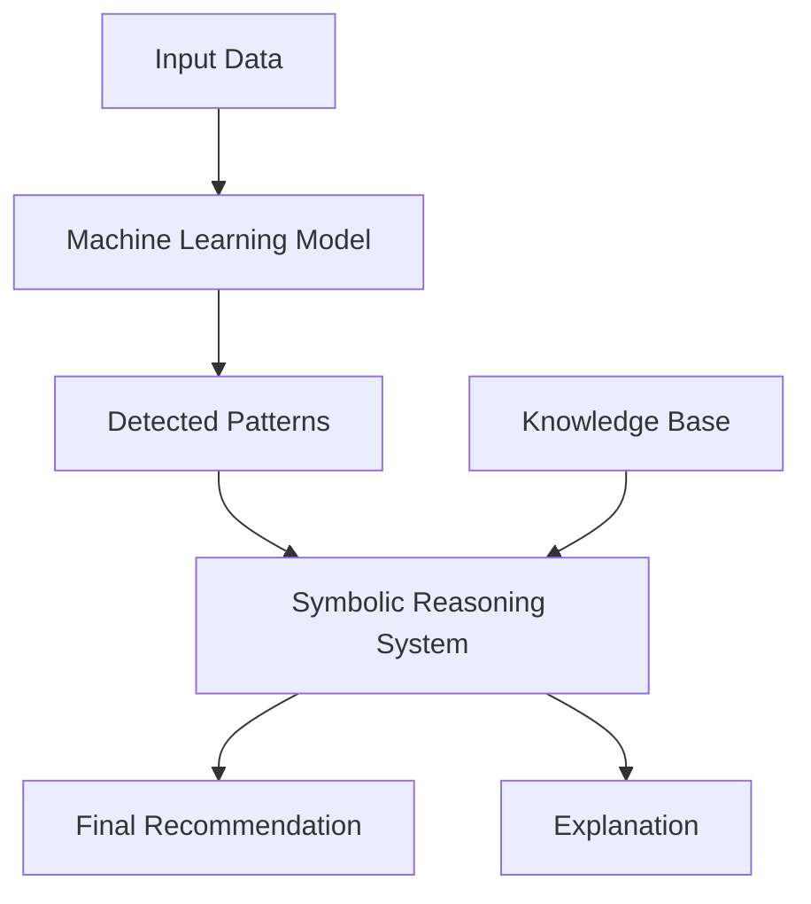

# 2.5 Strengths and Limitations of Symbolic AI

**Status:** ✅

**Team Member:** Frederick Samuel Lesmana

---

## 1. Introduction

Symbolic AI uses explicitly represented knowledge, logical rules, and reasoning techniques to solve problems.

As discussed in previous chapters, it can represent facts, apply logical rules, and build expert systems for specialized tasks.

However, like every AI approach, Symbolic AI has both strengths and limitations.

Understanding these characteristics helps us determine when Symbolic AI is appropriate and when other approaches may be more effective.

---

## 2. Strengths of Symbolic AI

### 2.1 Explainability

One of the greatest strengths of Symbolic AI is its ability to explain how it reaches a conclusion.

Since its decisions are based on explicit facts and rules, the reasoning process can often be traced.

**Example:**

```text
Rule:
IF GPA >= 3.8
THEN ExcellentStudent.

Fact:
GPA(Alex) = 3.9

Conclusion:
Alex is an excellent student.
```

The system can explain its conclusion by showing the rule and fact it used.

This is particularly valuable in fields where decisions need to be understood and reviewed.

### 2.2 Logical Consistency

Symbolic systems apply predefined rules consistently.

Given the same knowledge base and reasoning procedure, the system should produce the same conclusions.

This is useful for applications that require predictable decision-making.

Examples include:

- Business rule systems
- Automated eligibility checks
- Rule-based validation
- Regulatory compliance systems

However, consistency does not guarantee correctness. Incorrect rules can still produce incorrect conclusions.

### 2.3 Knowledge Representation

Symbolic AI can represent complex relationships between objects, concepts, and categories.

Using structures such as semantic networks, frames, and ontologies, it can organize information in a meaningful way.

For example, a university knowledge base could represent relationships between:

- Students
- Courses
- Lecturers
- Departments
- Academic requirements

This makes relationships and rules easier to inspect and maintain.

### 2.4 Efficient Reasoning in Defined Domains

When a problem has clearly defined rules and a manageable knowledge base, symbolic reasoning can solve it efficiently.

For example, a system that checks whether a student meets graduation requirements can evaluate predefined conditions without needing to train a machine learning model.

### 2.5 Knowledge Preservation

Expert knowledge can be stored in a knowledge base and reused whenever necessary.

This reduces dependence on having a human expert available for every individual decision.

It also allows specialized knowledge to be documented and maintained over time.

---

## 3. Limitations of Symbolic AI

Despite its advantages, Symbolic AI struggles with several types of problems.

### 3.1 Knowledge Acquisition Bottleneck

Symbolic systems require knowledge to be collected, organized, and represented explicitly.

This process can be time-consuming, especially in complex domains.

For example, building a medical expert system requires extensive knowledge from medical professionals.

The difficulty of acquiring and encoding this knowledge is known as the **knowledge acquisition bottleneck**.

### 3.2 Limited Learning Ability

Traditional Symbolic AI does not automatically learn new rules from experience.

If new information becomes available, the knowledge base usually needs to be updated manually or through an additional learning mechanism.

This makes traditional symbolic systems less adaptable to constantly changing environments.

### 3.3 Difficulty Handling Ambiguity

Human language and real-world situations are often unclear or ambiguous.

For example:

```text
The weather is fairly warm.
```

A traditional symbolic system may struggle to interpret "fairly warm" unless the expression is converted into a defined representation.

Fuzzy Logic can help represent vague concepts, but additional modeling is still required.

### 3.4 Dependence on Accurate Rules

A symbolic system can produce incorrect conclusions if its rules or facts are inaccurate.

For example:

```text
Rule:
IF a person has a fever
THEN the person has influenza.
```

This rule is too simplistic because fever can have many causes.

The system may apply the rule correctly but still produce an incorrect conclusion because its knowledge is incomplete.

### 3.5 Difficulty with Large and Complex Problems

As a knowledge base grows, managing relationships and rules can become increasingly difficult.

Large rule-based systems may experience:

- Conflicting rules
- Increased maintenance requirements
- More complex reasoning processes
- Difficulty updating existing knowledge

Careful knowledge organization and conflict resolution are therefore essential.

---

## 4. Symbolic AI vs. Machine Learning

Symbolic AI and Machine Learning approach intelligence differently.

Symbolic AI relies on explicitly represented knowledge and logical reasoning, while Machine Learning identifies patterns by learning from data.

| Feature | Symbolic AI | Machine Learning |
|---|---|---|
| Knowledge | Explicit facts and rules. | Patterns learned from data. |
| Learning | Usually requires manual updates. | Learns through training. |
| Explainability | Often provides traceable reasoning. | Can be difficult to interpret. |
| Data Requirements | Requires domain knowledge and rules. | Requires suitable training data. |
| Adaptability | Limited without updates. | Can adapt through retraining or continued learning. |
| Best Suited For | Clearly defined, rule-based problems. | Pattern recognition and complex data analysis. |

### Example: Medical Diagnosis

**Symbolic AI:**

A medical expert system applies predefined medical rules to symptoms and patient information.

**Machine Learning:**

A machine learning model analyzes large datasets of medical records or images to identify patterns associated with diseases.

Both approaches can support medical professionals, but they solve problems differently.

---

## 5. When Should We Use Symbolic AI?

Symbolic AI is most suitable when knowledge can be clearly represented and decisions depend on understandable rules.

| Situation | Suitability |
|---|---|
| Rule-based decision-making | High |
| Regulatory compliance | High |
| Expert knowledge systems | High |
| Clearly defined logical problems | High |
| Image recognition | Generally low |
| Natural language understanding | Limited on its own |
| Learning patterns from large datasets | Low |

The appropriate AI approach depends on the problem, available information, and required level of explainability.

---

## 6. Combining Symbolic AI with Machine Learning

Symbolic AI and Machine Learning do not necessarily need to operate separately.

Combining them can provide the benefits of both approaches.

This is commonly associated with **Neuro-Symbolic AI**.

Neuro-Symbolic AI combines neural networks, which learn patterns from data, with symbolic methods, which represent knowledge and perform logical reasoning.

### Example: Medical Assistance System

Consider a system designed to assist doctors:

1. A neural network analyzes a medical image.
2. The model identifies patterns that may indicate a disease.
3. A symbolic reasoning system applies medical rules and relevant patient information.
4. The system produces a recommendation with supporting reasoning.

### Architecture



The neural network provides pattern recognition, while the symbolic component contributes structured knowledge and logical reasoning.

This combination can be useful when applications require both learning from complex data and applying explicit rules.

However, hybrid systems also introduce additional complexity and require careful integration.

---

## 7. Real-World Applications

Symbolic AI remains useful in several areas.

| Application | How Symbolic AI Helps |
|---|---|
| Medical Expert Systems | Applies medical knowledge and rules to assist diagnosis. |
| Business Rule Engines | Automates decisions based on organizational policies. |
| Configuration Systems | Selects components that satisfy technical requirements. |
| Legal Knowledge Systems | Represents regulations and checks rule-based conditions. |
| Automated Planning | Uses logical representations to determine sequences of actions. |

These applications demonstrate that Symbolic AI remains relevant, particularly in domains with structured knowledge and clearly defined requirements.

---

## 8. Key Takeaways

| Strengths | Limitations |
|---|---|
| Explainable reasoning | Knowledge acquisition is difficult. |
| Consistent rule application | Limited automatic learning. |
| Structured knowledge representation | Difficulty handling ambiguity. |
| Efficient in defined domains | Depends on accurate rules. |
| Preserves expert knowledge | Can become difficult to maintain at scale. |

**Central idea:** Symbolic AI is powerful when knowledge and rules can be explicitly represented, but it struggles with ambiguity, automatic learning, and complex unstructured data.

Combining Symbolic AI with Machine Learning offers another approach to building systems that can both learn from data and reason using structured knowledge.

---

## 9. Review Questions

### Understanding

1. What are three major strengths of Symbolic AI?
2. What is the knowledge acquisition bottleneck?
3. Why can Symbolic AI produce incorrect conclusions even when its reasoning process is correct?
4. How does Symbolic AI differ from Machine Learning?

### Application

5. Why is Symbolic AI suitable for automated business rule systems?

6. Would Symbolic AI or Machine Learning be more suitable for recognizing objects in photographs? Explain.

7. How could an expert system assist a medical professional?

### Critical Thinking

8. Why is explainability important in certain AI applications?

9. Can Symbolic AI and Machine Learning complement each other? Give an example.

10. Do you think Symbolic AI will remain relevant as Machine Learning continues to develop? Explain your reasoning.

---

## 10. References

1. Russell, S. J., & Norvig, P. (2021). *Artificial Intelligence: A Modern Approach* (4th ed.). Pearson.
2. Poole, D., & Mackworth, A. (2017). *Artificial Intelligence: Foundations of Computational Agents* (2nd ed.). Cambridge University Press. [Online textbook](https://artint.info/2e/html/ArtInt2e.html)
3. Brachman, R. J., & Levesque, H. J. (2004). *Knowledge Representation and Reasoning*. Morgan Kaufmann.
4. Besold, T. R., et al. (2017). Neural-symbolic learning and reasoning: A survey and interpretation. [arXiv](https://arxiv.org/abs/1711.03902)
5. Stanford Encyclopedia of Philosophy. [Artificial Intelligence](https://plato.stanford.edu/entries/artificial-intelligence/)
