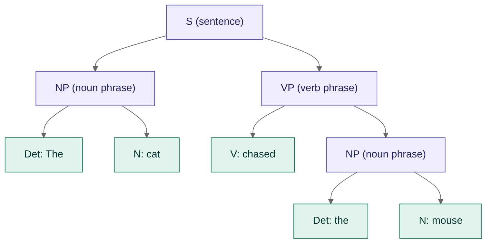

# 2.7 Natural Language Processing (NLP) in Symbolic AI

**Status:** 📝  
**Team Member:** Cassinis Soulisack (`@DiegoSmiley`)

**In this section:** Where We Are · What Is NLP? · Syntax · Semantics · Knowledge Representation in NLP · Rule-Based NLP · Logic and Inference · Sentiment Analysis · Question Answering · Information Retrieval · Common Misunderstandings · Key Takeaways · Practice Questions

---

## 1. Where We Are in the Module

So far in Part 2, the knowledge inside our systems was written in a neat, formal way, such as `Student(Alex)` or `IF GPA >= 3.5 THEN ...`. People do not talk like that. They write sentences such as *"The cat chased the mouse."*

This section asks: **how can a symbolic system understand human language?** It uses ideas from earlier sections:

* Logic, semantic networks and ontologies from [2.2 Knowledge Representation](05_Knowledge_Representation.md)
* IF-THEN rules and inference from [2.3 How Symbolic AI Reasons](06_How_Symbolic_AI_Reasons.md)

---

## 2. What Is NLP?

**Natural Language Processing (NLP)** is a part of AI that focuses on how computers and human language interact. It develops methods that let computers **understand**, **interpret** and **generate** human language in a meaningful way.

In **Symbolic NLP**, the computer processes language using **formal rules**, **logic** and **symbolic representations** written by people. This is the same approach as the rest of Part 2, applied to sentences.

> **Think of it like a translator with a grammar book and a dictionary.** The translator does not "feel" the meaning. They look up each word, apply the grammar rules, and write the meaning down in another language. Symbolic NLP does the same, with logic as the other language.

To understand a sentence, Symbolic NLP looks at two things:

| | Question it answers | Example: "The cat chased the mouse." |
|---|---|---|
| **Syntax** | How is the sentence built? | "The cat" is the subject, "chased" is the verb, "the mouse" is the object. |
| **Semantics** | What does the sentence mean? | `Chased(Cat, Mouse)`: the cat did the chasing and the mouse was chased. |

---

## 3. Syntax: Formal Grammars

**Syntax** is the structure of a sentence: which words group together and in what order. Symbolic NLP describes syntax with **formal grammars**, such as **context-free grammars** and **phrase structure grammars**. A grammar is a set of rules that:

* says which sentences are **valid**, and
* shows the **hierarchical structure** of a sentence: words group into phrases, and phrases group into a sentence.

Here is a small phrase structure grammar, written as context-free rules:

```text
S   → NP VP        A sentence is a noun phrase followed by a verb phrase
NP  → Det N        A noun phrase is a determiner followed by a noun
VP  → V NP         A verb phrase is a verb followed by a noun phrase

Det → the
N   → cat | mouse
V   → chased
```

`S`, `NP` and `VP` are **phrase categories**. The words at the bottom are the **vocabulary**. A program called a **parser** uses these rules to build a **parse tree**:



*Figure 2.6: The parse tree for "The cat chased the mouse." Purple boxes are phrase categories from the grammar rules; green boxes are the words and their word types.*

The tree shows the hierarchy: *the* and *cat* form a noun phrase; *chased* and *the mouse* form a verb phrase; the two phrases together form the sentence.

The grammar also tells us which sentences are **not** valid. "Cat the mouse chased the" has no parse tree with these rules, so it is rejected.

---

## 4. Semantics: Representing Meaning

**Semantics** is the meaning of words and sentences. Symbolic NLP represents meaning with the same tools as [2.2 Knowledge Representation](05_Knowledge_Representation.md): **formal logic**, **semantic networks** or **ontologies**.

Here is "The cat chased the mouse." in each form:

| Representation | Meaning of "The cat chased the mouse." |
|---|---|
| **Formal logic** | `Chased(Cat, Mouse)` |
| **Semantic network** | Node `Cat` → link `chased` → node `Mouse` |
| **Ontology** | `Cat` is a kind of `Animal`; `Mouse` is a kind of `Animal`; `chased` is a relation between two animals |

Notice how the parse tree helps. The noun phrase **before** the verb becomes the **first** argument (the one doing the chasing), and the noun phrase **after** the verb becomes the **second** argument (the one being chased). If the sentence were "The mouse chased the cat", the parse tree would swap the two noun phrases, and the meaning would become `Chased(Mouse, Cat)`.

Once the meaning is written in logic, the system can **store it** as a fact or **reason with it**, exactly as in 2.3.

---

## 5. Knowledge Representation in NLP

To work with language, a system also needs knowledge **about** words, facts, rules and relationships. Symbolic NLP mainly uses three representations, all introduced in 2.2:

| Representation | What it stores | Example |
|---|---|---|
| **Ontologies** | Concepts in a domain and how they relate, as a shared vocabulary | `Cat` is a kind of `Mammal`, which is a kind of `Animal` |
| **Semantic networks** | Concepts as nodes and relationships as labelled links | `Cat` —`eats`→ `Fish`; `Cat` —`has`→ `Tail` |
| **Logic-based representations** | Facts and rules in propositional or first-order logic | `∀x (Cat(x) → Animal(x))` |

With this knowledge, a system that reads "The cat chased the mouse" can also conclude that **an animal chased an animal**, because the ontology says cats and mice are animals.

---

## 6. Rule-Based NLP

**Rule-based NLP systems** use explicitly defined rules and patterns to analyse and process language. Typical tasks include:

* **Part-of-speech tagging:** labelling each word as a noun, verb, adjective and so on.
* **Syntactic parsing:** working out the sentence structure (Section 3).
* **Information extraction:** pulling specific facts out of text.

### 6.1 Worked Example: Part-of-Speech Tagging and Parsing

Take the sentence: **"The quick brown fox jumps over the lazy dog."**

A rule-based tagger looks up each word in a word list and applies rules such as "IF a word comes between a determiner and a noun, THEN it is probably an adjective".

| Word | Part of speech |
|---|---|
| The | Determiner |
| quick | Adjective |
| brown | Adjective |
| fox | Noun |
| jumps | Verb |
| over | Preposition |
| the | Determiner |
| lazy | Adjective |
| dog | Noun |

Parsing rules then group the tagged words into the sentence structure:

* **Subject:** *the quick brown fox* (the noun phrase before the verb)
* **Verb:** *jumps*
* **Prepositional phrase:** *over the lazy dog* (says where the fox jumps; *the lazy dog* is the object of *over*)

### 6.2 Information Extraction

An information extraction rule finds a pattern in the text and turns it into a fact:

```text
IF the text matches "<Animal> chased <Animal>"
THEN add the fact Chased(<Animal>, <Animal>)
```

Running this rule over "The cat chased the mouse" adds `Chased(Cat, Mouse)` to the knowledge base.

---

## 7. Logic and Inference in NLP

**Logic and inference** let a Symbolic NLP system **reason** about language and derive new knowledge from what it already has. Logical representations such as **first-order (predicate) logic** and **knowledge graphs** give a formal way to store and use linguistic knowledge.

### Worked Example: Family Relationships

Suppose a system has read these sentences and stored their meaning as facts:

| Sentence | Fact |
|---|---|
| "Tom is the parent of Ann." | `Parent(Tom, Ann)` |
| "Tom is the parent of Ben." | `Parent(Tom, Ben)` |
| "Ann is married to Leo." | `Spouse(Ann, Leo)` |

It also has a rule that defines **sibling**:

```text
IF Parent(z, x) AND Parent(z, y) AND x ≠ y
THEN Sibling(x, y)
```

A user asks: **"Who is Ann's sibling?"**

1. The question becomes the query `Sibling(Ann, ?who)`. The `?who` is a variable: the thing we want to find.
2. The rule needs `Parent(z, Ann)`. This matches `Parent(Tom, Ann)` by **unification** (from [2.3](06_How_Symbolic_AI_Reasons.md)), so `z = Tom`.
3. The rule then needs `Parent(Tom, ?who)` with `?who ≠ Ann`. This matches `Parent(Tom, Ben)`, so `?who = Ben`.
4. The system answers: **"Ben."**

The system never read the sentence "Ann and Ben are siblings". It **inferred** it from the facts and the rule. It can also explain the answer by listing the two facts and the rule it used.

---

## 8. Sentiment Analysis

**Sentiment analysis** finds the emotional tone (positive or negative) of text such as social media posts, product reviews or customer feedback.

A **rule-based** approach uses predefined patterns to spot words and clues that carry sentiment:

| Positive words | Negative words |
|---|---|
| good, excellent, happy | bad, poor, disappointed |

**Rules:**

1. Each positive word scores **+1**; each negative word scores **−1**.
2. Contextual clue: IF *not* comes just before a sentiment word, THEN flip that word's score.
3. IF the total is above 0, THEN the text is **positive**; IF below 0, **negative**; IF exactly 0, **neutral**.

**Worked example:** *"The food was excellent and the staff were happy to help, but the delivery was not good."*

1. *excellent* → +1
2. *happy* → +1
3. *not good* → +1 flipped to **−1**
4. Total = +1 + 1 − 1 = **+1**, so the review is **positive**.

The system can show exactly which words produced the result.

---

## 9. Question Answering

**Question answering systems** use formal knowledge, such as logic, semantic networks or knowledge graphs, to understand a question asked in natural language and **infer** the answer.

### Worked Example: A Medical Question Answering System

The system stores medical knowledge as an ontology, with diseases, symptoms and treatments as entities and relationships:

```text
HasSymptom(Flu, Fever)
HasSymptom(Flu, Cough)
HasSymptom(Flu, Tiredness)
TreatedBy(Flu, Rest)
TreatedBy(Flu, Fluids)
```

A user asks: **"What are the symptoms of flu?"**

1. The question is parsed and turned into the query `HasSymptom(Flu, ?s)`.
2. The system follows the `HasSymptom` links from `Flu` in its knowledge graph.
3. It finds three matches and answers: **"Fever, cough and tiredness."**

The same knowledge answers other questions. "How is flu treated?" becomes `TreatedBy(Flu, ?t)`, which gives **"Rest and fluids."**

---

## 10. Information Retrieval

**Information retrieval** finds the relevant documents in a large collection of text. Symbolic NLP helps by representing what the documents are about in a formal, logical way, then using **logical inference** to match a query with the right documents.

### Worked Example: A Legal Information Retrieval System

Legal concepts, laws and past cases are encoded in a structured form:

```text
About(Case_12, TenantRights)
About(Case_31, EmploymentContract)
About(Statute_7, TenantRights)
IsKindOf(Eviction, TenantRights)
```

A lawyer searches for **documents about eviction**.

1. The query is turned into `About(?doc, Eviction)`.
2. No document is stored as being directly about *Eviction*. However, the rule "IF a document is about a topic, THEN it is relevant to every more specific kind of that topic" combined with `IsKindOf(Eviction, TenantRights)` lets the system infer that documents about *TenantRights* are relevant.
3. The system returns **Case_12** and **Statute_7**, but not Case_31.

A plain keyword search for the word "eviction" might have missed both documents. Logical inference found them through the meaning of the concepts.

---

## 11. Common Misunderstandings

| Misunderstanding | What Is Actually True |
|---|---|
| "Grammar rules are enough to understand a sentence." | Grammar gives the **syntax** (structure). The system still needs **semantics** to know what the sentence means. |
| "Syntax and semantics are the same thing." | "The cat chased the mouse" and "The mouse chased the cat" have the same structure but different meanings. |
| "The computer understands language like a person." | A symbolic system only applies its rules and stored knowledge. Its answers are only as good as those rules and that knowledge. |
| "Sentiment analysis reads the writer's feelings." | A rule-based system only adds up the scores of the words it recognises. Words not in its lists are ignored. |
| "Information retrieval is just keyword search." | Symbolic information retrieval uses meaning and logical inference, so it can find relevant documents that do not contain the exact search word. |

---

## 12. Key Takeaways

* **NLP** focuses on how computers understand, interpret and generate human language. **Symbolic NLP** does this with formal rules, logic and symbolic representations.
* **Syntax** is sentence structure. **Formal grammars**, such as context-free and phrase structure grammars, define valid sentences, and a parser builds a parse tree.
* **Semantics** is meaning. It can be represented with **formal logic**, **semantic networks** or **ontologies**.
* **Rule-based NLP** uses predefined rules for **part-of-speech tagging**, **syntactic parsing** and **information extraction**.
* **Logic and inference** let a system derive new knowledge, such as working out that two people are siblings.
* Applications include **sentiment analysis**, **question answering** and **information retrieval**.

---

## 13. Practice Questions and Answers

Try answering each question yourself before reading the answers.

### Questions

**1.** What is NLP, and what makes NLP "symbolic"?

**2.** What is the difference between syntax and semantics? Use "The cat chased the mouse" in your answer.

**3.** Using the grammar in Section 3, can the parser build a tree for "The mouse chased the cat"? What would its meaning be in logic?

**4.** Tag each word in "The happy dog chased the cat" with its part of speech.

**5.** Name the three knowledge representations that Symbolic NLP mainly uses, and give one example of each.

**6.** Use the family facts in Section 7. Add the fact `Parent(Tom, Cara)`. What does the system answer to "Who are Ann's siblings?"

**7.** Use the sentiment rules in Section 8 to score: *"The product is good but the battery is poor and I am disappointed."* Is the result positive, negative or neutral?

**8.** In the medical system in Section 9, what query would the system build for "How is flu treated?", and what is the answer?

### Answers

**1.** NLP is the part of AI that focuses on how computers and human language interact, letting computers understand, interpret and generate language. It is **symbolic** when the processing uses formal rules, logic and symbolic representations written by people.

**2.** **Syntax** is the structure: "The cat" is the subject, "chased" is the verb and "the mouse" is the object. **Semantics** is the meaning: `Chased(Cat, Mouse)`, the cat did the chasing.

**3.** **Yes.** `S → NP VP`, the first NP is `Det N` = *The mouse*, and the VP is `V NP` = *chased* + *the cat*. All the words are in the vocabulary. Its meaning is `Chased(Mouse, Cat)`: the same structure, but a different meaning.

**4.** The = determiner · happy = adjective · dog = noun · chased = verb · the = determiner · cat = noun.

**5.** **Ontologies**, for example `Cat` is a kind of `Animal`. **Semantic networks**, for example `Cat` —`eats`→ `Fish`. **Logic-based representations**, for example `∀x (Cat(x) → Animal(x))`.

**6.** Both `Parent(Tom, Ben)` and `Parent(Tom, Cara)` match the rule, so the system answers **"Ben and Cara."**

**7.** *good* → +1; *poor* → −1; *disappointed* → −1. Total = +1 − 1 − 1 = **−1**, so the result is **negative**.

**8.** The query is `TreatedBy(Flu, ?t)`. It matches `TreatedBy(Flu, Rest)` and `TreatedBy(Flu, Fluids)`, so the answer is **"Rest and fluids."**

---

## 14. References

1. Jurafsky, D., & Martin, J. H. *Speech and Language Processing* (3rd ed. draft). [Online textbook](https://web.stanford.edu/~jurafsky/slp3/)
2. Russell, S. J., & Norvig, P. (2021). *Artificial Intelligence: A Modern Approach* (4th ed.). Pearson.
3. BIT2026 Course Lecture Slides, Chapter 4: Symbolic AI (Natural Language Processing in Symbolic AI).
